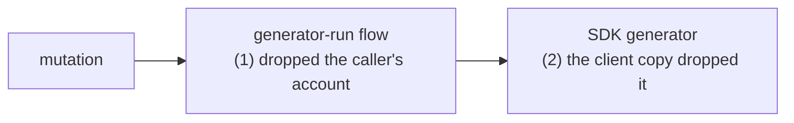

# Pull Request Descriptions

> Part of: `dev/guidelines/` | Related: [Git Workflow](git-workflow.md),
> [Writing Documentation](documentation.md)

How to write the title and description of a pull request, by hand or with an agent. The sections
follow `.github/pull_request_template.md`.

The reviewer already has the diff and the CI results. Write what neither of them shows: why the
change is needed, the decisions behind it, where to look, and the evidence that it works.

## Title

Use `<type>: <short description> [<issue reference>]`, where the description says what changes for
the reader of the release history.

```text
✅ fix(git): log "New commit detected" only for a branch the sync imports [IFC-2448]
❌ fix: update base.py and repository.py
```

## Sections

Delete every section that has nothing to say. Do not write "N/A": an empty heading costs the
reviewer a read and tells them nothing. A dependency bump, a lint fix or a typo fix needs one line
under **Why**.

### Why

State the problem as users, operators or developers meet it today, then what the PR achieves. Add
what the PR deliberately does not do when a reviewer would otherwise ask, and link the issue.

### Approach and decisions

Describe what the diff does not show: the approach, the alternatives rejected and why, the behavior
that changes, and what deliberately stays the same. Never list files, functions or commits; the
diff lists them better.

```markdown
✅ The caches now hold each GraphQL schema with a weak reference, so a schema is freed once the
   registry drops it. Validation errors are not cached: their traceback references the schema.
❌ - Updated `execution.py`
   - Added tests in `test_execution.py`
```

### Review guide

Say where to start, which parts need the most scrutiny, and which parts are mechanical or generated.
Name modules and symbols, not line numbers: line numbers are wrong after the next push.

### Evidence

Give the proof that CI does not show:

- A test that fails on the base branch and passes on this branch, with the failure it reports
- Checks on a running stack, and what was observed
- Measurements, as a before and after comparison
- Screenshots or a recording of a UI change

Do not list the commands CI already runs or their pass counts. End with a **Not verified** line that
names what you did not check, so the reviewer knows where the evidence stops.

```markdown
✅ `test_schema_is_released_after_executing_queries` fails on `stable`: the schema is still
   referenced after the registry drops it. It passes on this branch.
   Not verified: the memory use of a task worker under a production schema.
❌ uv run pytest backend/tests/unit/graphql/  # 412 passed
```

### Impact

Keep only the lines that apply: a user-visible change, with its changelog fragment, an upgrade or
migration step, a configuration change, an API change, or a performance change.

### Open questions

The human author writes this section: the decisions they want the reviewer to challenge, and the
questions they could not settle themselves. An agent leaves the section's comment in place for the author to fill in or delete, and
never writes it.

### Checklist

Tick a box only when the item is done or does not apply. The checklist holds what the reviewer
cannot check from the diff or from CI.

## Diagrams

Add a mermaid diagram when the change alters a flow between components, the data passed between
them, or a state transition. A diagram of the path the data takes explains such a change faster
than the prose that describes it.

- Show a before and an after when the change moves a step or adds a branch
- Keep a diagram to about ten nodes, and split a larger flow into one diagram per stage
- Label nodes and edges with what happens, in plain words, not only with function names

````markdown

````

## Length

Write **Why** and **Approach and decisions** so a reviewer reads them in about a minute. Put test
tables, logs and long measurements in a `<details>` block:

```markdown
<details>
<summary>Memory per schema update, 30 updates</summary>

| Code | First update | Last update |
|---|---|---|
| ... | ... | ... |

</details>
```

## Writing the Description with an Agent

- **Write it last**: generate the description after the last code change, from the diff, not from
  the plan the agent started with
- **Check every claim**: apply the AGENTS.md rule on checking a PR description against the diff, and
  remove any claim the diff does not support
- **Fill the template, not a fixed shape**: use the sections in `.github/pull_request_template.md`
  and delete the ones with nothing to say
- **Leave "Open questions" to the author**
- **Update it after review**: when a push changes behavior, the approach or the evidence, update
  the description in the same session. State when a later commit corrects an earlier one, so a
  reviewer who read the first version knows what changed
