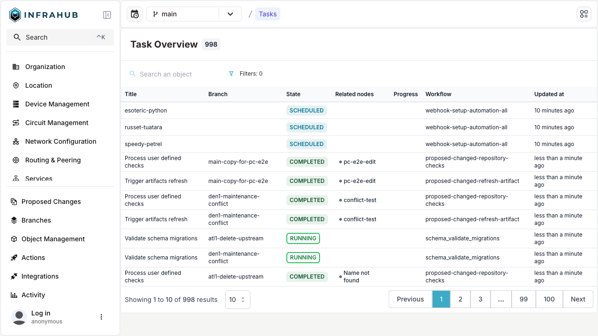

# Tasks

The **Tasks system** in Infrahub is designed to manage and control various backend operations with robust error reporting, improved supervision, and enhanced logging capabilities.

In Infrahub 1.0, we integrated Prefect as the task manager to orchestrate workflows. The task system is comprised of:

* A **Task manager** (based on Prefect) that orchestrates tasks.
* One or more **Task workers** (written in Python) that execute operations

In Infrahub 1.1, key backend tasks began to be migrated to this framework, and subsequent releases have further refined its functionality.

See the [Architecture](../../overview/architecture.mdx) subject for further information about the Task manager and Task worker as well as the overall system design.

Key operations managed by the task system include:

* Jinja template rendering.
* Performing checks and Transform functions.
* Carrying out pull, merge, and diff Git operations.

More logging and oversight are made possible by these enhancements, which increase background task dependability and transparency.
The tasks indicator at the top right of the Infrahub window is a noticeable feature for users. It provides a quick access to examine both in-progress and finished tasks and changes color while a job is active.



## Task history retention

The task manager stores every task run, with its logs and artifacts, in its own PostgreSQL database. This task history is what the Tasks view lists. Every hour, the task manager deletes the finished runs (completed, failed, cancelled, or crashed) whose end time is older than the task history retention, 30 days by default, together with their logs and artifacts. The deletion cannot be undone. Runs that are still running or pending are not deleted; see [Runs that stay running or pending](#runs-that-stay-running-or-pending).

### Set the retention

The `task_manager.retention` section of the configuration holds three retention settings. Each one has its own environment variable:

| Setting | Environment variable | Default | Records kept |
|---|---|---|---|
| `task_history` | `INFRAHUB_TASK_MANAGER_RETENTION_TASK_HISTORY` | `30d` | Finished task runs, with their logs and artifacts |
| `activity_log` | `INFRAHUB_TASK_MANAGER_RETENTION_ACTIVITY_LOG` | `7d` | The events of the [activity log](./activity-log.mdx#retention) |
| `prefect_own_events` | `INFRAHUB_TASK_MANAGER_RETENTION_PREFECT_OWN_EVENTS` | `7d` | The events that the task manager records for its own use, which the activity log does not show |

```toml
[task_manager.retention]
task_history = "90d"
activity_log = "7d"
prefect_own_events = "7d"
```

Set the values on the task manager, and on the container of its background services if they run in a container of their own. The Docker Compose file passes the three environment variables to the task manager, so you can set them in your `.env` file; [How to configure Infrahub](../install-configure/configure-infrahub.mdx) describes the ways to set environment variables. The values apply when the task manager starts.

Each value is a number of days, such as `30d`, or an ISO 8601 duration, such as `P30D`, from 1 to 36,500 days. A value outside that range, or in another form, stops the task manager at startup. It also stops every other Infrahub process that receives the value and loads the whole configuration, such as the API server and the task workers, which receive the same three environment variables in the Docker Compose file. The error names the setting:

```text
task_history | Value error, Invalid task manager retention: task_history must be at least 1 day (value_error)
```

`prefect_own_events` must not be longer than `activity_log`, because the task manager deletes every event older than the activity log retention. A longer value stops the same processes with the error `Invalid task manager retention: prefect_own_events must not be longer than activity_log, so set prefect_own_events to at most the activity_log value`. When you set `activity_log` below 7 days, also set `prefect_own_events` to that value or less, because its default is 7 days.

At startup, the task manager logs the value that Prefect applies for each of the Prefect settings below, whatever sets it, in lines that start with `Task manager retention:`. With the default values, the line for `PREFECT_SERVER_SERVICES_DB_VACUUM_EVENT_RETENTION_OVERRIDES` shows `{}`, because `prefect_own_events` equals `activity_log`, so no event type needs a retention of its own.

The task manager applies these settings through the settings of Prefect, the workflow engine it runs. If one of the following Prefect settings is already set, its value takes precedence, and the task manager logs a warning, such as `PREFECT_EVENTS_RETENTION_PERIOD is set and overrides task_manager.retention.activity_log` for an environment variable, or `PREFECT_SERVER_EVENTS_RETENTION_PERIOD is set in a Prefect settings file or profile and overrides task_manager.retention.activity_log` for a settings file. A setting counts as set when one of these sets it:

* An environment variable of the task manager, under any name Prefect accepts for it.
* Prefect's own settings files: a `.env` file, `prefect.toml`, the `[tool.prefect]` table of `pyproject.toml`, or the active section of `profiles.toml`.

| Prefect variable | Setting it overrides |
|---|---|
| `PREFECT_SERVER_SERVICES_DB_VACUUM_RETENTION_PERIOD` | `task_history` |
| `PREFECT_SERVER_EVENTS_RETENTION_PERIOD`, or its older name `PREFECT_EVENTS_RETENTION_PERIOD` | `activity_log` |
| `PREFECT_SERVER_SERVICES_DB_VACUUM_EVENT_RETENTION_OVERRIDES` | `prefect_own_events` |

To let the `task_manager.retention` settings apply, remove these settings from the environment variables and the Prefect settings files of the task manager, and of the container of its background services if they run in a container of their own.

`PREFECT_SERVER_SERVICES_DB_VACUUM_ENABLED` does not override a retention. It turns each of the hourly cleanups on or off, and the task manager sets it to `events,flow_runs` when none of the sources above sets it. When it is already set, the task manager keeps its value:

* Without `flow_runs`, for example `events` or `false`, old task runs are not deleted, so `task_history` does not apply, and the task manager refuses `infrahub tasks flush flow-runs`.
* Without `events`, for example `flow_runs`, old events are not deleted, so neither `activity_log` nor `prefect_own_events` applies.
* `true` turns on both cleanups.

At startup, the task manager logs a warning for each cleanup that the value turns off:

```text
PREFECT_SERVER_SERVICES_DB_VACUUM_ENABLED does not turn on flow_runs, so old task runs are not deleted and task_manager.retention.task_history is not applied
PREFECT_SERVER_SERVICES_DB_VACUUM_ENABLED does not turn on events, so old events are not deleted and task_manager.retention.activity_log and task_manager.retention.prefect_own_events are not applied
```

An empty value does not count as set: the task manager removes it, because Prefect would read it as `false`, which turns off the deletion of task runs.

### Delete old task runs and get disk space back

`infrahub tasks flush flow-runs` deletes the same runs as the hourly cleanup, with their logs and artifacts, using the task history retention in effect on the task manager. The deletion runs inside the task manager, one day of end times at a time, and the command prints the progress and then a summary. If the command is interrupted, the deletion continues in the task manager. Running the command again follows the deletion that is still running, or continues from the oldest remaining run. If the task manager restarts while the command follows the deletion, the command waits until the task manager answers again and starts the deletion again. Its summary then reads `Deleted at least N runs`, because the deletion that the restart stopped may have deleted more runs than the command saw.

Deleting runs does not shrink the database files: PostgreSQL reuses the space of deleted rows for new runs, so the disk usage stays level but does not go down. With `--rewrite`, the command then rewrites each task history and activity log table whose live rows hold less than half of its disk space, which returns that space to the disk, and leaves a table whose rows mostly hold live data as it is. You do not need to stop anything: a task that reads or writes a table waits until the rewrite of that table ends, which on very large instances can take a few seconds, and at most a minute. The rewrite needs free disk space for a copy of the rows that a table keeps. On Docker Compose:

```bash
docker compose exec infrahub-server infrahub tasks flush flow-runs --rewrite
```

The summary reports the number of runs deleted, the size of the task history and activity log tables before and after, and what the rewrite did with each table: the tables it rewrote, the tables it left as they are, the tables it could not lock, the tables whose rewrite took too long, and the tables whose rewrite failed with a database error. If another session holds a lock on a table for more than 3 seconds, the command tries that table again 20 seconds later, up to 5 times, then skips it and names it in the summary. A rewrite that takes longer than 60 seconds is stopped, which leaves that table as it was. A table whose rewrite fails with a database error, for example because there is not enough free disk space for the copy, also stays as it was, and the command goes on with the next table. Run the command again later to rewrite a table it skipped.

Use `--rewrite` once after you upgrade an existing instance that holds a lot of task history, as described in [Clean up old task history after the upgrade](../maintain-upgrade/upgrade/overview.mdx#clean-up-old-task-history-after-the-upgrade), and after you lower the task history or the activity log retention. The next hourly cleanup deletes the records older than the new value, and the command still rewrites the tables that are mostly free space, even though it has little left to delete.

The command exits with:

* `0` when the deletion completed, and also when the task manager runs a release without the cleanup, in which case it prints `The task manager does not provide the task history cleanup yet; skipped.` and deletes nothing.
* `1` in these cases:
  * The deletion failed.
  * The task manager could not be reached to start the deletion, or a proxy in front of it answered with `502`, `503` or `504`.
  * The task manager does not delete old task runs, because `PREFECT_SERVER_SERVICES_DB_VACUUM_ENABLED` is set to a value without `flow_runs`. The command prints `Old task runs are not deleted, because PREFECT_SERVER_SERVICES_DB_VACUUM_ENABLED does not turn on flow_runs` and deletes nothing.
  * The task manager answered with an unexpected error, or with an answer that the command cannot read.
  * The command gave up after 3 hours in which the task manager only answered that another task manager replica runs a deletion, or could not be reached. The command treats a `502`, `503` or `504` answer from a proxy in front of the task manager the same way.

The command no longer accepts `--days-to-keep` and `--batch-size`. Set the `task_history` retention instead.

### Runs that stay running or pending

A run can stay running or pending after the task worker that ran it stopped, for example after a crash. The hourly cleanup does not delete these runs, because they never finished. `infrahub tasks flush stale-runs` marks the runs that have been running or pending for more than 2 days as crashed:

```bash
docker compose exec infrahub-server infrahub tasks flush stale-runs
```

A crashed run has an end time, so the hourly cleanup deletes it once it is older than the task history retention. Change the number of days with `--days-to-keep`. The command counts the days from the time a run started, or, for a pending run that never started, from the time it was expected to start. It also marks a run that is still working after that many days, so check that no task is meant to run that long before you run it.

### Background services in their own container

The task manager runs the hourly cleanups in its background services. When these services run in a container of their own instead of inside the task manager, start that container with `infrahub tasks background-services` rather than `prefect server services start`. `prefect server services start` does not read the `task_manager.retention` settings, so it does not delete task runs and keeps events for Prefect's default retention.

When `PREFECT__SERVER_WEBSERVER_ONLY` is set, the task manager runs without its background services, and at startup it logs a line that starts with `Task manager retention: PREFECT__SERVER_WEBSERVER_ONLY is set` and names `infrahub tasks background-services`.

`infrahub tasks background-services` reads the `task_manager` section of the configuration file passed as its argument, else of the file that `INFRAHUB_CONFIG` names, else of `infrahub.toml`, together with the environment variables. A file passed as the argument must exist: otherwise the command prints `Configuration file not found: <path>` and exits with code `1`. Without the argument, a missing file leaves the settings to the environment variables.
