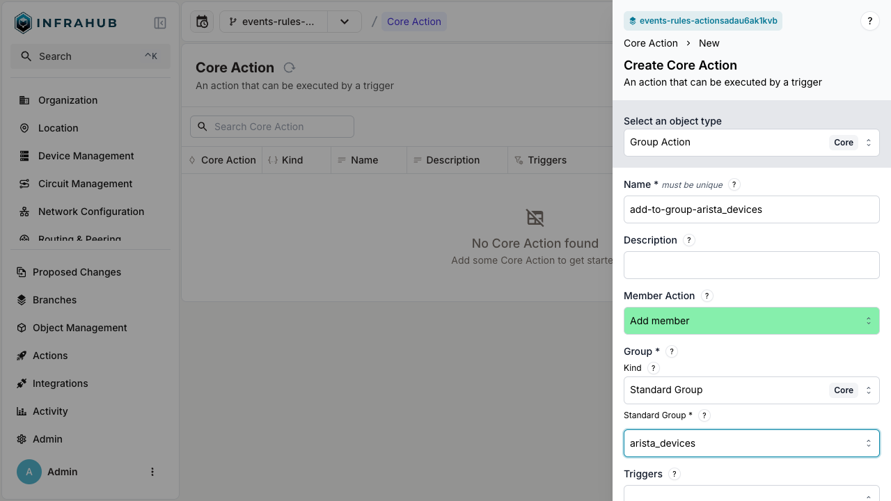
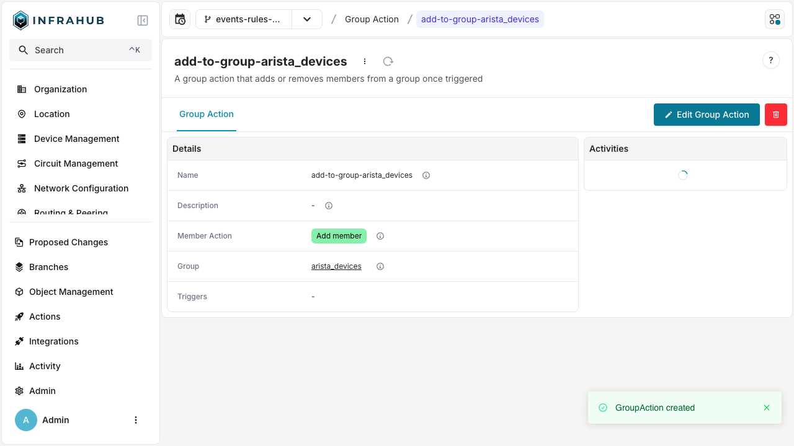
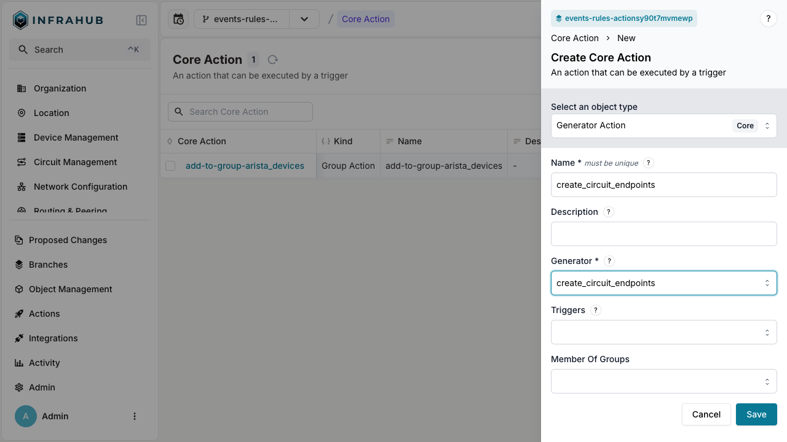

import Tabs from '@theme/Tabs';
import TabItem from '@theme/TabItem';

# Event actions

An event action is the work a rule starts when it matches an event: a group action adds the object of the event to a group or removes it, and a Generator action runs a Generator definition for it. An action does nothing on its own. It runs each time a [rule](./event-rules.mdx) that references it matches, on the branch where the event was emitted.

| Action | What it does | Rules that can run it |
|---|---|---|
| Group action (`CoreGroupAction`) | Adds the object of the event to a group, or removes it | Node trigger rules |
| Generator action (`CoreGeneratorAction`) | Runs a Generator definition for the object of the event, or for the members added to or removed from a group | Node trigger rules and group trigger rules |

Infrahub emits events for the data an action changes, and another rule can match them. To run a Generator on a branch as soon as its input exists, match these events with a second rule: see [Running a Generator from events](../generators/overview.mdx#running-a-generator-from-events).

## Configure a group action

Use a group action to add objects to a group, or remove them from it, when they meet a condition you express as a rule: for example, to add every new device whose platform is Arista EOS to `arista_devices`. Infrahub adds or removes the object of the event, on the branch of the event, and emits `infrahub.group.member_added` or `infrahub.group.member_removed`.

<Tabs groupId="method" queryString>
  <TabItem value="web" label="Web interface" default>

1. Go to **Actions** > **Events** > **Actions** and click **Add Core Action**.
2. In **Select an object type**, choose **Group Action**.
3. Fill in the action:
   - **Name**: For example `add-to-group-arista_devices`.
   - **Member Action**: **Add member** or **Remove member**. The default is **Add member**.
   - **Group**: The kind of group, then the group, for example `arista_devices`.

   

4. Click **Save**. The action's page shows its settings, and the rules that run it under **Triggers**.

   

  </TabItem>
  <TabItem value="object-file" label="Object file">

```yaml
---
apiVersion: infrahub.app/v1
kind: Object
spec:
  kind: CoreGroupAction
  data:
    - name: add-to-group-arista_devices
      member_action: add_member
      group: arista_devices
```

Load it with `infrahubctl object load <file>`, or list it under `objects` in the `.infrahub.yml` of a [linked repository](../git-integration/overview.mdx). `member_action` is `add_member` or `remove_member`.

  </TabItem>
</Tabs>

A node trigger rule can run a group action. Do not use a group action with a group trigger rule: see [Known limitations](./event-rules.mdx#known-limitations).

## Configure a Generator action

A Generator action runs a Generator definition on the branch of the event:

- From a node trigger rule, for the object of the event.
- From a group trigger rule, for the members that were added to the group or removed from it.

Infrahub runs the Generator only for objects that are members of the Generator definition's target group. If none of them is a member, the run fails with `Target <id> is not part of the group <id>`. To run a Generator for new objects, chain two rules: a node trigger rule with a group action adds the object to the target group, and a group trigger rule on that group runs the Generator action.


<Tabs groupId="method" queryString>
  <TabItem value="web" label="Web interface" default>

1. Go to **Actions** > **Events** > **Actions** and click **Add Core Action**.
2. In **Select an object type**, choose **Generator Action**.
3. Fill in the action:
   - **Name**: For example `create_circuit_endpoints`.
   - **Generator**: The Generator definition, for example `create_circuit_endpoints`.

   

4. Click **Save**.

  </TabItem>
  <TabItem value="object-file" label="Object file">

```yaml
---
apiVersion: infrahub.app/v1
kind: Object
spec:
  kind: CoreGeneratorAction
  data:
    - name: create_circuit_endpoints
      generator: create_circuit_endpoints
```

  </TabItem>
</Tabs>

The Generator definition has to exist on the default branch. Infrahub reads rules and the actions they reference from the default branch only, and skips a rule whose action references a Generator definition it cannot find there.

## Next

- [Event rules](./event-rules.mdx) — Create the rule that runs the action, and choose the branches whose events it matches
- [Event system](./event-system.mdx) — See which events Infrahub emits for an action's changes
