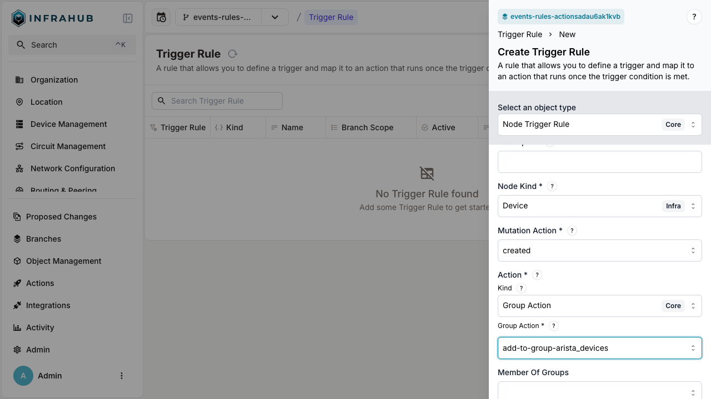
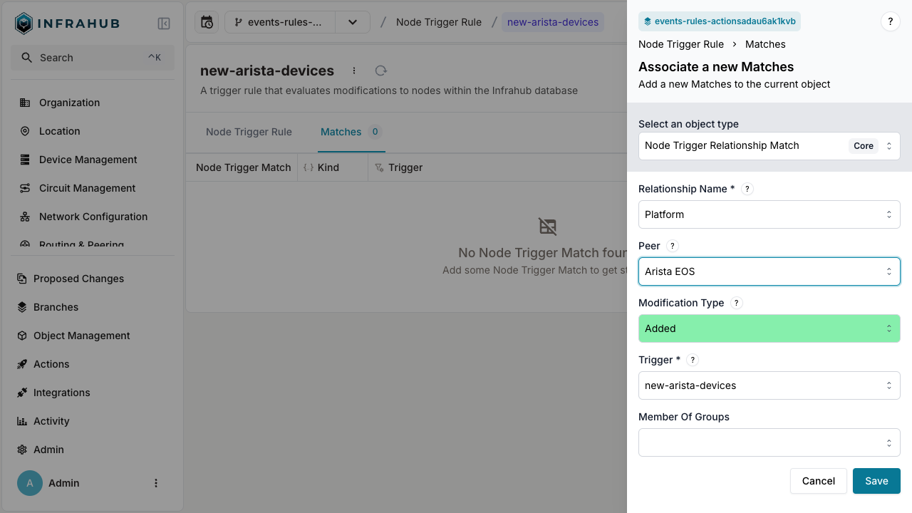
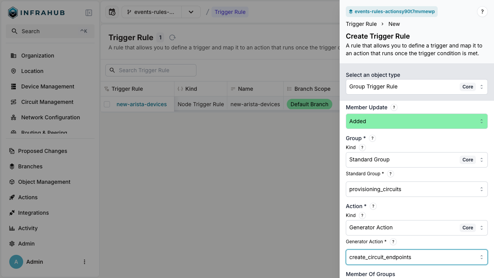
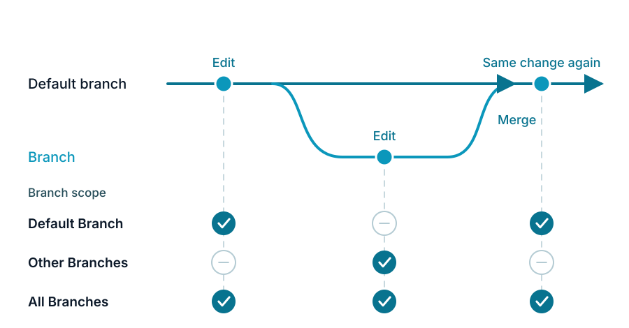

import Tabs from '@theme/Tabs';
import TabItem from '@theme/TabItem';

# Event rules

An event rule matches events and runs one action each time an event matches. Create a rule when one kind of change should always be followed by the same work: for example, when every new Arista device has to be in the `arista_devices` group, or when a Generator has to run each time a circuit is added to a group.

A rule runs exactly one [action](./event-actions.mdx). To run two actions for the same events, create two rules. Several rules can run the same action.

## Choose a rule type

| | Node trigger rule (`CoreNodeTriggerRule`) | Group trigger rule (`CoreGroupTriggerRule`) |
|---|---|---|
| Matches | The creation or the update of an object of one kind | Members added to one group, or members removed from it |
| Narrow it with | Attribute and relationship matches | Nothing more: the group and **Member Update** are the whole condition |
| Actions it can run | A group action or a Generator action | A Generator action |

A node trigger rule cannot match a delete: its mutation action is `created` or `updated`.

## What a node trigger rule matches

Without matches, a node trigger rule matches every `created` or `updated` event of its node kind. Each match you add narrows it, and an event has to satisfy every match.

An **attribute match** compares the value of one attribute in the event:

- **Value** matches when the new value equals **Value**. Use it to match a device whose status changes to `active`.
- **Value Previous** matches when the previous value equals **Value Previous**. Use it to match a device whose status changes from `active`.
- **Full value match** matches when the new value equals **Value** and the previous value equals **Value Previous**. Use it to match one transition, for example from `provisioning` to `active`.

An empty **Value** does not mean any value: Infrahub compares it with the attribute's value like any other value.

A **relationship match** checks a change to one relationship:

- **Modification Type** is **Added** (a peer was added), **Removed** (a peer was removed), or **Updated** (a peer was added or removed).
- **Peer** is optional. Set it to the ID of one object to match only changes involving that object, for example the Arista EOS platform. Without it, any peer matches.

## Configure a node trigger rule

Create the [action](./event-actions.mdx) first, because you have to choose it before you can save the rule.

A new rule is active as soon as you save it, unless you set **Active** to **False**.

<Tabs groupId="method" queryString>
  <TabItem value="web" label="Web interface" default>

1. Go to **Actions** > **Events** > **Rules** and click **Add Trigger Rule**.
2. In **Select an object type**, choose **Node Trigger Rule**.
3. Fill in the rule:
   - **Name**: For example `new-arista-devices`.
   - **Active**: **False** for now.
   - **Branch Scope**: The branches whose events the rule matches. See [Where trigger rules are stored and evaluated](#where-trigger-rules-are-stored-and-evaluated).
   - **Node Kind**: For example `InfraDevice`.
   - **Mutation Action**: `created` or `updated`.
   - **Action**: The kind of action, then the action, for example the group action `add-to-group-arista_devices`.

   

4. Click **Save**.
5. On the rule, open the **Matches** tab and add a match. Choose **Node Trigger Relationship Match** or **Node Trigger Attribute Match**, fill in its fields, and save it. For the example, the relationship name is `platform`, the modification type is **Added**, and the peer is the ID of the Arista EOS platform.

   

6. Edit the rule and set **Active** to **True**.

:::success Best practice

Keep the rule inactive until you have added all its matches, then activate it. An active rule without matches runs its action for every event of its node kind and mutation action.

:::

  </TabItem>
  <TabItem value="object-file" label="Object file">

Loading an object file creates the rule and its matches together, so the rule has its matches when it becomes active. Keep it in a repository to review rule changes like any other change.

```yaml
---
apiVersion: infrahub.app/v1
kind: Object
spec:
  kind: CoreNodeTriggerRule
  data:
    - name: new-arista-devices
      branch_scope: default_branch
      node_kind: InfraDevice
      mutation_action: created
      action: add-to-group-arista_devices
      matches:
        kind: CoreNodeTriggerRelationshipMatch
        data:
          - relationship_name: platform
            modification_type: added
            peer: "<ID of the Arista EOS platform>"
```

Load it with `infrahubctl object load <file>`, or list it under `objects` in the `.infrahub.yml` of a [linked repository](../git-integration/overview.mdx). For an attribute match, use the kind `CoreNodeTriggerAttributeMatch` with `attribute_name`, `value_match` (`value`, `value_previous`, or `value_full`), and `value` or `value_previous`.

  </TabItem>
</Tabs>

## Configure a group trigger rule

A group trigger rule runs a Generator action for the members added to a group, or removed from it. Create the [Generator action](./event-actions.mdx#configure-a-generator-action) first.

<Tabs groupId="method" queryString>
  <TabItem value="web" label="Web interface" default>

1. Go to **Actions** > **Events** > **Rules** and click **Add Trigger Rule**.
2. In **Select an object type**, choose **Group Trigger Rule**.
3. Fill in the rule:
   - **Name**: For example `added-to-provisioning-circuits`.
   - **Branch Scope**: The branches whose events the rule matches.
   - **Member Update**: **Added** or **Removed**.
   - **Group**: The kind of group, then the group, for example `provisioning_circuits`.
   - **Action**: **Generator Action**, then the action, for example `create_circuit_endpoints`.

   

4. Click **Save**. The rule is active.

  </TabItem>
  <TabItem value="object-file" label="Object file">

```yaml
---
apiVersion: infrahub.app/v1
kind: Object
spec:
  kind: CoreGroupTriggerRule
  data:
    - name: added-to-provisioning-circuits
      branch_scope: default_branch
      member_update: added
      group: provisioning_circuits
      action: create_circuit_endpoints
```

  </TabItem>
</Tabs>

:::warning

Do not choose a group action for a group trigger rule. Infrahub then stops applying any trigger rule change until you delete that rule. See [Known limitations](#known-limitations).

:::

## Where trigger rules are stored and evaluated

Infrahub reads trigger rules from the default branch only. A rule created on another branch does not run its action, and Infrahub shows no error when you create it. Infrahub skips the rule when it sets up the rules, and the task worker logs a warning, `Skipping trigger rule with an unresolved relationship`, naming the rule and the relationship it could not resolve.

Create rules on the default branch, together with the groups and Generator definitions they reference. The **Branch Scope** of a rule selects the events it matches by the branch each event was emitted on:

- **Default Branch** (`default_branch`, the default): Events on the default branch.
- **Other Branches** (`other_branches`): Events on every other branch. Choose it when the result has to be reviewed in a Proposed Change before it is merged into the default branch.
- **All Branches** (`all_branches`): Events on every branch.

The action runs on the branch of the event. When a branch is merged, Infrahub emits the events of the merged changes again on the default branch, and when a branch is rebased, it emits events on that branch, so a rule can match the same change twice:



- With **Default Branch**, Infrahub runs the action once for a change made on a branch, when the branch is merged.
- With **Other Branches**, the action runs on the branch when you make the change, and again on the branch when you rebase it.
- With **All Branches**, the action runs on the branch and again on the default branch after the merge. For a Generator action, the Generator runs a second time on the default branch.

See [Merges and rebases emit events again](./event-system.mdx#merges-and-rebases-emit-events-again).

## Known limitations

- [10463](https://github.com/opsmill/infrahub/issues/10463): attaching a group action to a group trigger rule stops Infrahub from applying any trigger rule change until that rule is deleted. Existing rules still run their actions, so you might not notice the failure.

## Next

- [Event actions](./event-actions.mdx) — Create the group action or Generator action a rule runs
- [Event system](./event-system.mdx) — See which events exist and on which branch each one is emitted
