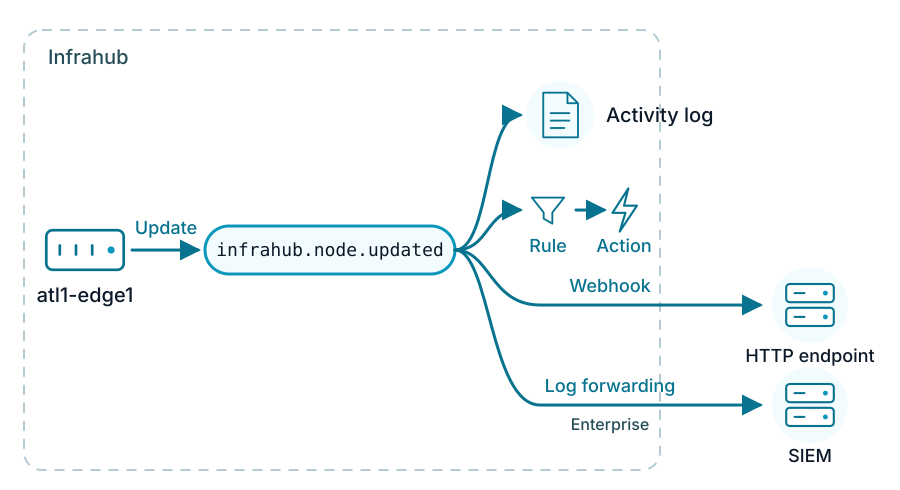

# Events

Infrahub emits an event each time something happens to its data or to its branches, for example when an object is created, updated, or deleted, when a member is added to a group, or when a branch is merged. With event rules and actions, you configure Infrahub to change the members of a group or run a Generator when one of those events occurs. Configure them when the same change should always be followed by the same work, so that nobody has to remember to do it:

- Add every new device whose platform is Arista EOS to the `arista_devices` group, so that the artifact definitions and Generator definitions that target the group include it.
- Run a Generator on a branch as soon as its input exists, so that the objects it creates are on the branch before you open a Proposed Change.

To send an event to a system outside Infrahub, such as a CI pipeline or a chat channel, create a [webhook](../webhooks/overview.mdx) instead.

## Events, rules, and actions

- **An event** is the record of what happened, on which branch, by which account, and when. Infrahub emits events without any configuration, and each one appears in the [activity log](../deploy-manage/run-observe/activity-log.mdx). Infrahub Enterprise can also send them to a SIEM through [log forwarding](../deploy-manage/run-observe/log-forwarding/overview.mdx).
- **A rule** matches events. A node trigger rule matches the creation or the update of objects of one kind, optionally only when an attribute has a given value or a relationship changes. A group trigger rule matches members added to or removed from one group. Each rule runs exactly one action.
- **An action** is the work a rule starts. A group action adds the object of the event to a group or removes it. A Generator action runs a Generator definition for that object.

When a rule matches an event, Infrahub runs its action on the branch where the event was emitted. Infrahub emits events for the changes an action makes, and another rule can match those events: when a group action adds a device to a group, Infrahub emits `infrahub.group.member_added`, which a group trigger rule can match.

Infrahub reads rules from the default branch only, and the branch scope of a rule selects the events it matches by the branch they were emitted on. When a branch is merged, Infrahub emits the events of the merged changes again on the default branch, so a rule whose branch scope is **All Branches** runs its action twice for the same change. See [Where trigger rules are stored and evaluated](./event-rules.mdx#where-trigger-rules-are-stored-and-evaluated).

## Choose a rule, a webhook, or a Generator setting

- **An event rule** runs an action that changes data in Infrahub: the action changes a group's members or runs a Generator. Choose a rule when the work that follows the change happens in Infrahub.
- **A [webhook](../webhooks/overview.mdx)** sends the event in an HTTP request to a URL you choose. Choose a webhook when another system has to act on the change, for example to start a pipeline or to post a message.
- **The Generator settings `execute_in_proposed_change` and `execute_after_merge`** make Infrahub run a Generator when it runs the checks of a Proposed Change, or after a merge. Choose a rule instead when the Generator has to run as soon as its input changes on a branch, before a Proposed Change exists. See [Running a Generator from events](../generators/overview.mdx#running-a-generator-from-events).

## Example workflows

Start from the outcome you want, then choose the action that produces it, the rule that runs the action, and the event the rule matches.

### Add Arista devices to a group

Every new device whose platform is Arista EOS has to be a member of the `arista_devices` group.

1. **Action**: Create a group action with **Member Action** set to **Add member** and **Group** set to `arista_devices`.
2. **Rule**: Create a node trigger rule on `InfraDevice` with the mutation action `created`, and add a relationship match on `platform` with the modification type **Added** and the ID of the Arista EOS platform as the peer. Choose the group action as the rule's action.
3. **Event**: Infrahub emits `infrahub.node.created` when a device is created.

The rule matches only new devices. To also add a device whose platform changes to Arista EOS later, create a second rule with the mutation action `updated` and the same relationship match. See [Event actions](./event-actions.mdx#configure-a-group-action) and [Event rules](./event-rules.mdx#configure-a-node-trigger-rule) for each step.

### Create circuit endpoints when a circuit enters provisioning

A Generator, `create_circuit_endpoints`, creates the endpoints of each circuit in the `provisioning_circuits` group, and the group is the target group of its Generator definition.

1. **Action**: Create a Generator action that runs the `create_circuit_endpoints` Generator definition.
2. **Rule**: Create a group trigger rule on `provisioning_circuits` with **Member Update** set to **Added**, and choose the Generator action.
3. **Event**: Infrahub emits `infrahub.group.member_added` when a circuit is added to the group.

Infrahub runs the Generator for the circuits that were added. A Generator action runs only for objects that are members of its Generator definition's target group, and here `provisioning_circuits` is that group. See [Configure a Generator action](./event-actions.mdx#configure-a-generator-action).

## In this section

- [Event system](./event-system.mdx) — See what an event contains, which branch it is emitted on, and how to query events
- [Event rules](./event-rules.mdx) — Match events by node kind, attribute, relationship, or group, and choose the branches whose events a rule matches
- [Event actions](./event-actions.mdx) — Add objects to a group or run a Generator when a rule matches
