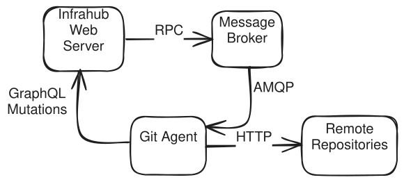

import ReferenceLink from "../../src/components/Card";

Connect an external Git repository to keep the code that drives Infrahub — schemas, Transformations, Generators, checks, GraphQL queries, and artifact definitions — under version control, next to your infrastructure data. Infrahub imports that code and keeps it in sync as the repository changes.

To set one up, see [connect a repository](./connect-repository.mdx), [configure `.infrahub.yml`](./infrahub-yml.mdx), and [filter which branches sync](./branch-synchronization.mdx).

## Two version-control planes

Infrahub has two separate version-control systems, and understanding the split is the key to the rest of this section.

- **The graph** — your infrastructure data (objects) and schema. Infrahub versions the graph itself: you branch it, change it, review the diff in a [Proposed Change](../proposed-changes/overview.mdx), and merge. This is Git-like version control, but the store is Infrahub's database, not a Git repository.
- **Git** — the code that describes intent: schemas, Transformations, Generators, checks, GraphQL queries, and artifact definitions, declared in [`.infrahub.yml`](./infrahub-yml.mdx). Infrahub reads this code from the repository and imports it.

The link between the two runs one way: from Git into Infrahub. Git is where you author code intent; Infrahub imports it and applies it to the graph. Data moves the other way only inside Infrahub — when you merge a branch, the change is applied to the graph, not pushed back to Git. A read-write repository does write one thing back to Git, and only one; the [repository types](#read-only-vs-core) section covers it.

## Why Git integration matters

Modern infrastructure management requires both structured data (network configurations, device inventories) and code (automation scripts, templates, validation logic). By integrating with Git repositories, Infrahub bridges these two worlds, enabling:

- **Unified version control**: Both your infrastructure data and automation code follow the same branching and merging workflows
- **Familiar developer workflows**: Teams can leverage existing Git practices and tooling
- **Separation of concerns**: Infrastructure data resides in Infrahub's graph database while code remains in Git
- **Enhanced collaboration**: Multiple teams can work on different aspects of infrastructure without conflicts

## Repository types and their design rationale {#read-only-vs-core}

Infrahub supports two distinct repository connection types, each designed for specific use cases and operational requirements.

### Repository: read-write integration

The standard **Repository** type gives Infrahub read-write access to Git. Infrahub imports code from every branch automatically, and on a Proposed Change merge it updates the linked Git branch — for branches that sync with Git (see [Controlling whether a branch reaches Git](#controlling-whether-a-branch-reaches-git)).

**Design principles:**

- **Branch parity**: each branch in the Git repository has a corresponding branch in Infrahub
- **Automatic import**: Infrahub imports changes from Git in the background, without a manual trigger
- **One write-back on merge**: merging a Proposed Change updates the linked branch in Git (see [merging branches](#merging-branches) below); this moves code intent, never your infrastructure data

**How it works internally:**

When you create a Repository connection, Infrahub:

1. Clones the repository to local storage
2. Creates Git worktrees for each branch to enable parallel operations
3. Tracks all remote branches and creates corresponding Infrahub branches
4. Runs background synchronization tasks every few seconds to detect changes
5. Parses the `.infrahub.yml` file to determine which resources to import

When you merge a Proposed Change and the source branch is set to sync with Git, Infrahub merges the corresponding branch in the Git repository and pushes the result to the remote. By default this is a fast-forward when possible, so no merge commit is created (see [merging branches](#merging-branches)). Only the code tracked in Git moves; your infrastructure data stays in the graph.

The push runs after the merge in Infrahub, as a background task, and it can fail, for example when the remote is unreachable or a branch protection refuses it. The merge in Infrahub stays complete, and Infrahub keeps the merge in the push queue of the repository. Infrahub retries the push automatically when the cause can clear by itself, records the push state in the `delivery_*` attributes of the repository, and pauses the import of the remote default branch and the regeneration that the repository defines until the queue is empty. To retry or abandon the pending pushes, see [when a push to the remote fails](./branch-synchronization.mdx#when-a-push-to-the-remote-fails).

A read-write repository has a `default_branch` attribute (defaulting to `main`) that names the Git branch mapped to Infrahub's default branch. Merges into Infrahub's default branch are pushed back to that Git branch on the remote, and that Git branch is imported as Infrahub's default branch, so a repository can use a non-`main` Git default branch. When `default_branch` is not `main`, a Git branch literally named `main` is not imported.

When a remote branch is skipped, Infrahub records a warning in the repository's **Tasks** tab. The warning names the skipped branch and the repository's `default_branch`. A push to the skipped branch does not import it; Infrahub records the warning instead.

The warning appears:

- In the "Adding repository" task, when you add the repository on Infrahub's default branch.
- In a later synchronization task, when that synchronization imports a branch or detects a new commit on the skipped branch.

A successful synchronization where nothing changed on the remote adds no task. If you add the repository on another Infrahub branch, Infrahub imports no other remote branches until you merge that branch, so the first warning comes from a synchronization after the merge.

With more than one task worker, a push to the skipped branch is not always reported. Each worker compares the new commit against its own copy of the repository, and a fetch triggered by another worker can update that copy first. The same push can also be reported by more than one worker.

### Read-only Repository: controlled unidirectional flow

The **Read-only Repository** type offers a simpler, unidirectional integration designed for scenarios where you need to consume resources from Git without modifying the external repository.

**Design principles:**

- **Single reference tracking**: links one specific Git ref (branch, tag, or commit)
- **Manual synchronization**: Infrahub does not import from a read-only repository on its own; you update it by changing the `ref` or using the **Import latest commit** action. On a schedule, the [read-only refs check](#read-only-refs-check) reads the commit that each tracked `ref` points to on the remote, but it never imports
- **Protection of external resources**: guarantees no modifications to the external repository

**How it works internally:**

Read-only repositories:

1. Track a single Git reference rather than all branches
2. Import changes only when you change the `ref` or run **Import latest commit**. The read-only refs check finds new commits on the remote, but it does not import them
3. Import resources according to the `.infrahub.yml` configuration
4. Maintain a simpler state model without complex branch synchronization logic

## Architecture and data flow

Understanding how Infrahub manages Git repositories helps clarify the system's capabilities and constraints.

### Component responsibilities



The architecture carefully separates concerns between components:

- **Infrahub API Server**: Never directly connects to Git repositories; handles GraphQL mutations and queries
- **Task Workers**: Manage all Git operations including cloning, fetching, and pushing
- **Message Broker**: Coordinates communication between API server and task workers
- **File System Storage**: Maintains local clones and worktrees in `git.repositories_directory`

This separation ensures that Git operations don't block API requests and enables horizontal scaling of task workers for improved performance.

### Synchronization mechanisms

**For standard Repositories:**

- Background tasks poll for changes multiple times per minute
- Each sync operation fetches from origin and compares local vs. remote state
- New branches automatically trigger Infrahub branch creation
- Updated branches trigger re-import of changed resources

**For Read-only Repositories:**

- No automatic import occurs. On a schedule, the [read-only refs check](#read-only-refs-check) reads the commit that each tracked `ref` points to on the remote, so that the **Commits** tab can list new commits, but it does not import them
- Updates can be triggered by modifying the `ref` property to point to a different branch, tag, or commit
- Alternatively, use the **Import latest commit** action to fetch the latest commit for the current ref from the remote without changing the ref
- Each update fetches the specified commit and imports resources according to configuration

### Merging branches

**This applies only to standard repositories:**

By default, Infrahub runs a standard `git merge`, which fast-forwards when the history allows it. When merging a branch linked to Git, Infrahub moves the destination branch pointer forward without creating a merge commit; if the branches have diverged, Git falls back to a merge commit.

You can configure Infrahub to always create a merge commit by setting the `INFRAHUB_GIT_USE_EXPLICIT_MERGE_COMMIT` environment variable to `true`. This approach maintains a more explicit commit history and improves auditability.

<ReferenceLink title="Enabling explicit merge commits" url="/git-integration/connect-repository#customizing-git-merge-behavior"/>

### Controlling whether a branch reaches Git

Each Infrahub branch has a `sync_with_git` property, chosen when you create the branch. It controls whether a branch **created in Infrahub** is extended to Git: when it is on, Infrahub creates a matching branch in every read-write repository and, on a Proposed Change merge, merges that branch in Git. When it is off, the branch stays inside Infrahub's graph.

The name reads as if it governs importing Git branches into Infrahub — it does not. Import always runs from Git to Infrahub regardless of this property; `sync_with_git` only affects branches going the other way, from Infrahub out to Git. Many data-only changes never need a Git branch at all, since that data lives only in the graph.

## The `.infrahub.yml` configuration file {#infrahub-yaml}

The `.infrahub.yml` file acts as a manifest, declaring which resources Infrahub should import from the repository. This declarative approach enables:

- Selective importing of repository contents based on specific needs
- Clear boundaries between Infrahub-managed and external resources
- Version-specific configurations (different branches can have different `.infrahub.yml` files)

For detailed information about `.infrahub.yml` configuration and syntax, see [Infrahub configuration file](./infrahub-yml.mdx).

## Status tracking and health monitoring {#repository-statuses}

A read-write repository tracks its operational state through four distinct status dimensions, each serving a different monitoring purpose. A read-only repository has the first three.

### Admin status: lifecycle management

Tracks whether Infrahub is actively using the repository:

- **Active**: Repository is in production use
- **Inactive**: Repository is disabled or unused
- **Staging**: Repository is pending activation via Proposed Change

### Operational status: connectivity health

Monitors the connection between Infrahub and the Git server:

- **Online**: Successfully connected and authenticated
- **Credential Error**: Authentication failure
- **Connectivity Error**: Network or connectivity issue
- **Error**: Other initialization or configuration problems
- **Unknown**: Status cannot be determined

### Sync status: data consistency

Indicates the state of data synchronization:

- **In sync**: All repository resources are current in Infrahub
- **Syncing**: Synchronization operation in progress
- **Error (import)**: Failed to import resources from repository
- **Unknown**: Synchronization state cannot be determined

### Push status: merges waiting for the remote

Stored in the `delivery_status` attribute of a read-write repository. Read it on the default branch:

- **Nothing pending** (`none`, or no value): No merge waits to be pushed to the remote
- **Pending** (`pending`): A push runs, is about to run, or waits for an automatic retry
- **Action required** (`action-required`): No automatic retry is planned; retry or abandon the pending pushes, as described in [when a push to the remote fails](./branch-synchronization.mdx#when-a-push-to-the-remote-fails)

## Repository actions and operations

Beyond basic synchronization, repositories support administrative actions for troubleshooting and maintenance:

- **Check connectivity**: Validates network access and authentication without modifying repository content. For a read-write **Repository** the check also confirms that Infrahub can push to the remote, so credentials that can read but not push are caught here rather than at the first branch creation or merge. The result is recorded in the repository's operational status: a successful check sets it to **Online**, while a failure sets it to the matching error state by cause - a permission or authentication failure to **Credential Error**, a transport failure (unreachable host, timeout, TLS) to **Connectivity Error**, and anything else to **Error**. **Online** confirms repository-level write access only; it does not evaluate branch protection, push rules, or pre-receive hooks, which apply only when a real push is attempted. The write check is also effective only on Git servers that enforce write authorization when advertising the receive-pack service (such as GitHub and GitLab); on servers that defer that check to the actual push, a read-only credential can still be recorded **Online**
- **Reimport current commit**: Forces re-processing of the current commit without fetching new changes, useful for recovering from import errors. Refused while the repository has pending pushes
- **Retry and abandon pending pushes** (read-write repositories only, through GraphQL): The `InfrahubRepositoryDeliveryRetry` mutation pushes the pending merges of the repository to the remote again. The `InfrahubRepositoryDeliveryAbandon` mutation drops every pending merge of the repository without a push, and keeps a record of them. See [retry the pending pushes](./branch-synchronization.mdx#retry-the-pending-pushes) and [what an abandonment leaves behind](./branch-synchronization.mdx#what-an-abandonment-leaves-behind)
- **Import latest commit** (read-only repositories only): Fetches the latest commit from the remote for the tracked ref and imports its resources. This is useful when the remote repository has new changes and you want to pull them without manually updating the `ref` property. Unlike changing the `ref`, this operation keeps the same ref but updates to whatever commit that ref currently points to on the remote

## The Commits tab and commits not yet imported {#commits-tab}

Every repository page has a **Commits** tab. It lists, newest first, the commits of the Git branch or ref that Infrahub reads for the repository on the Infrahub branch you are viewing, and marks the commit that Infrahub has imported. Use it to find out whether the remote has commits that Infrahub has not imported yet.

Which Git branch or ref the tab lists depends on the repository type:

- **Repository** (read-write): on Infrahub's default branch, the Git branch named by the repository's `default_branch`; on any other Infrahub branch, the Git branch with the same name. When [selective branch synchronization](./branch-synchronization.mdx) is configured and Infrahub would not import that Git branch, the tab shows **No commit log**. Without selective branch synchronization, the tab lists the commits of that Git branch whether or not the Infrahub branch syncs with Git.
- **Read-only Repository**: the repository's `ref` on the Infrahub branch you are viewing.

### Infrahub reads the commit list on each request

Infrahub does not store the commit list. Each time the tab requests the list, Infrahub asks a task worker to read the commits from its local copy of the repository and returns the answer. To answer, the task worker does not fetch from the remote, clone the repository, or import anything, so the list is only as recent as the last time that task worker's copy was fetched from the remote.

Any task worker can answer a request. When you run more than one task worker, two requests can be answered from copies that were fetched at different times.

When the task worker that answers has no local copy of the repository yet, the tab shows **Commit log not available yet**. For a read-only repository, or for a read-write repository that has already imported a commit on the branch, Infrahub starts a separate task that creates the copy. For a read-write repository that has not imported a commit on the branch, Infrahub creates the copy during the repository's next sync. In both cases, the tab requests the list again every 10 seconds for up to 5 minutes. To request it again yourself, select the refresh button at the top of the tab.

### Commit labels and the comparison with the remote head

Each commit row shows its hash, summary, author, and date. The labels show how a commit relates to the imported commit:

- **Remote head**: the latest commit of the Git branch or ref, as last fetched into the copy of the task worker that answered
- **Imported**: the commit Infrahub has imported on this Infrahub branch. When the imported commit is also the remote head, the row shows both labels
- **Pending import**: a commit after the imported commit that Infrahub has not imported, other than the remote head
- **Not on current history**: a commit that cannot be placed relative to the imported commit, because the history was rewritten, the imported commit was not found, or nothing has been imported on this Infrahub branch yet

Commits older than the imported commit have no label. Use the row menu to copy the full commit hash or, for a repository hosted on GitHub, to open the commit on GitHub.

Infrahub also compares the remote head with the imported commit, and the tab shows the result:

| Comparison | When it applies | What the tab shows |
|---|---|---|
| In sync | The remote head is the imported commit. | A count of **0** on the tab. |
| Behind | The imported commit is an ancestor of the remote head. | The number of commits pending import, on the tab and above the list. The number includes the remote head. |
| Rewritten | The imported commit is no longer part of the history of the Git branch or ref, for example after a force push. | A warning that the tracked ref was rewritten, and nothing marked as pending. |
| Imported commit not found | The task worker's copy does not contain the imported commit. | A warning that the imported commit could not be found on the remote. |
| Ref missing | Read-only repositories only: the `ref` does not resolve in the task worker's copy, for example after it was deleted on the remote and a later fetch removed it from the copy. | A warning that the tracked ref no longer exists on the remote. When a commit has been imported, the list starts at that commit and Infrahub still uses it. When nothing has been imported, the list is empty. |
| Nothing imported | No commit has been imported on this Infrahub branch yet. | The commits, with every commit except the remote head labeled **Not on current history**. For a read-write repository with no Git branch to read, or a read-only repository with no `ref`, **No commit log**. |
| No remote branch | Read-write repositories only: the Git branch does not exist in the task worker's copy, but the Infrahub branch has an imported commit. | **No commit log**. |

### Updated and Checked times {#commits-freshness}

The line at the top of the tab names the Git branch or ref after **Tracking**, and shows up to two times:

- **Updated** is when the task worker that answered last fetched its copy of the repository from the remote. It is not shown when that time is not known, for example after the last fetch failed. The GraphQL API returns it as `fetched_at`.
- **Checked** is shown for read-only repositories only. It is when the [read-only refs check](#read-only-refs-check) last ran for the repository, on any task worker, including a check that failed. Infrahub records one **Checked** time per repository, not per branch: a check you start with **Check remote now** compares only the `ref` of the branch you are viewing, but it updates the **Checked** time shown on every branch. When the repository tracks a different `ref` on another branch, that branch can show a recent **Checked** time even though Infrahub last compared its `ref` at the last scheduled check. The GraphQL API returns **Checked** as `checked_at`.

An **Updated** time older than the **Checked** time does not mean the list is out of date: a check fetches only when the commit that a tracked `ref` points to on the remote differs from the commit in the copy of the task worker that runs the check.

Infrahub keeps the **Checked** time in its cache for up to 30 days. It is not shown when no check has run in that time, when the cache was cleared, or when the cache cannot be read. Read-write repositories have no **Checked** time, because their regular sync fetches the remote and **Updated** already shows when that happened.

### Read-only refs check {#read-only-refs-check}

Infrahub does not import from a read-only repository on its own, so without this check it would not fetch new commits for the **Commits** tab to list. The read-only refs check reads the commit that each tracked `ref` of a read-only repository points to on the remote, and compares it with two other commits:

- When the commit differs from the commit in the copy of the task worker that runs the check, that task worker fetches from the remote. The fetch updates every branch and tag in its copy.
- When the commit differs from the commit the previous check found, or no previous check recorded one, Infrahub asks the other task workers to fetch too. It asks for each Infrahub branch that tracks that `ref` and has imported a commit. A check started with **Check remote now** asks only for the Infrahub branch you are viewing.

After the task workers have fetched, the **Commits** tab lists the new commits whichever task worker answers.

:::info The check never changes the imported commit
The read-only refs check never imports and never writes the repository's `commit` or `ref`. Task workers that fetch new commits keep the imported commit checked out. The imported commit changes only when you change the `ref` or select **Import latest commit**, as described in [How to connect external Git repositories](./connect-repository.mdx#update-a-read-only-repository-with-remote-changes).
:::

The check runs in two ways:

- **On a schedule**: a task runs every minute and checks each read-only repository at most once per interval. Set the interval in minutes with [`INFRAHUB_GIT_READ_ONLY_REFS_CHECK_INTERVAL_MINS`](../reference/configuration.mdx), from 1 to 1440 (default 15). After a failed check, the repository is checked again after 5 minutes, or after the interval when the interval is shorter. The check covers each Infrahub branch on which the repository is active and has a `ref`, for repositories that have a location.
- **On request**: select **Check remote now** on the **Commits** tab of a read-only repository. The check compares only the `ref` of the Infrahub branch you are viewing. You need permission to update read-only repositories on that branch, and the repository must have a location and a `ref` and be active on that branch. After you select the button, the tab in your browser shows **Check running.** with a **View task** link until the check ends. The GraphQL mutation `InfrahubReadOnlyRepositoryCheckRefs` starts the same check and returns the task ID.

### Reading commits from the GraphQL API

The **Commits** tab uses the `InfrahubRepositoryCommits` query, which takes the repository ID or name, a `limit` from 1 to 100 (default 10), and an `offset`. It returns the commits for the branch the query is sent to, along with `condition`, `pending_count`, `fetched_at`, and `checked_at`.

```graphql
query RepositoryCommits($id: String!) {
  InfrahubRepositoryCommits(repository_id: $id, limit: 20) {
    git_ref
    condition
    imported_commit
    remote_head
    pending_count
    fetched_at
    checked_at
    unavailable { reason message }
    edges {
      node { short_hash summary author_name authored_at state }
    }
  }
}
```

## Design trade-offs and constraints

The current architecture makes several important trade-offs:

### Branch hierarchy limitations

Infrahub currently supports only single-level branch hierarchy (branches created from main). This simplification:

- Reduces complexity in conflict resolution
- Ensures predictable merge paths
- May limit advanced Git workflows

### Synchronization frequency

The polling-based synchronization approach:

- Provides near-real-time updates (within seconds)
- Avoids webhook complexity and firewall issues
- May introduce slight delays compared to push-based systems

## Common misconceptions

- **Merging a change in Infrahub pushes data to Git.** It does not. A data merge is applied to the graph. The only thing a merge writes to Git is the code-intent branch of a read-write repository, updated on a Proposed Change merge.
- **`sync_with_git` controls importing Git branches into Infrahub.** It does not. It controls whether a branch created in Infrahub is extended out to Git. Import always runs from Git to Infrahub.
- **A read-write repository has an "Import latest commit" button.** It does not. Read-write repositories import automatically in the background; **Import latest commit** is a read-only repository action, used because Infrahub does not import from read-only repositories on its own.
- **The read-only refs check updates a read-only repository.** It does not. It fetches new commits from the remote so that the **Commits** tab lists them, but the imported commit changes only when you change the `ref` or run **Import latest commit**.

## Further reading

- [How to connect external Git repositories](./connect-repository.mdx) - Practical guide for setting up repositories
- [Infrahub configuration file](./infrahub-yml.mdx) - Detailed `.infrahub.yml` reference
- [Selective branch synchronization](./branch-synchronization.mdx) - Controlling which Git branches sync to Infrahub
- [Proposed Changes](../proposed-changes/overview.mdx) - Understanding the merge and review process
- [Version control in Infrahub](../immutable-history/overview.mdx) - Broader context of Infrahub's version control features
