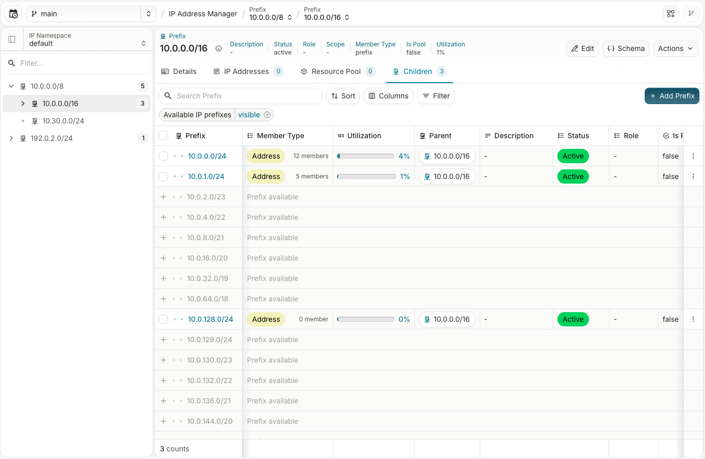

import Tabs from '@theme/Tabs';
import TabItem from '@theme/TabItem';

Create, change and delete the prefixes and addresses of your address plan in the web interface, with GraphQL, or with the Python SDK. Create them this way to record addressing that already exists, or to plan the subnets of a new site. Write your Generators and provisioning scripts to allocate them from a pool instead, as described in [Allocate IPs and prefixes](./allocate-ips-and-prefixes.mdx).

Set the value and the namespace of each prefix and address, and Infrahub sets its parent. Creating, changing or deleting one prefix can therefore change the parent of other prefixes and addresses.

The examples use the Marketplace kinds `IpamPrefix` and `IpamIPAddress`, described in [Build your IPAM schema](./build-your-ipam-schema.mdx), and the `default` namespace. To work in another namespace, see [Use namespaces](./use-namespaces.mdx#create-a-prefix-or-an-address-in-a-namespace).

## Create a prefix

Choose the member type of the prefix before you create it, because Infrahub computes the utilization of the prefix with a formula that depends on it:

- `prefix` for a prefix that you divide into other prefixes, such as the `10.0.0.0/16` of a data center that you split into subnets.
- `address` for a subnet that contains addresses. This is the default.

Set `is_pool` to `true` when every address in the prefix is usable, including the network and broadcast addresses.

<Tabs groupId="method" queryString>
  <TabItem value="web" label="Web Interface" default>

1. In the menu, select **IPAM** → **IP Prefixes**, then select **Add Prefix**.
2. In the **Create Prefix** panel, enter the prefix in CIDR notation in **Prefix**, and choose the **Member Type**.
3. Leave **IP Namespace** empty to create the prefix in `default`. The field is empty when the panel opens, even when another namespace is selected on the IPAM page.
4. Select **Save**.

</TabItem>

  <TabItem value="graphql" label="GraphQL">

```graphql
mutation {
  IpamPrefixCreate(data: {
    prefix: {value: "10.0.0.0/16"},
    member_type: {value: "prefix"},
    description: {value: "Data center 1"}
  }) {
    ok
    object {
      id
      hfid
    }
  }
}
```

</TabItem>

  <TabItem value="sdk" label="Python SDK">

```python
prefix = await client.create(
    kind="IpamPrefix",
    prefix="10.0.0.0/16",
    member_type="prefix",
    description="Data center 1",
)
await prefix.save()
```

</TabItem>
</Tabs>

Infrahub places the new prefix under the most specific prefix that contains it, and moves the existing prefixes and addresses it contains under it.

## Create an address

Enter the address with its prefix length, for example `10.0.1.10/24`. A value without a prefix length is stored as a host address, so `10.0.1.10` becomes `10.0.1.10/32`.

<Tabs groupId="method" queryString>
  <TabItem value="web" label="Web Interface" default>

In the menu, select **IPAM** → **IP Addresses**, then select **Add IP Address**. Enter the address with its prefix length, and select **Save**. As for a prefix, leave **IP Namespace** empty to create the address in `default`.

</TabItem>

  <TabItem value="graphql" label="GraphQL">

```graphql
mutation {
  IpamIPAddressCreate(data: {
    address: {value: "10.0.1.10/24"},
    description: {value: "web01"}
  }) {
    ok
    object {
      id
      ip_prefix {
        node { prefix { value } }
      }
    }
  }
}
```

</TabItem>

  <TabItem value="sdk" label="Python SDK">

```python
address = await client.create(
    kind="IpamIPAddress",
    address="10.0.1.10/24",
    description="web01",
)
await address.save()
```

</TabItem>
</Tabs>

The parent prefix of an address is the most specific prefix that contains it. If no prefix contains it, the address has no parent prefix until you create one that does.

## Create a prefix or an address in available space

When you add a subnet to a site or an address to a subnet, start from the available space of the parent prefix instead of searching for an unused value.

<Tabs groupId="method" queryString>
  <TabItem value="web" label="Web Interface" default>

1. Open the parent prefix by selecting its value in the prefix table or in the tree.
2. On the **Children** tab, each available block is listed as a row marked **Prefix available**. The rows are shown by default. To hide or show them, select the **Available IP prefixes** tag above the table. Sorting the table, or filtering it on some columns, hides the rows and the tag. On the **IP Addresses** tab of a subnet, select the **Available IP addresses** tag to hide or show the rows of available address ranges.
3. Select an available prefix row. The **Create Prefix** panel opens with the available block in **Prefix**. To create a smaller prefix inside the block, change the value, for example from `10.0.2.0/23` to `10.0.2.0/24`.
4. **IP Namespace** is empty in the panel. If the parent prefix is not in `default`, choose its namespace there. Otherwise the prefix is created in `default`.
5. Select **Save**.



</TabItem>

  <TabItem value="graphql" label="GraphQL">

Query the next available prefix of a given size in the parent prefix, then create it:

```graphql
query {
  InfrahubIPPrefixGetNextAvailable(prefix_id: "<parent-prefix-id>", prefix_length: 24) {
    prefix
  }
}
```

</TabItem>

  <TabItem value="sdk" label="Python SDK">

Query the next available prefix of a given size in the parent prefix, then create it:

```python
parent = await client.get(
    kind="IpamPrefix",
    prefix__value="10.0.0.0/16",
    ip_namespace__name__value="default",
)
query = """
query ($parent: String!) {
  InfrahubIPPrefixGetNextAvailable(prefix_id: $parent, prefix_length: 24) {
    prefix
  }
}
"""
result = await client.execute_graphql(query=query, variables={"parent": parent.id})
subnet = await client.create(
    kind="IpamPrefix",
    prefix=result["InfrahubIPPrefixGetNextAvailable"]["prefix"],
)
await subnet.save()
```

</TabItem>
</Tabs>

The query returns the value and creates nothing, so another client can use the same value before you create it. To list every available block of the parent prefix, see [Query IPAM data](./query-ipam-data.mdx#list-the-available-space-in-a-prefix).

Write your Generator or script to allocate the prefix from a Resource Manager pool instead. In one request, Infrahub creates the next available prefix in the pool's resources, and it never gives the same prefix to two requests with different identifiers. Create the pool first, with the parent prefix as one of its resources. See [Allocate IPs and prefixes](./allocate-ips-and-prefixes.mdx).

## Change a prefix or an address

Change any attribute of a prefix or an address, such as its description, status or member type. Two changes have effects beyond the prefix or address you change:

- When you change the value of a prefix, for example from `10.0.1.0/24` to `10.0.0.0/23`, Infrahub moves prefixes and addresses into it or out of it. When you change it back, Infrahub reverses the move.
- When you change the member type of a prefix, Infrahub computes its utilization with the other formula. See [Utilization depends on the member type](./overview.mdx#utilization-depends-on-the-member-type).

To move a prefix or an address to another namespace, see [Use namespaces](./use-namespaces.mdx#move-a-prefix-or-an-address-to-another-namespace).

<Tabs groupId="method" queryString>
  <TabItem value="web" label="Web Interface" default>

Open the prefix or the address, and select **Edit** in the page header. In a table, **Edit** is also in the **⋮** menu of each row. Change the values, and save.

</TabItem>

  <TabItem value="graphql" label="GraphQL">

Identify the prefix by its ID in `id`:

```graphql
mutation {
  IpamPrefixUpdate(data: {
    id: "<prefix-id>",
    prefix: {value: "10.0.0.0/23"}
  }) {
    ok
  }
}
```

</TabItem>

  <TabItem value="sdk" label="Python SDK">

```python
prefix = await client.get(
    kind="IpamPrefix",
    prefix__value="10.0.1.0/24",
    ip_namespace__name__value="default",
)
prefix.prefix.value = "10.0.0.0/23"
await prefix.save()
```

</TabItem>
</Tabs>

## Delete a prefix or an address

When you delete a prefix, Infrahub moves its child prefixes and addresses up to its parent. It does not delete them. To remove a whole subtree, delete each of its prefixes and addresses.

When you delete an address that was allocated from a pool, it becomes available in the pool again. If a branch was created before you deleted the address, that branch still has it, so the address becomes available only after you rebase or delete that branch. See [Return an address to the pool](./allocate-ips-and-prefixes.mdx#return-an-address-to-the-pool).

<Tabs groupId="method" queryString>
  <TabItem value="web" label="Web Interface" default>

Open the prefix or the address, and select **Actions** → **Delete**. In a table, **Delete** is also in the **⋮** menu of each row. Confirm with **Delete**.

</TabItem>

  <TabItem value="graphql" label="GraphQL">

Identify the prefix by its ID in `id`:

```graphql
mutation {
  IpamPrefixDelete(data: {id: "<prefix-id>"}) {
    ok
  }
}
```

</TabItem>

  <TabItem value="sdk" label="Python SDK">

```python
prefix = await client.get(
    kind="IpamPrefix",
    prefix__value="10.0.1.0/24",
    ip_namespace__name__value="default",
)
await prefix.delete()
```

</TabItem>
</Tabs>

## Concurrent changes to one namespace

When several people or scripts change prefixes in the same namespace at the same time, the changes are saved one by one, on every branch. Adding, deleting or resizing a prefix can change the parent of other prefixes, and saving two such changes at once could leave a prefix with two parents. Creating many prefixes in one namespace in parallel is therefore no faster than creating them one after another.

Changes to different addresses are saved in parallel. When two people or scripts create or change the same address in the same namespace on the default branch, the changes are saved one after the other. If two requests create the same address at the same time, and addresses are unique in your schema, one succeeds and the other fails with a uniqueness error.

## Next

- [Use namespaces](./use-namespaces.mdx) — Separate overlapping address space and move prefixes between namespaces
- [Allocate IPs and prefixes](./allocate-ips-and-prefixes.mdx) — Allocate the next available address or prefix from a pool
- [Query IPAM data](./query-ipam-data.mdx) — Check utilization and the tree after a change
- [Plan changes on a branch](./plan-changes-on-a-branch.mdx) — Review an addressing change before it is merged
