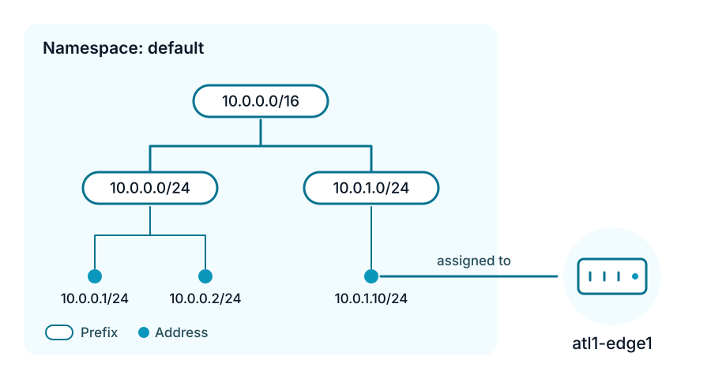
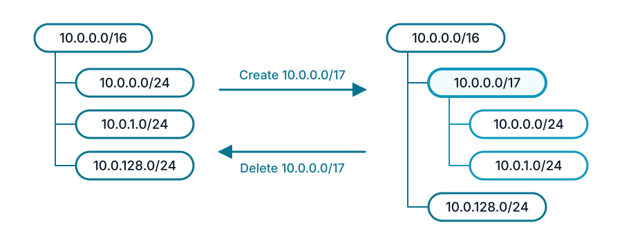
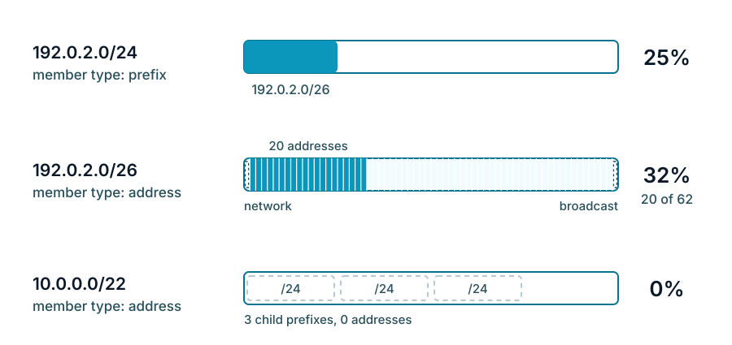

With IP address management (IPAM) in Infrahub, you record your IP namespaces, prefixes and addresses in the same graph as your devices, interfaces and services. You need it when you have to know which address space is assigned to what and where free space remains, and when an addressing change has to be reviewed on a branch together with the rest of a change. Infrahub supports IPv4 and IPv6.

Infrahub records the addressing plan. It does not configure addresses on the network: it is not a DHCP or DNS server, and it does not discover addresses by scanning the network.

Before you can create prefixes and addresses, load a schema that defines them. The Marketplace schema `infrahub/ipam` defines `IpamPrefix` and `IpamIPAddress`, and the examples in this section use those kinds. See [Build your IPAM schema](./build-your-ipam-schema.mdx) to load it or define your own.

:::tip Migrating from another system?

Once your IPAM schema is in place, use [Infrahub Sync](https://docs.infrahub.app/sync) to import your existing IP data from a prior source of truth.

:::

## How IP data is organized

- A namespace is a separate address space. Every prefix and every address belongs to exactly one namespace. Infrahub creates the `default` namespace when it starts for the first time, and assigns a prefix or an address to it when you do not choose a namespace.
- Within a namespace, prefixes form a tree based on network containment. A prefix is the parent of the prefixes it contains, and each address belongs to the most specific prefix that contains it.
- Prefixes and addresses relate to the rest of your data through schema relationships. In the Marketplace schema, an address relates to an interface (`interface`) and can be the primary address of a device (`primary_of`).

Three built-in generics, `BuiltinIPNamespace`, `BuiltinIPPrefix` and `BuiltinIPAddress`, define this behavior, and the prefix and address nodes of your schema inherit from them. Whether one namespace can hold the same prefix twice also depends on your schema: the Marketplace schema makes prefixes and addresses unique within a namespace.

To store a single IP value on another node without these behaviors, such as the address of a syslog server, use the `IPAddress`, `IPHost` or `IPNetwork` attribute kinds instead. See [Build your IPAM schema](./build-your-ipam-schema.mdx#iphost-ipnetwork-and-ipaddress-attribute-kinds) for when to choose each.

## What Infrahub changes when you add or delete a prefix

You set the value of a prefix or an address, and Infrahub sets its parent. After each create, update or delete, Infrahub updates the tree of the namespace:

- When you create a prefix, Infrahub moves the existing prefixes and addresses it contains under it.
- When you delete a prefix, Infrahub moves its child prefixes and addresses up to its parent. It does not delete them.
- When you change the value of a prefix, for example from a `/24` to a `/23`, Infrahub moves prefixes and addresses into it or out of it.
- An address that no prefix contains has no parent prefix until you create a prefix that contains it.

The `parent`, `children`, `ancestors` and `descendants` relationships of a prefix, and the `ip_prefix` relationship of an address, are read-only. The read-only `is_top_level` attribute is `true` on a prefix that has no parent. See [Manage prefixes and addresses](./manage-prefixes-and-addresses.mdx) for each operation.

## Utilization depends on the member type

Set the member type of each prefix to match what it holds: `prefix` for a prefix that contains other prefixes, `address` for a subnet that holds addresses. A new prefix has the member type `address` unless you set it.

Infrahub computes the read-only `utilization` attribute of a prefix from its direct children, with a formula that depends on the member type:

- **`prefix`**: the address space of the child prefixes, divided by the address space of the prefix. For example, `192.0.2.0/24` with one `192.0.2.0/26` child has a utilization of 25%.
- **`address`**: the number of addresses in the prefix, divided by the number of usable addresses. For example, `192.0.2.0/26` has 62 usable addresses, so with 20 addresses its utilization is 32%.

Infrahub counts only the children that match the member type. A prefix that contains other prefixes, and whose member type is still `address`, has a utilization of 0%, however many prefixes it holds.

Infrahub returns utilization as a whole number, rounded down. A large prefix can therefore have a utilization of 0% while it holds a few small prefixes: for `10.0.0.0/8` with three `/24` children, the value is 0 in either mode.

The network and broadcast addresses count as usable when `is_pool` is `true`, when an IPv4 prefix is `/31` or longer (per [RFC 3021](https://datatracker.ietf.org/doc/html/rfc3021)), and for every IPv6 prefix. With `is_pool` set, Infrahub can also allocate the network and broadcast addresses when it allocates the next free address, from a Resource Manager pool or from the next-available query. `is_pool` is an attribute of the prefix, and is not related to Resource Manager pools.

Utilization is computed for the branch you query. Infrahub includes an address you add on a branch in the utilization of that branch, and in the utilization of the default branch only after the merge.

## Namespaces separate overlapping address space

Create a namespace when address space overlaps, for example when the customers of a managed service all use `10.0.0.0/8`, or when two sets of prefixes must be kept separate so that the same values can exist in both. Each namespace has its own tree and its own utilization figures.

To record which customer, business unit or region owns a prefix, use a relationship such as a tenant, not a namespace. A VRF node and a namespace also record different things: a VRF node records the routing instance, and a namespace allows the same prefix to exist twice. See [Use namespaces](./use-namespaces.mdx) for how to combine them.

:::info
When you delete a namespace, Infrahub deletes every prefix and address in it. The `default` namespace cannot be deleted.
:::

## IPAM in the web interface

Select **IPAM** → **IP Prefixes** in the menu to view the prefixes of one namespace, and **IP Addresses** to view its addresses. Choose the namespace in the **IP Namespace** selector above the tree. The tree on the left shows the prefix hierarchy, and the table lists each prefix with its member type, its utilization and its parent.

On the page of a prefix, list the free blocks between its existing children, and create a prefix or an address in one of them. See [Manage prefixes and addresses](./manage-prefixes-and-addresses.mdx#create-a-prefix-or-an-address-in-free-space) for the steps.

## Changes on a branch

You can create, update and delete namespaces, prefixes and addresses on any branch. Infrahub updates the tree of the branch after each change. When you merge or rebase the branch, Infrahub updates the tree of the target branch for the prefixes and addresses that changed. See [Plan changes on a branch](./plan-changes-on-a-branch.mdx) for the review workflow, and for what happens when two branches create the same prefix.

## Allocate addresses and prefixes

To assign addresses and prefixes from automation, such as a Generator that builds a new site, allocate them from a Resource Manager pool. A pool takes IPAM prefixes as its resources, returns the next free address or prefix in them, and returns the same allocation when you repeat a request with the same identifier. See [Allocate IPs and prefixes](./allocate-ips-and-prefixes.mdx) for the steps.

## In this section

- [Build your IPAM schema](./build-your-ipam-schema.mdx) — Load the Marketplace IPAM schema or define your own prefix and address nodes, and choose their uniqueness constraints
- [Manage prefixes and addresses](./manage-prefixes-and-addresses.mdx) — Create, change and delete prefixes and addresses, and see what each change does to the tree
- [Use namespaces](./use-namespaces.mdx) — Separate overlapping address space, combine namespaces with VRFs, and move prefixes between namespaces
- [Allocate IPs and prefixes](./allocate-ips-and-prefixes.mdx) — Assign the next free address or prefix from a Resource Manager pool
- [Query IPAM data](./query-ipam-data.mdx) — Read utilization, the hierarchy and the free space of a prefix with GraphQL or the Python SDK
- [Plan changes on a branch](./plan-changes-on-a-branch.mdx) — Prepare an addressing change on a branch, review it, and resolve duplicates between branches
