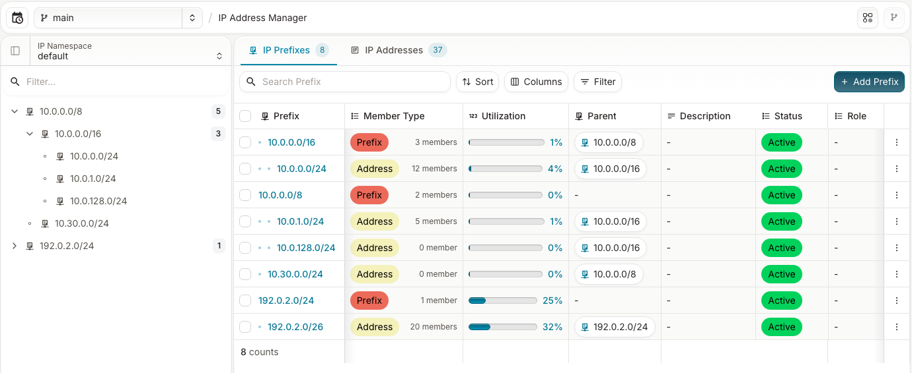

With IP address management (IPAM) in Infrahub, you record your IP namespaces, prefixes and addresses in the same graph as the devices, interfaces and services that use them. From the values of these prefixes and addresses, Infrahub works out which prefix contains which, and how much of each prefix is in use. Infrahub supports IPv4 and IPv6.

Network teams use IPAM in Infrahub to:

- find available address space when they add a subnet to a site
- allocate loopback addresses and point-to-point subnets from a pool when a Generator creates the devices and interfaces of a new data center or customer service
- review changes to prefixes and addresses in the same Proposed Change as the device changes that depend on them
- record customer networks whose address ranges overlap, each in its own namespace

IPAM in Infrahub is a record of the address plan, not a network service: Infrahub does not configure addresses on devices, it is not a DHCP or DNS server, and it does not discover addresses by scanning the network.

Before you can create prefixes and addresses, load a schema that defines them. The Marketplace schema `infrahub/ipam` defines `IpamPrefix` and `IpamIPAddress`, and the examples in this section use those kinds. See [Build your IPAM schema](./build-your-ipam-schema.mdx) to load it or define your own.

:::tip Migrating from another system?

Once your IPAM schema is in place, use [Infrahub Sync](https://docs.infrahub.app/sync) to import your existing IP data from a prior source of truth.

:::

## How IP data is organized

- A namespace is a separate address space. Every prefix and every address belongs to exactly one namespace. Infrahub creates the `default` namespace when it starts for the first time, and creates a prefix or an address in it when no namespace is chosen.
- Within a namespace, prefixes form a tree based on network containment. A prefix is the parent of the prefixes it contains, and each address belongs to the most specific prefix that contains it.
- Prefixes and addresses relate to the rest of your data through schema relationships. In the Marketplace schema, an address relates to an interface (`interface`) and can be the primary address of a device (`primary_of`).

Three built-in generics, `BuiltinIPNamespace`, `BuiltinIPPrefix` and `BuiltinIPAddress`, define this behavior, and the prefix and address nodes of your schema inherit from them. Whether one namespace can hold the same prefix twice also depends on your schema: the Marketplace schema makes prefixes and addresses unique within a namespace.

To store a single IP value on another node without these behaviors, such as the address of a syslog server, use the `IPAddress`, `IPHost` or `IPNetwork` attribute kinds instead. See [Build your IPAM schema](./build-your-ipam-schema.mdx#iphost-ipnetwork-and-ipaddress-attribute-kinds) for when to choose each.

## What Infrahub changes when you create, change or delete a prefix

You set the value of a prefix or an address, and Infrahub sets its parent. Creating, changing or deleting a prefix also changes the parents of other prefixes and addresses in that namespace:

- When you create a prefix, Infrahub moves the existing prefixes and addresses it contains under it.
- When you delete a prefix, Infrahub moves its child prefixes and addresses up to its parent. It does not delete them.
- When you change the value of a prefix, for example from a `/24` to a `/23`, Infrahub moves prefixes and addresses into it or out of it.
- An address that no prefix contains has no parent prefix until you create a prefix that contains it.

Because Infrahub sets the parents, the `parent` and `children` relationships of a prefix and the `ip_prefix` relationship of an address are read-only. To read the tree, see [Query IPAM data](./query-ipam-data.mdx). For each operation, see [Manage prefixes and addresses](./manage-prefixes-and-addresses.mdx).

## Utilization depends on the member type

Before adding a subnet or a site, check the utilization of each prefix to find the blocks with available space and the subnets that are nearly full.

Set the member type of each prefix to match what it contains: `prefix` for a prefix that contains other prefixes, `address` for a subnet that contains addresses. A new prefix has the member type `address` unless you set it.

Infrahub computes the read-only `utilization` attribute of a prefix from its direct children, with a formula that depends on the member type:

- **`prefix`**: the address space of the child prefixes, divided by the address space of the prefix. For example, `192.0.2.0/24` with one `192.0.2.0/26` child has a utilization of 25%.
- **`address`**: the number of addresses in the prefix, divided by the number of usable addresses. For example, `192.0.2.0/26` has 62 usable addresses, so with 20 addresses its utilization is 32%.

Infrahub counts only the children that match the member type. A prefix that contains other prefixes, and whose member type is still `address`, has a utilization of 0%, however many prefixes it contains.

Infrahub returns utilization as a whole number, rounded down. A large prefix can therefore have a utilization of 0% while it contains a few small prefixes: for `10.0.0.0/8` with three `/24` children, the value is 0 in either mode.

In a subnet, the first address (the network address) and the last address (the broadcast address) cannot be assigned to a host. Infrahub leaves them out when it calculates utilization, so the `/26` above has 62 usable addresses, not 64.

Every address is usable in three cases:

- The prefix has `is_pool` set to `true`. You can then also allocate the network and broadcast addresses, from a Resource Manager pool or with the next-available query.
- The prefix is an IPv4 `/31` or `/32` (see [RFC 3021](https://datatracker.ietf.org/doc/html/rfc3021)).
- The prefix is IPv6.

Despite its name, `is_pool` does not make the prefix a Resource Manager pool.

When you query a branch, Infrahub computes utilization for that branch. Infrahub includes an address you add on a branch in the utilization of that branch, and in the utilization of the default branch only after the merge.

## Namespaces separate overlapping address space

Create a namespace when address space overlaps, for example when the customers of a managed service all use `10.0.0.0/8`, or when two sets of prefixes must be kept separate so that the same values can exist in both. Each namespace has its own tree and its own utilization figures.

To record which customer, business unit or region owns a prefix, use a relationship such as a tenant, not a namespace. A VRF node and a namespace also record different things: a VRF node records the routing instance, and a namespace allows the same prefix to exist twice. See [Use namespaces](./use-namespaces.mdx) for how to combine them.

:::info
When you delete a namespace, Infrahub deletes every prefix and address in it. The `default` namespace cannot be deleted.
:::

## IPAM in the web interface

In the web interface, view the address plan one namespace at a time under **IPAM** in the menu: the prefix tree, and a table of the prefixes with the member type, utilization and parent of each. Choose the namespace in the **IP Namespace** selector above the tree.

Open a prefix to view its child prefixes together with the available blocks inside it, and select an available block to create a prefix or an address in it. See [Manage prefixes and addresses](./manage-prefixes-and-addresses.mdx#create-a-prefix-or-an-address-in-available-space) for the steps.

## Changes on a branch

Prepare an addressing change, such as a subnet split or the prefixes of a new site, on a branch, and review it in a Proposed Change together with the device and service changes that depend on it. You can create, change and delete namespaces, prefixes and addresses on any branch. Infrahub updates the tree of the branch after each change. When you merge or rebase the branch, Infrahub updates the tree of the target branch for the prefixes and addresses that changed. See [Plan changes on a branch](./plan-changes-on-a-branch.mdx) for the review workflow, and for what happens when two branches create the same prefix.

## Allocate addresses and prefixes

When a Generator creates the devices and interfaces of a new data center, site or customer service, write it to allocate their addresses and prefixes from a Resource Manager pool, and do the same in a provisioning script. Add IPAM prefixes to the pool as its resources. Each time the Generator or script requests an address or a prefix from the pool, Infrahub creates the next available one in those prefixes and reserves it on every branch, so two requests with different identifiers never receive the same value. When a request repeats an identifier, Infrahub returns the address or prefix it already allocated for that identifier, so the Generator or script can run again without allocating a second one. See [Allocate IPs and prefixes](./allocate-ips-and-prefixes.mdx) for the steps.

## In this section

- [Build your IPAM schema](./build-your-ipam-schema.mdx) — Load the Marketplace IPAM schema or define your own prefix and address nodes, and choose their uniqueness constraints
- [Manage prefixes and addresses](./manage-prefixes-and-addresses.mdx) — Create, change and delete prefixes and addresses, and see what each change does to the tree
- [Use namespaces](./use-namespaces.mdx) — Separate overlapping address space, combine namespaces with VRFs, and move prefixes between namespaces
- [Allocate IPs and prefixes](./allocate-ips-and-prefixes.mdx) — Allocate the next available address or prefix from a Resource Manager pool
- [Query IPAM data](./query-ipam-data.mdx) — Read utilization, the hierarchy and the available space of a prefix with GraphQL or the Python SDK
- [Plan changes on a branch](./plan-changes-on-a-branch.mdx) — Prepare an addressing change on a branch, review it, and resolve duplicates between branches
