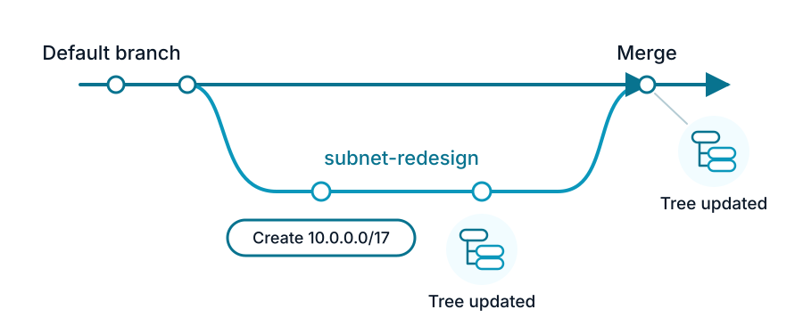

Make an addressing change, such as a subnet split or the prefixes of a new site, on a branch, so that it stays apart from the default branch until it is reviewed and merged. On the branch, create, change and delete namespaces, prefixes and addresses the same way as on the default branch: in the web interface, with GraphQL, or with the Python SDK.

## Prepare and review the change

1. [Create a branch](../branches/create.mdx).
2. Make the addressing changes on the branch, as described in [Manage prefixes and addresses](./manage-prefixes-and-addresses.mdx).
3. Open a [Proposed Change](../proposed-changes/overview.mdx). On the Data tab, reviewers view the prefixes, addresses and namespaces that were added, changed or deleted, and the attributes that changed on each. The checks run on the Proposed Change, including the Schema Integrity check described in [When the same prefix is created on two branches](#when-the-same-prefix-is-created-on-two-branches).
4. Merge the Proposed Change after the review. See [Merge a branch](../branches/merge.mdx) for what happens at merge time.

## How Infrahub updates the tree on a branch and at merge

Infrahub updates the tree of a branch after each change on it, so the prefixes and addresses on the branch have the right parents while you work. When you merge or rebase the branch, Infrahub reads the diff between the two branches, finds the prefixes and addresses that changed, and updates the parents of those only: on the branch being merged into, or on the rebased branch.

When you query a branch, Infrahub computes utilization for that branch, so the figures on the branch include its changes, and the figures on the default branch include them only after the merge.

## When the same prefix is created on two branches

When your schema makes prefixes and addresses unique within a namespace, as the Marketplace schema does, and the same prefix or address is created in one namespace on two branches, only one of the two branches can be merged. The first merge succeeds, and Infrahub blocks the second:

- In the Proposed Change of the second branch, the Schema Integrity check fails with uniqueness violations for the duplicate prefix, and Infrahub refuses to merge the Proposed Change.
- The Data tab of that Proposed Change shows no conflict. A conflict is a change that two branches make to the same object, and the two prefixes are separate objects.
- When you rebase the second branch, the rebase fails with the same violations, and Infrahub leaves the branch as it was.
- If you merge the branch directly, without a Proposed Change, the merge fails with the same violations. Branch validation does not report them beforehand, because it checks only for conflicts.

To merge the second branch, first delete the duplicate prefix or address from it, or change its value. Then select **Retry all** on the Checks tab of the Proposed Change.

Without a uniqueness constraint, you can merge both branches, and the namespace then contains two prefixes with the same value. See [Build your IPAM schema](./build-your-ipam-schema.mdx#choose-the-uniqueness-constraints) to choose the constraint.

## Example: split a subnet on a branch

The network team of customer A, from the example in [Use namespaces](./use-namespaces.mdx#example-overlapping-customer-address-space), needs to split `10.1.0.0/16` into two `/17` prefixes ahead of a data center migration. `10.1.0.0/16` has the member type `prefix` and contains several `/24` prefixes.

1. Create a branch named `customer-a-subnet-split`.
2. On the branch, create `10.1.0.0/17` and `10.1.128.0/17` in the `customer-a` namespace, with the member type `prefix`. You do not set their parent. Infrahub places both under `10.1.0.0/16`, and moves each existing `/24` under the `/17` that contains it.
3. Open a Proposed Change. The Data tab lists the two `/17` prefixes as added, and each moved `/24` as updated, with its parent changed from `10.1.0.0/16` to the `/17` that contains it.
4. Merge the Proposed Change. Shortly after the merge, Infrahub places the two `/17` prefixes under `10.1.0.0/16` on the default branch, and each `/24` under the `/17` that contains it.

## Related

- [Branches](../branches/overview.mdx) — Branch lifecycle and isolation modes
- [Proposed Changes](../proposed-changes/overview.mdx) — The review and merge workflow
- [Manage prefixes and addresses](./manage-prefixes-and-addresses.mdx) — Each operation, and what happens when two clients write to one namespace at the same time
- [Allocate IPs and prefixes](./allocate-ips-and-prefixes.mdx) — Allocating on a branch during provisioning
