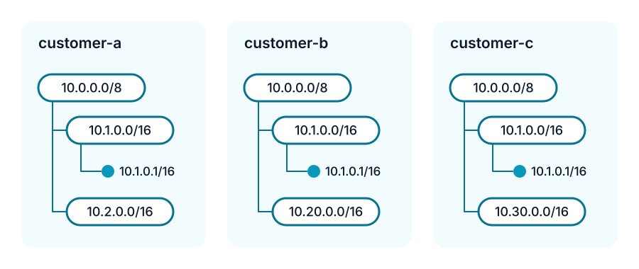

import Tabs from '@theme/Tabs';
import TabItem from '@theme/TabItem';
import VideoPlayer from '../../src/components/VideoPlayer';

An IP namespace is a separate IP address space. Prefixes and addresses in one namespace are independent of those in another, so the same prefix can exist in several namespaces, each with its own tree and its own utilization figures. With namespaces, you track networks whose address ranges overlap in one Infrahub instance, such as the networks of the customers of a managed service.

<center>
  <VideoPlayer url='https://www.youtube.com/watch?v=T5Qiy-13kYg' light />
</center>

## When to create a namespace

Create a namespace when the address space you track overlaps, or must be kept separate so that the same values can exist twice:

- Customers of a managed service who each use `10.0.0.0/8` in their own network.
- A lab or a disaster recovery network that reuses the addressing of production.

Do not create a namespace only to record who owns a prefix. To record which customer, business unit, region or data center a prefix belongs to, relate the prefix to that object. The Marketplace [`infrahub/tenancy`](https://marketplace.infrahub.app/schemas/infrahub/tenancy) extension, for example, relates tenants to prefixes and addresses. Each namespace has its own tree and its own utilization figures, the web interface shows one namespace at a time, and a Resource Manager pool allocates from one namespace only.

A deployment that manages a single network or organization usually needs only the `default` namespace.

## Choose between a namespace and a VRF

A VRF and a namespace record different things. A VRF node records the routing instance. A namespace is what allows the same prefix to exist twice: the Marketplace IPAM schema makes prefixes unique within a namespace, so two VRFs that hold the same prefix need two namespaces.

How you combine them depends on how your organization models its networks. Each of these models works with Infrahub:

- One namespace for each VRF. Each VRF has its own tree and its own utilization figures, and every VRF can hold the same prefixes as another.
- Several VRFs in one namespace. A VRF node records each routing instance, and the `vrf` relationship of each prefix records the VRF it belongs to. The VRFs share one tree and one set of utilization figures, and with the Marketplace IPAM schema they cannot hold the same prefix or address twice. A prefix of one VRF inside a prefix of another VRF is accepted and becomes its child: `10.0.128.0/17` of VRF blue is placed under `10.0.0.0/16` of VRF red, and counts in its utilization. The `enforce_unique` attribute of the Marketplace VRF records the intent to keep the prefixes of a VRF unique, and Infrahub does not enforce it.
- A VRF node that is also the namespace. Define a VRF node that inherits from `BuiltinIPNamespace`, and add the VRF attributes to it, such as the route distinguisher. Each VRF is then a namespace, with its own tree, and you manage one node for each VRF instead of two.

![Three models for two VRFs, red and blue. One namespace for each VRF: two namespaces, red and blue, each hold 10.0.0.0/16, and each corresponds to a VRF node. Several VRFs in one namespace: a single namespace, default, holds 10.0.0.0/16, related to VRF red, and 10.1.0.0/16, related to VRF blue, in one tree, so the same prefix cannot exist twice. A VRF node that is also the namespace: the VRF nodes red and blue inherit from BuiltinIPNamespace, have a route distinguisher, and each hold 10.0.0.0/16 in their own tree.](../media/ipam/ipam-vrf-namespace-models.svg)

In the Marketplace [`infrahub/vrf`](https://marketplace.infrahub.app/schemas/infrahub/vrf) extension, the VRF node records the route distinguisher, the import and export route targets, and, through the `vrf` relationship of each prefix, the prefixes that belong to the VRF. It has no relationship to a namespace. The extension includes one as a commented-out example, for when you want to record which namespace each VRF uses.

## The default namespace

Infrahub creates a namespace named `default` when it starts for the first time. A prefix or an address created without a namespace is assigned to `default`. The `default` namespace cannot be deleted.

## Example: overlapping customer address space

A service provider runs managed networks for three customers, and each customer uses `10.0.0.0/8` internally. One namespace cannot hold three copies of the same prefix when prefixes are unique within a namespace. With one namespace per customer, each copy is tracked separately:



Each namespace has its own tree, its own utilization figures and its own addresses. A query filtered on `customer-a` returns only the prefixes and addresses of customer A.

## Create a namespace

<Tabs groupId="method" queryString>
  <TabItem value="web" label="Web Interface" default>

1. In the menu, select **IPAM** → **Namespaces**. You can also select **View all IP namespaces** in the **IP Namespace** selector of the IPAM page.
2. Select **Add IP Namespace**.
3. In the **Create IP Namespace** panel, enter the **Name**, for example `customer-a`, and an optional **Description**.
4. Select **Save**.

</TabItem>

  <TabItem value="graphql" label="GraphQL">

```graphql
mutation {
  IpamNamespaceCreate(data: {
    name: {value: "customer-a"},
    description: {value: "Customer A managed network"}
  }) {
    ok
    object {
      id
    }
  }
}
```

</TabItem>

  <TabItem value="sdk" label="Python SDK">

```python
namespace = await client.create(
    kind="IpamNamespace",
    name="customer-a",
    description="Customer A managed network",
)
await namespace.save()
```

</TabItem>
</Tabs>

## Create a prefix or an address in a namespace

Choose the namespace when you create the prefix or the address. Without one, Infrahub uses `default`.

<Tabs groupId="method" queryString>
  <TabItem value="web" label="Web Interface" default>

In the **Create Prefix** or **Create IP Address** panel, choose the namespace in the **IP Namespace** field.

The field is empty when the panel opens, even when another namespace is selected in the **IP Namespace** selector of the IPAM page. If you leave it empty, Infrahub creates the prefix or the address in `default`.

</TabItem>

  <TabItem value="graphql" label="GraphQL">

Give the namespace by its name in `hfid`, or by its ID in `id`. `id` accepts only the ID of the namespace, not its name.

```graphql
mutation {
  IpamPrefixCreate(data: {
    prefix: {value: "10.0.0.0/8"},
    member_type: {value: "prefix"},
    ip_namespace: {hfid: ["customer-a"]}
  }) {
    ok
    object {
      hfid
    }
  }
}
```

To create an address, use `IpamIPAddressCreate` with `address` in place of `prefix` and `member_type`, and the same `ip_namespace`.

</TabItem>

  <TabItem value="sdk" label="Python SDK">

Give the namespace by its HFID, a list that holds its name:

```python
prefix = await client.create(
    kind="IpamPrefix",
    prefix="10.0.0.0/8",
    member_type="prefix",
    ip_namespace=["customer-a"],
)
await prefix.save()
```

To create an address, create an `IpamIPAddress` with `address` and the same `ip_namespace`.

</TabItem>
</Tabs>

## View one namespace

<Tabs groupId="method" queryString>
  <TabItem value="web" label="Web Interface" default>

The IPAM section of the web interface shows one namespace at a time. Choose the namespace in the **IP Namespace** selector at the top of the tree: Infrahub reloads the tree, the tables and the utilization figures for the selected namespace.

</TabItem>

  <TabItem value="graphql" label="GraphQL">

A query returns prefixes and addresses from every namespace unless you filter on one. Filter with `ip_namespace__name__value`, or with `ip_namespace__ids`:

```graphql
query {
  IpamPrefix(ip_namespace__name__value: "customer-a") {
    edges {
      node {
        prefix { value }
        utilization { value }
      }
    }
  }
}
```

</TabItem>

  <TabItem value="sdk" label="Python SDK">

A query returns prefixes and addresses from every namespace unless you filter on one:

```python
prefixes = await client.filters(kind="IpamPrefix", ip_namespace__name__value="customer-a")
for prefix in prefixes:
    print(prefix.prefix.value, prefix.utilization.value)
```

</TabItem>
</Tabs>

## Move a prefix or an address to another namespace

Change the namespace of the prefix or the address. Infrahub moves only that prefix or address:

- The child prefixes and addresses of a moved prefix stay in the old namespace, under the next prefix there that contains them, or at the top level.
- In the new namespace, Infrahub places the moved prefix or address under the most specific prefix that contains it, or at the top level.

:::warning

Moving a prefix to another namespace does not move the prefixes and addresses under it. After the move, part of the address plan is in one namespace and part in the other. To move a prefix together with everything under it, see [Move a prefix with everything under it](#move-a-prefix-with-everything-under-it).

:::

<Tabs groupId="method" queryString>
  <TabItem value="web" label="Web Interface" default>

Open the prefix or the address, select **Edit**, choose the new namespace in **IP Namespace**, and save.

</TabItem>

  <TabItem value="graphql" label="GraphQL">

Identify the prefix by its ID in `id`:

```graphql
mutation {
  IpamPrefixUpdate(data: {
    id: "<prefix-id>",
    ip_namespace: {hfid: ["customer-b"]}
  }) {
    ok
  }
}
```

To move an address, use `IpamIPAddressUpdate` with the same `id` and `ip_namespace` fields.

</TabItem>

  <TabItem value="sdk" label="Python SDK">

```python
prefix = await client.get(
    kind="IpamPrefix",
    prefix__value="10.0.0.0/8",
    ip_namespace__name__value="customer-a",
)
prefix.ip_namespace = ["customer-b"]
await prefix.save()
```

To move an address, get the `IpamIPAddress` and set its `ip_namespace` in the same way.

</TabItem>
</Tabs>

### Move a prefix with everything under it

To move a prefix together with every prefix and address under it, change the namespace of each one. The following Python SDK function reads the prefix, the prefixes under it and their addresses, and moves each of them to the target namespace:

```python
async def move_subtree(client, prefix: str, source: str, target: str, branch: str) -> None:
    root = await client.get(
        kind="IpamPrefix",
        prefix__value=prefix,
        ip_namespace__name__value=source,
        include=["descendants"],
        branch=branch,
    )
    prefix_ids = [root.id, *(related.id for related in root.descendants.peers)]
    prefixes = await client.filters(kind="IpamPrefix", ids=prefix_ids, branch=branch)
    addresses = await client.filters(kind="IpamIPAddress", ip_prefix__ids=prefix_ids, branch=branch)
    for node in [*prefixes, *addresses]:
        node.ip_namespace = [target]
        await node.save()


await move_subtree(client, prefix="10.0.0.0/8", source="customer-a", target="customer-b", branch="move-customer-a")
```

Infrahub places each prefix and address in the tree of the target namespace as it is moved, so the moved prefixes and addresses keep the same parents there.

Create the branch before you run the function, and review the result in a Proposed Change. If the target namespace already holds one of the values, Infrahub rejects that change, and the function stops after it has moved only part of the prefixes and addresses. You can then delete the branch instead of moving them back one by one.

## Delete a namespace

:::warning

When you delete a namespace, Infrahub deletes every prefix and every address in it. The `default` namespace cannot be deleted.

:::

<Tabs groupId="method" queryString>
  <TabItem value="web" label="Web Interface" default>

Select **IPAM** → **Namespaces** in the menu, and select the namespace to open it. Then select **Actions** → **Delete**, and confirm with **Delete**.

</TabItem>

  <TabItem value="graphql" label="GraphQL">

Identify the namespace by its ID in `id`:

```graphql
mutation {
  IpamNamespaceDelete(data: {id: "<namespace-id>"}) {
    ok
  }
}
```

</TabItem>

  <TabItem value="sdk" label="Python SDK">

```python
namespace = await client.get(kind="IpamNamespace", name__value="customer-a")
await namespace.delete()
```

</TabItem>
</Tabs>

## Next

- [Manage prefixes and addresses](./manage-prefixes-and-addresses.mdx) — Create, change and delete prefixes and addresses within a namespace
- [Allocate IPs and prefixes](./allocate-ips-and-prefixes.mdx) — Allocate from a pool, which draws from one namespace
- [Plan changes on a branch](./plan-changes-on-a-branch.mdx) — Review a namespace change before it is merged
