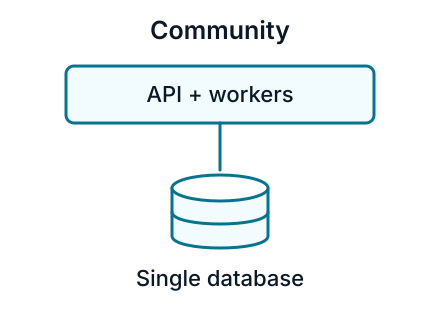
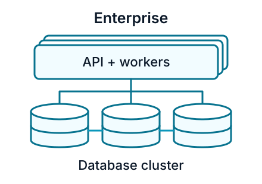

# Community vs enterprise

Infrahub Community provides the open-source platform under the Apache 2.0 license. Enterprise adds performance optimizations, high availability, additional security controls, and professional support under a commercial license.

**Both editions include the core data and automation features.** The choice depends on how you operate Infrahub: your workload, availability requirements, approval policies, and support needs.

## What both editions include

- **Data modeling:** Custom schemas, relationships, validation, and Resource Manager for allocating resources such as IP addresses.
- **Version control:** Branches, diffs, history, Proposed Changes, and checks before merging.
- **Automation:** Git integration, Generators that create or update objects, and Jinja2 or Python Transformations that render data into artifacts.
- **Access:** Web UI, APIs, local accounts, single sign-on (SSO) through OIDC or OAuth2, and role-based access control (RBAC).

See [key concepts](./concepts.mdx) for an introduction to these features.

## What changes with enterprise

| Area | Community | Enterprise |
|------|-----------|------------|
| License | Free, open source (Apache 2.0) | Commercial |
| Database | Neo4j Community | Neo4j Enterprise, with clustering support |
| Performance | Standard processing | Optimizations for larger datasets and automation workloads |
| High availability | Single database instance | Redundant deployment options across platform components |
| Deployment | Docker Compose or Kubernetes | Docker Compose, Kubernetes, or bare metal |
| Change approvals | Review Proposed Changes | Also enforce required approvals and revoke approvals when a branch changes |
| Authentication | Local accounts and SSO | Also authenticate directly against an LDAP directory |
| Log export | In-app activity log | Also forward audit events and application logs via syslog |
| Releases | Community releases | Hardened releases |
| Support | Community assistance, without guaranteed response times | Support backed by a service-level agreement (SLA); optional 24/7 coverage |

:::info Enterprise controls

Change approvals, LDAP authentication, and log forwarding require configuration. See [change approvals](../change-approval/change-approval-workflow.mdx), [LDAP authentication](../deploy-manage/user-management/ldap/overview.mdx), and [log forwarding](../deploy-manage/run-observe/log-forwarding/overview.mdx).

:::

## Scale and availability

Community uses a single Neo4j database instance. Enterprise supports a clustered database and redundant application services for deployments that must tolerate component failures.

  

  

  

  

These diagrams show the application and graph database. A [full high availability deployment](../deploy-manage/install-configure/production-deployment/high-availability.mdx) also requires redundancy for the cache, message bus, task manager database, and load balancers. Installing Enterprise alone does not configure high availability.

:::info Sizing Infrahub

Device count is a sizing guide, not an edition limit. Capacity also depends on schema complexity, relationships, data history, and automation activity. Test representative imports, queries, and merges with your own data. See [hardware requirements](../deploy-manage/install-configure/hardware-requirements.mdx) for resource allocations and [OpsMill pricing](https://opsmill.com/pricing/) for current Enterprise packages.

:::

## Choose an edition

  

    

      

        <h3>Community</h3>
      

      

        
Choose Community when your team can operate and troubleshoot the platform, community support meets your needs, and a single database instance is acceptable. It supports production use as well as learning, development, and testing.

      

      

        <a className="button button--secondary button--block" href="https://discord.gg/opsmill">Join the community</a>
        <a className="button button--primary button--block margin-top--sm" href="./quickstart">Start the quickstart</a>
      

    

  

  

    

      

        <h3>Enterprise</h3>
      

      

        
Choose Enterprise when you need required change approvals, LDAP, syslog forwarding, high availability, performance optimizations, or guaranteed support response times.

        
If Enterprise is your intended production edition, evaluate it directly with representative data and automation. A Community trial does not demonstrate Enterprise performance.

        
See <a href="../deploy-manage/install-configure/install/enterprise">Enterprise installation</a> to get started.

      

      

        <a className="button button--primary button--block" href="https://cal.com/team/opsmill/meet">Talk to OpsMill</a>
      

    

  

## Moving to enterprise

Enterprise uses the same schema and core data model as Community. You can retain your modeling and automation approach while adopting Enterprise capabilities.

Plan the transition with OpsMill around your current version, database, and target deployment. Take a backup, test the transition, and agree on a maintenance window. Changes to the database edition or topology need deployment planning.

For licensing, support options, and evaluation terms, see [OpsMill pricing](https://opsmill.com/pricing/). For community questions, join [Discord](https://discord.gg/opsmill).
