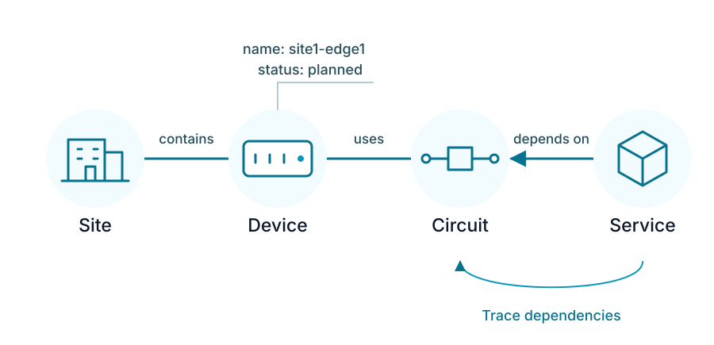
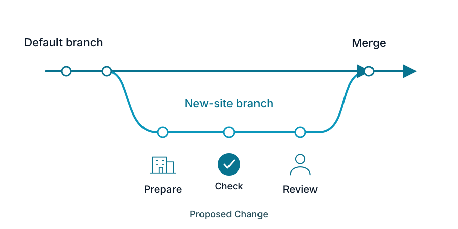
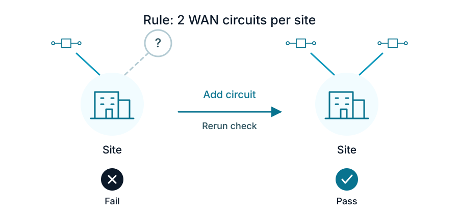
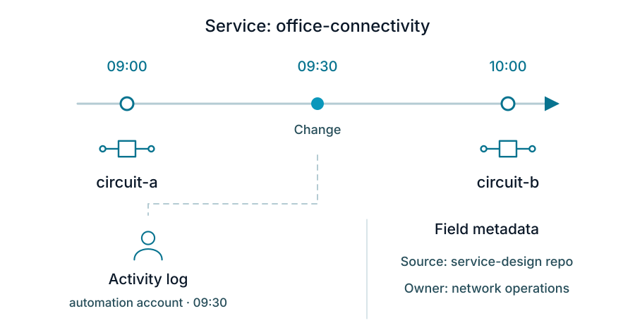
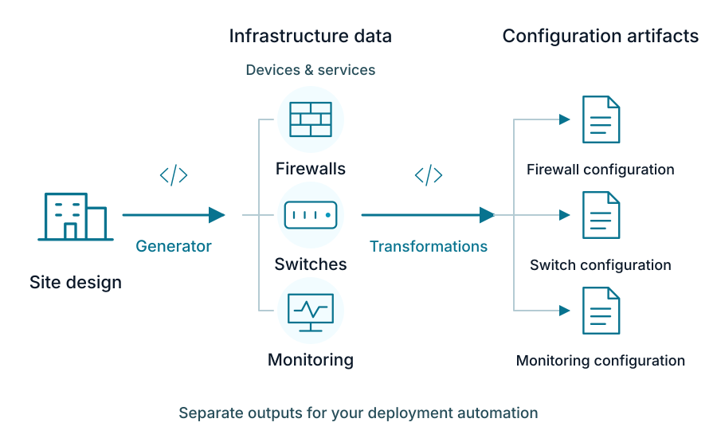
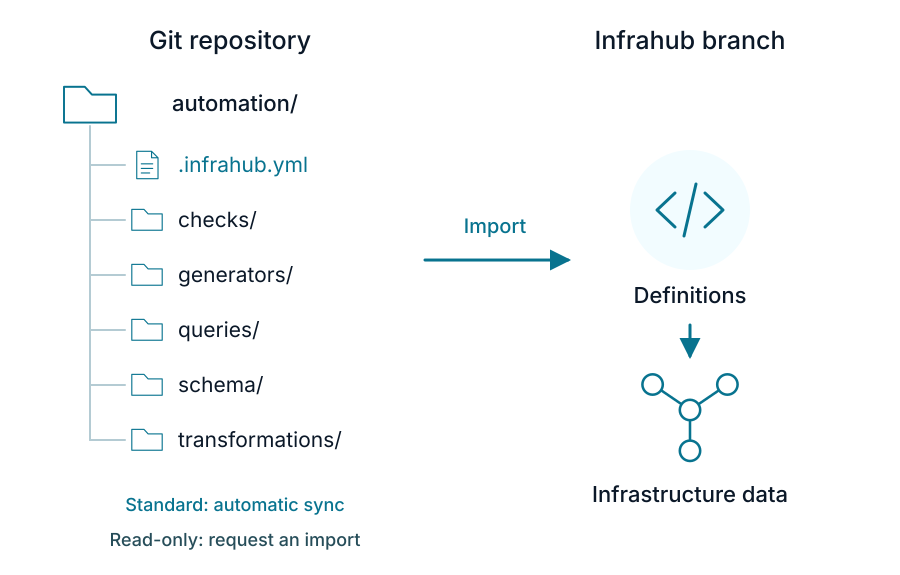

Infrahub stores infrastructure data and its relationships, versions changes, and generates outputs for your automation. You can describe a new site, review its devices and addressing before deployment, and produce configurations from the same data.

## Connected data and a flexible schema

An **object** represents something you manage: a site, device, circuit, or service. **Attributes** describe it, such as a device's name or status. **Relationships** connect objects, such as a device to its site or a service to its circuit. Together, these objects and relationships form a **graph**.

:::info
These connections make the data useful beyond an inventory. You can find the services that depend on a circuit before planning its replacement.
:::

The **schema** defines the kinds of objects you can create, their attributes, relationships, and validation rules. You define it in YAML to match your infrastructure and business, including concepts such as customers or service tiers. Infrahub generates the web UI and API endpoints from that schema.

Start with your existing model or [define a schema](../schema/overview.mdx), then evolve it as your requirements change.

## Branches and Proposed Changes

A **branch** is a separate version of your infrastructure data, schema, and artifacts.

:::info
For a new site, you can prepare devices, addressing, and schema changes on a branch while others continue working on the default branch.
:::

A **Proposed Change** is the review of a branch before merging, similar to a pull request. Reviewers can inspect differences, discuss changes, and examine validation results. Merging applies the changes to the default branch.

[Branches](../branches/overview.mdx) isolate branch-aware data. You can also define [shared data](../schema/branch-awareness.mdx) that stays the same across branches, such as an IP address Resource Pool.

## Validation before merge

Schema rules describe valid data: required attributes, allowed values, and relationships. [Checks](../checks/overview.mdx) add your business and infrastructure design rules in Python, such as requiring two WAN circuits for every site. This can flag a design that leaves a site dependent on a single connection.

:::info
Checks run as part of a [Proposed Change](../proposed-changes/overview.mdx), so reviewers can catch a missing backup connection before approving a site design. Finding that gap before deployment helps reduce the risk of an outage that interrupts business operations.
:::

## History and data ownership

[Immutable history](../immutable-history/overview.mdx) records earlier versions of objects, attributes, and relationships. The [Activity log](../deploy-manage/run-observe/activity-log.mdx) records operations, including who changed an object and when.

[Data lineage](../objects/metadata.mdx) describes where a value came from and who owns it. You can record source and owner metadata on individual attributes and relationships, which is useful when people and external systems maintain different parts of the same device record.

:::info
You can query a past state to investigate which circuit a service used before a change, then use the Activity log to identify who changed it and when.
:::

## Reusable definitions and resource allocation

When adding another site, some details repeat and others must be unique. These concepts address different parts of that work:

| Concept | Example use |
| --- | --- |
| [Object Templates](../object-templates/overview.mdx) | Create a switch with its standard set of interfaces. Later template edits do not change existing objects. |
| [Profiles](../profiles/overview.mdx) | Share interface settings across switches. Updating a Profile updates inherited values, while explicit overrides remain. |
| [Groups](../groups/overview.mdx) | Select the devices that a check, Generator, or artifact definition targets. |
| [IPAM](../ipam/overview.mdx) | Model IP prefixes and addresses and their relationships to your infrastructure. |
| [Resource Manager](../resource-manager/overview.mdx) | Allocate addresses, prefixes, or numbers such as VLAN IDs from defined pools. |

## Generators, Transformations and Artifacts

A [Generator](../generators/overview.mdx) runs your **Python logic to create or update objects** and relationships in Infrahub. For example, a Generator can turn a site design into firewall and switch devices, their networks, and monitoring services according to your rules.

A [Transformation](../transformations/overview.mdx) **converts queried data into an output format** using Jinja2 or Python. It can produce a device configuration, an automation inventory or a report. An [artifact](../artifacts/overview.mdx) is a **stored output for a particular target**, available for review and retrieval.

The distinction is the output: Generators change the data model's objects; Transformations produce content from that data.

## Git integration

An external Git repository stores the files that define your automation: schemas, GraphQL queries, Generators, Transformations, and Checks. In the repository, [`.infrahub.yml`](../git-integration/infrahub-yml.mdx) declares which resources Infrahub imports and how they connect: which query a Transformation reads, which objects a Generator targets, or which checks validate a change.

With a standard **Repository** connection, Infrahub automatically imports updates from Git into corresponding Infrahub branches. For a new site, you can change a configuration template in Git and add devices on the matching Infrahub branch, then review the resulting data and artifacts in a Proposed Change. When the branch is configured to **sync with Git, merging in Infrahub also merges the linked Git branch.**

A **Read-only Repository** connection imports a selected branch, tag, or commit. You **request updates explicitly**; Infrahub does not poll it or write back to Git.

:::info
Choose a Read-only Repository connection when you want to control when new automation code is imported.
:::

Git versions the files; Infrahub versions the infrastructure data. Editing a device in Infrahub does not write that device back to Git. See [Git integration](../git-integration/overview.mdx) to choose a connection and configure synchronization.

## External automation

External tools can query data through the [GraphQL API](../development-resources/graphql/overview.mdx) and retrieve artifacts for deployment through the REST API. [Events](../events/overview.mdx) and [webhooks](../webhooks/overview.mdx) connect changes in Infrahub to other workflows, such as notifying an automation pipeline after a merge.

Merging updates the data in the main branch of Infrahub. Infrahub does not deploy configurations. An external deployment tool that you operate, such as an Ansible playbook or a CI/CD pipeline, controls when and how they are applied to infrastructure.

## Try it

[Explore Infrahub](./explore.mdx) to view objects, relationships, and branches in the web UI, or [build your first schema](../learn/tutorials/build-your-first-schema.mdx) to model your own infrastructure.
