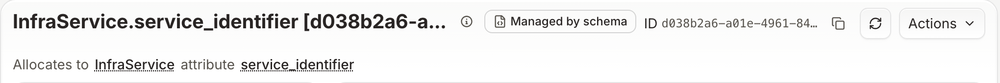

# How to migrate number pools to `ranges`

With Infrahub version 1.12, a number pool can hold several weighted ranges. `start_range` and
`end_range` are deprecated in favor of `ranges`. They still work as a way to declare a single
range, and will be removed in a later version.

What you migrate depends on how the pool was created:

- **Schema pools.** Infrahub creates one pool for each `NumberPool` attribute of
  your schema and sets its ranges from the attribute's `parameters`. You change these ranges only in
  the schema. Follow [Migrate schema pools](#migrate-schema-pools).
- **User pools.** Every other number pool, created in the web interface, with a GraphQL
  mutation or with the Python SDK. You change their ranges on the pool. Follow
  [Migrate user pools](#migrate-user-pools).

To find out which kind a pool is, go to **Object Management** → **Resource Managers** and open the
pool. The page of a schema pool shows a **Managed by schema** tag next to the pool name:



In GraphQL and the Python SDK, the pool's `pool_type` is `Schema` for a schema pool and `User` for a
user pool.

For both kinds of pools, [upgrade infrahubctl and the Python SDK](#upgrade-infrahubctl-and-the-python-sdk)
and [update the scripts that read pools](#update-scripts-that-read-pools).

:::info

What the upgrade changes:

- **All pools:** Each pool holds one range with the bounds of its former `start_range` and
  `end_range`, and keeps the numbers it allocated.
- **All pools:** Infrahub refuses a change to a pool's ranges that leaves an allocated number
  outside every range, and lists the objects that hold those numbers.
- **Schema pools:** A schema load that uses `start_range` or `end_range` returns a
  deprecation warning.
- **Schema pools:** The first schema load after the upgrade reports a change on each
  `NumberPool` attribute that declares only `start_range` or only `end_range`. The change is
  expected, and the pool allocates from the same numbers.

:::

<details>
<summary>Schema used in this guide</summary>

The examples use the following schema. Infrahub creates a pool for the `NumberPool` attribute
`service_identifier`. For the `Number` attribute `vlan_id`, you create a pool yourself.
Adapt the type names to match your own schema.

```yaml
nodes:
  - name: Service
    namespace: Infra
    display_label: "{{ name__value }}"
    attributes:
      - name: name
        kind: Text
        unique: true
      - name: service_identifier
        kind: NumberPool
        read_only: true
        parameters:
          start_range: 100
          end_range: 4094
  - name: VLAN
    namespace: Ipam
    attributes:
      - name: name
        kind: Text
        unique: true
      - name: vlan_id
        kind: Number
        parameters:
          min_value: 1
          max_value: 4094
```

</details>

## Upgrade infrahubctl and the Python SDK

With Infrahub 1.12, use `infrahub-sdk` version 1.24.0 or later:

```shell
pip install --upgrade 'infrahub-sdk[ctl]>=1.24.0'
```

Earlier versions do not support `ranges`, and the SDK can create a pool with the wrong ranges without
an error.

## Migrate schema pools

### Step 1: Update schema files

In the `parameters` of each `NumberPool` attribute, replace `start_range` and `end_range` with
`ranges`. Each range has a `start` and an `end`, both included and both optional, and an optional
`weight`.

#### Both bounds

**Before:**

```yaml
parameters:
  start_range: 100
  end_range: 4094
```

**After:**

```yaml
parameters:
  ranges:
    - start: 100
      end: 4094
```

#### One bound

Declare only the bound that the old declaration sets:

**Before:**

```yaml
parameters:
  start_range: 100
```

**After:**

```yaml
parameters:
  ranges:
    - start: 100
```

Infrahub stores no value for the missing bound. A range without a `start` begins at `1`, and a range
without an `end` stops at the largest number Infrahub supports. The pool page shows that number as
`MAX`.

#### Several ranges

The range with the highest `weight` is allocated first. A missing weight counts as `0`; on a tie,
the lowest `start` comes first. Nothing between two ranges is allocated.

```yaml
parameters:
  ranges:
    - start: 100
      end: 199
      weight: 100
    - start: 300
      end: 399
```

#### No range

For an attribute that declares neither `ranges` nor `start_range` / `end_range`, Infrahub creates a
pool with one range without a start or an end. The range runs from `1` to the largest number Infrahub
supports, like the default range before 1.12. When a later load declares neither, the pool keeps the
ranges it holds.

With `ranges: []`, Infrahub creates a pool that allocates nothing, or removes every range from an
existing pool. The load is refused while an object holds a number from the pool.

#### Refused declarations

| Declaration | Error |
|---|---|
| `start_range` or `end_range` with `ranges` | `start_range/end_range cannot be combined with ranges` |
| Overlapping ranges | `Range 100 - 200 overlaps 150 - 300` |
| `end` lower than `start` | `Range end (200) cannot be lower than start (300)` |
| A range shortened below a number already allocated, for example `100`–`200` changed to `100`–`100` while `101` is allocated | `Attribute-level 'number_pool' constraint violation on schema 'InfraService'. Node (<SERVICE-NAME>) is not compliant. The error relates to field service_identifier=101.` |

### Step 2: Apply schema changes

If you're using Git integration, commit the changes and let Infrahub import them.

If you're using `infrahubctl`:

1. Check the schema:

   ```shell
   infrahubctl schema check path/to/your/schema/files
   ```

2. Load it on the default branch:

   ```shell
   infrahubctl schema load path/to/your/schema/files
   ```

The load returns a deprecation warning for each attribute still using `start_range` or `end_range`.

A schema pool is shared by every branch, and Infrahub sets its ranges from the schema of the default
branch. When you load a range change on another branch, Infrahub accepts the load, but the pool keeps
its current ranges until you merge the branch into the default branch.

:::success
If the load returns no deprecation warning and every `NumberPool` attribute declares `ranges`,
your schema files are migrated.
:::

### Change schema pool ranges only in the schema

Infrahub refuses a change to the ranges of a schema pool made with a GraphQL mutation or with the
Python SDK:

- Setting `start_range` or `end_range` on the pool: `start_range or end_range can't be updated on
  schema defined pools, update the schema in the default branch instead`.
- Setting `ranges` on the pool, or creating, changing or deleting one of its `CoreNumberPoolRange`
  objects: `ranges can't be updated on schema defined pools, update the schema in the default branch
  instead`.

## Migrate user pools

### In GraphQL scripts

In GraphQL, the weight is `allocation_weight`.

#### Create a pool

**Before:**

```graphql
mutation {
  CoreNumberPoolCreate(
    data: {
      name: {value: "VLAN ID pool"}
      node: {value: "IpamVLAN"}
      node_attribute: {value: "vlan_id"}
      start_range: {value: 100}
      end_range: {value: 1000}
    }
  ) {
    ok
  }
}
```

**After:**

```graphql
mutation {
  CoreNumberPoolCreate(
    data: {
      name: {value: "VLAN ID pool"}
      node: {value: "IpamVLAN"}
      node_attribute: {value: "vlan_id"}
      ranges: [{start: 100, end: 1000}]
    }
  ) {
    ok
  }
}
```

A range can leave out `start` or `end`, for example `ranges: [{start: 100}]`. Infrahub reads the
missing bound from the attribute the pool allocates for:

- A range without a `start` begins at the attribute's `min_value`, or at `1` when the attribute has
  no `min_value` or a `min_value` below `1`.
- A range without an `end` stops at the attribute's `max_value`, or at the largest number Infrahub
  supports when the attribute has no `max_value`.

When a `CoreNumberPoolCreate` sends none of `ranges`, `start_range` and `end_range`, Infrahub creates
the pool with one range without a start or an end. The account that sends the mutation needs the
permission to create `CoreNumberPoolRange` objects. To create a pool that holds no range, send
`ranges: []`.

#### Update a pool

`ranges` replaces all the pool's ranges. A range with the same bounds as a stored one keeps its
weight unless `allocation_weight` is set. `ranges: []` removes every range.

```graphql
mutation {
  CoreNumberPoolUpdate(
    data: {
      id: "<POOL-ID>"
      ranges: [
        {start: 100, end: 199, allocation_weight: 100}
        {start: 300, end: 399}
      ]
    }
  ) {
    ok
  }
}
```

Each range must stay within the `min_value` and `max_value` of the attribute the pool allocates
for. With `min_value: 1` and `max_value: 4094` on `vlan_id`, a range from `100` to `5000` is refused.
A range that starts below `min_value` is refused the same way.

### In Python SDK scripts

The SDK takes the same fields as GraphQL: each range is a dictionary with `start`, `end` and
`allocation_weight`, any of which can be left out.

#### Create a pool

**Before:**

```python
pool = await client.create(
    kind="CoreNumberPool",
    name="VLAN ID pool",
    node="IpamVLAN",
    node_attribute="vlan_id",
    start_range=100,
    end_range=1000,
)
await pool.save()
```

**After:**

```python
pool = await client.create(
    kind="CoreNumberPool",
    name="VLAN ID pool",
    node="IpamVLAN",
    node_attribute="vlan_id",
    ranges=[{"start": 100, "end": 1000}],
)
await pool.save()
```

#### Update a pool

To replace all the ranges of an existing pool, declare the pool with its complete list of ranges
and save it with `allow_upsert=True`. Infrahub finds the pool by its name, keeps the ranges whose
bounds match, creates the new ones and deletes the others.

```python
pool = await client.create(
    kind="CoreNumberPool",
    name="VLAN ID pool",
    node="IpamVLAN",
    node_attribute="vlan_id",
    ranges=[
        {"start": 100, "end": 199, "allocation_weight": 100},
        {"start": 300, "end": 399},
    ],
)
await pool.save(allow_upsert=True)
```

To add, change or delete a single range, create, update or delete the matching
`CoreNumberPoolRange` object:

```python
pool = await client.get(kind="CoreNumberPool", name__value="VLAN ID pool")

new_range = await client.create(kind="CoreNumberPoolRange", start=3000, end=3999, pool=pool)
await new_range.save()

new_range.allocation_weight.value = 50
await new_range.save()

await new_range.delete()
```

:::warning

Do not change ranges with `add()`, `extend()` or `remove()` on the pool's `ranges` relationship.
The `CoreNumberPool` mutations accept ranges as bounds, not as references to `CoreNumberPoolRange`
objects.

:::

### How `start_range` and `end_range` behave on writes

Existing scripts that set `start_range` and `end_range`, in GraphQL or with the SDK, keep working
while each pool holds one range, which is the case for every user pool after the upgrade.

- On a pool with one range, setting `start_range` or `end_range` changes the bounds of that range,
  for example `end_range: 299` changes `100`–`199` to `100`–`299`. The bound you leave out keeps its
  value, and setting a bound to null removes it from the range.
- On a pool with several ranges, setting either field is refused. The error lists the ranges to edit
  instead.
- A request that creates a pool can set `start_range` alone or `end_range` alone. The range then has
  no value for the other bound.

## Update scripts that read pools

This section applies to schema pools and user pools.

### In GraphQL

**Before:**

```graphql
query {
  CoreNumberPool(ids: ["<POOL-ID>"]) {
    edges {
      node {
        start_range { value }
        end_range { value }
      }
    }
  }
}
```

**After:**

```graphql
query {
  CoreNumberPool(ids: ["<POOL-ID>"]) {
    edges {
      node {
        ranges {
          edges {
            node {
              start { value }
              end { value }
              allocation_weight { value }
            }
          }
        }
      }
    }
  }
}
```

`start` and `end` return null for a range without that bound.

Reading the deprecated fields:

- On a pool with one range, `start_range` and `end_range` return the bounds of that range, and null
  for a bound the range leaves out.
- On a pool with zero or several ranges, both return null.

### With the Python SDK

```python
pool = await client.get(kind="CoreNumberPool", name__value="VLAN ID pool", include=["ranges"])
await pool.ranges.fetch()
for pool_range in pool.ranges.peers:
    print(pool_range.peer.start.value, pool_range.peer.end.value, pool_range.peer.allocation_weight.value)
```

`start.value` and `end.value` are `None` for a range without that bound.

## Related resources

- [Number pools in the schema](../../schema/number-pool): declare a `NumberPool` attribute and the
  ranges of its pool.
- [Allocate numbers](../../resource-manager/allocate-number): create a number pool and allocate
  numbers from it.
- [Weighted allocation](../../resource-manager/weighted-allocation): set the order in which IP
  address and IP prefix pools allocate their resources.
