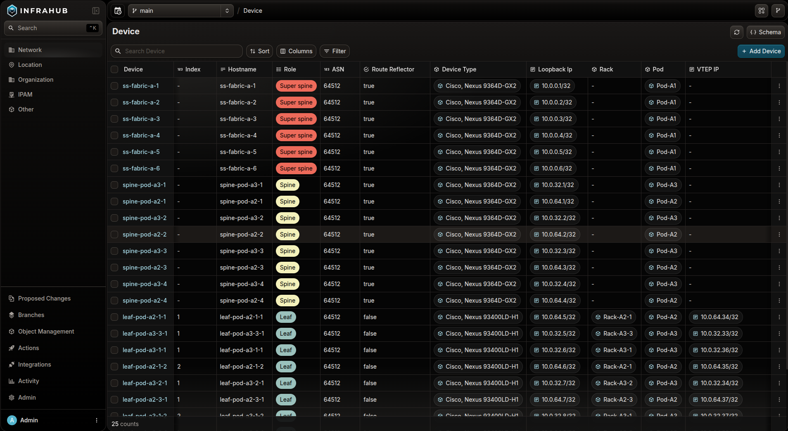
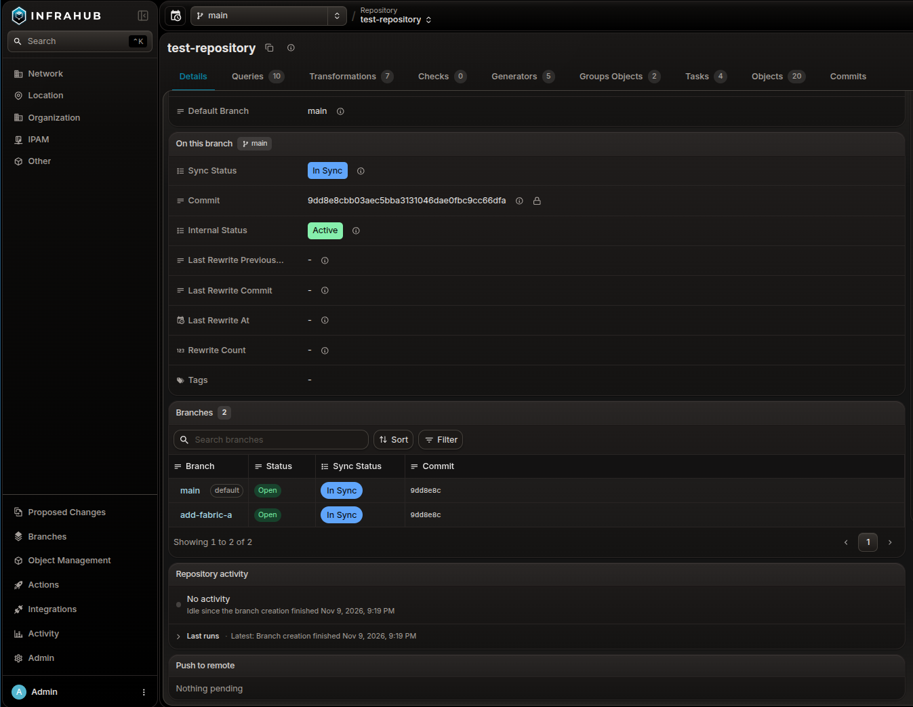
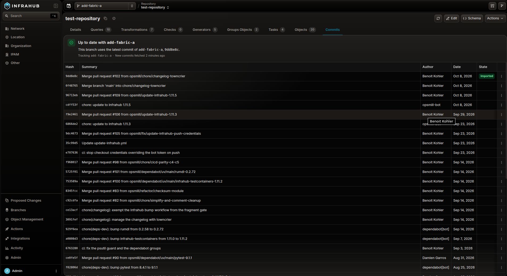
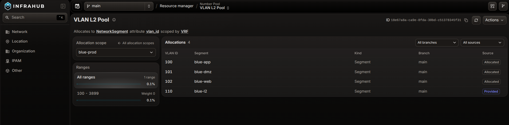

<table>
  <tbody>
    <tr>
      <th>Release Number</th>
      <td>1.12.0</td>
    </tr>
    <tr>
      <th>Release Date</th>
      <td>November, 10th 2026</td>
    </tr>
    <tr>
      <th>Tag</th>
      <td>[infrahub-v1.12.0](https://github.com/opsmill/infrahub/releases/tag/infrahub-v1.12.0)</td>
    </tr>
  </tbody>
</table>

Infrahub 1.12 focuses on how Infrahub works with your Git repositories. Before you merge an Infrahub branch, you can check which commit it imported from each repository and whether the import succeeded. If Infrahub cannot push a merge back to Git, you can view the cause and retry. The release also changes how number pools allocate numbers, reduces the processing after large merges, adds tracing for slow automation, and introduces dark mode as an alpha.

This release contains breaking changes that need action before you upgrade. See [Before you upgrade](#before-you-upgrade).

## Release highlights

- **[Review changes to automation and data together with greater confidence](#review-and-troubleshoot-git-repository-changes).** Verify that schemas, templates, Transformations, and Generator definitions have been imported successfully from Git before merging an Infrahub branch. If synchronization fails, you can identify the cause and recover while continuing to test changes on other branches.
- **[Automate on the infrastructure you already operate](#allocate-new-numbers-while-preserving-existing-assignments).** Record the numbers your objects already hold in a number pool and allocate new numbers alongside them. A pool can now contain multiple ranges and keep a separate allocation sequence for each site or other scope.
- **[Keep making changes efficiently as your infrastructure grows](#merge-and-review-large-changes-with-fewer-delays).** Reduce the processing required to update computed attributes and validate large Proposed Changes, and [trace slow Generators, Transformations, and API requests](#diagnose-api-response-times-and-automation-delays) to identify where time is spent.
- **[Work in dark mode (alpha)](#announcing-dark-mode).** Choose a dark appearance or match your operating system's theme.

## Before you upgrade

Review the [breaking changes and required actions](#breaking-changes-and-required-actions), particularly if you use any of the following:

| If you use… | Preparation |
|---|---|
| Generators that manage objects | Before upgrading, update each Generator to save every object it must retain on every run, including unchanged objects. |
| Git repositories that define objects | Before upgrading, restore any removed object files and their `objects:` entries if you want to retain those objects in Infrahub. |
| SSO with existing accounts | Link existing accounts to their SSO identities before the account-name fallback default changes. |
| Experimental NATS drivers | Before upgrading, replace the NATS message broker with RabbitMQ and the NATS cache with Redis. |
| Number pools for unique attributes | Before allocating numbers after upgrading, record existing assignments in their pools and resolve overlapping pool ranges. |
| Local `infrahubctl` commands | Before running Generators, Transformations, or checks after upgrading, select the intended Infrahub branch explicitly or enable selection from your current Git branch. |

## Announcing Dark Mode

You can now work in Infrahub in dark mode or match your operating system's appearance. The [**Theme** menu](https://github.com/opsmill/infrahub/blob/99b0f19f17b674642d757506a9438bb4c3db4032/docs/docs/faq/faq.mdx#does-the-web-interface-have-a-dark-theme) in your account offers **Dark**, **Light**, and **System**. Dark mode is available as an alpha; some pages may still display incorrect colors.

## Review and troubleshoot Git repository changes

Before merging an Infrahub branch, you can now confirm that it successfully imported the intended changes to schemas, templates, and automation definitions stored in a connected Git repository. If the merge completes in Infrahub but updating Git fails, you can also resolve that error without repeating the Infrahub merge.

- **Resolve repository import errors before merging.** Compare [the imported commit and import status](https://github.com/opsmill/infrahub/blob/99b0f19f17b674642d757506a9438bb4c3db4032/docs/docs/git-integration/branch-synchronization.mdx#checking-a-repositorys-status-on-every-branch) across Infrahub branches on the repository page. When reviewing a Proposed Change, failed or incomplete imports now appear in its checks, with the affected repository and correction needed. A merge fails until [required imports succeed](https://github.com/opsmill/infrahub/blob/99b0f19f17b674642d757506a9438bb4c3db4032/docs/docs/branches/merge.mdx#before-the-merge-starts-repository-imports).
- **Complete the Git update after an Infrahub merge.** You can now inspect why the connected Git repository could not be updated and [retry after correcting the cause](https://github.com/opsmill/infrahub/blob/99b0f19f17b674642d757506a9438bb4c3db4032/docs/docs/git-integration/branch-synchronization.mdx#retry-the-pending-pushes). Alternatively, abandon the Git update while keeping the completed Infrahub merge. Temporary failures are retried automatically.
- **Review new Git commits before importing them into Infrahub.** For read-only repositories, automatic checks make new commits available to review in the [**Commits** tab](https://github.com/opsmill/infrahub/blob/99b0f19f17b674642d757506a9438bb4c3db4032/docs/docs/git-integration/overview.mdx#commits-tab). Choose when to import them; until then, Infrahub uses the previously imported version.
- **Continue working on other branches while correcting an import error.** Errors in one Git branch's schema, object data files, or GraphQL queries no longer stop imports from other Git branches.
- **Continue using a Git branch after rebasing it.** Rebased or force-pushed branches in connected read-write repositories now import without the false merge conflicts that previously interrupted synchronization.

## Allocate new numbers while preserving existing assignments

Allocate numbers to objects alongside the numbers already in use in your infrastructure. You can now [record existing assignments in a number pool](https://github.com/opsmill/infrahub/blob/99b0f19f17b674642d757506a9438bb4c3db4032/docs/docs/resource-manager/track-existing-numbers.mdx) without changing their values. The pool marks those numbers as used and excludes them when allocating new ones.

- **Assign a specific number from a pool.** You can now [choose the number an object receives](https://github.com/opsmill/infrahub/blob/99b0f19f17b674642d757506a9438bb4c3db4032/docs/docs/resource-manager/allocate-number.mdx#request-a-specific-number) instead of taking the next available number. The pool records the assignment and excludes that number from subsequent allocations.
- **Allocate around gaps in your numbering plan.** A pool can now contain [multiple ranges](https://github.com/opsmill/infrahub/blob/99b0f19f17b674642d757506a9438bb4c3db4032/docs/docs/resource-manager/allocate-number.mdx#change-the-ranges-of-a-pool), such as 100–199 and 300–399, leaving 200–299 outside automatic allocation. You can also choose which range the pool uses first.
- **Reuse the same numbers across sites or other scopes from one pool.** [Allocation scopes](https://github.com/opsmill/infrahub/blob/99b0f19f17b674642d757506a9438bb4c3db4032/docs/docs/resource-manager/allocate-numbers-per-scope.mdx) let one pool keep a separate allocation sequence for each value of an attribute or relationship you choose, such as the site an object belongs to. The pool can assign the same number to objects at different sites without allocating it twice within one site.
- **Identify where more numbers are needed.** You can now [check how much of each range or allocation scope is in use](https://github.com/opsmill/infrahub/blob/99b0f19f17b674642d757506a9438bb4c3db4032/docs/docs/resource-manager/allocate-number.mdx#view-how-much-of-a-pool-is-in-use) to decide where to expand a pool. You can also view which object holds each number and on which branch.

## Merge and review large changes with fewer delays

When you change data across a large infrastructure, you can review and merge your changes with fewer delays from recalculating computed attributes and running checks.

- **Get updated computed attribute values sooner after a merge or rebase.** Merges and rebases now recalculate each affected [Python computed attribute](https://github.com/opsmill/infrahub/blob/99b0f19f17b674642d757506a9438bb4c3db4032/docs/docs/computed-attributes/overview.mdx#python-computed-attribute) in batches of objects, instead of starting one task for every changed object. In a test merge of an AI data center fabric with 1,504 interfaces, this took 7 tasks instead of 1,504 on Infrahub 1.11.3, so the values are up to date sooner when you generate artifacts or run Generators. This applies when the attribute's Transformation uses a [query that targets a single object](https://github.com/opsmill/infrahub/blob/99b0f19f17b674642d757506a9438bb4c3db4032/docs/docs/development-resources/graphql/single-target-queries.mdx). Otherwise, Infrahub recalculates the attribute for every object of its kind.
- **Check requirements across large groups of objects with fewer API requests.** Before merging a Proposed Change, you can [check requirements](https://github.com/opsmill/infrahub/blob/99b0f19f17b674642d757506a9438bb4c3db4032/docs/docs/checks/overview.mdx), such as naming conventions, across the objects in your target groups. Previously, the API load of these checks grew with the square of the number of objects in the group. Artifact checks receive the same improvement. Proposed Changes with many checks also finish validation sooner, because Infrahub now reads the state of all running checks together instead of one at a time.
- **Complete artifact checks for large groups of objects.** The CI pipeline of a Proposed Change [generates the artifacts from your branch](https://github.com/opsmill/infrahub/blob/99b0f19f17b674642d757506a9438bb4c3db4032/docs/docs/proposed-changes/overview.mdx#artifact-generation), so you can compare them before merging. For artifact definitions that target about a thousand objects, these artifact checks no longer stay in progress after a connection pool timeout, which blocked the merge.
- **Edit one automation definition without rerunning the others.** When you [change an artifact or Generator definition in `.infrahub.yml`](https://github.com/opsmill/infrahub/blob/99b0f19f17b674642d757506a9438bb4c3db4032/docs/docs/proposed-changes/overview.mdx#understanding-artifact-regeneration), Infrahub now regenerates the artifacts or runs the Generator for that definition only. An edit that changes no definition, such as a comment, regenerates nothing. A definition that still regenerates on any repository file change, or that lists `.infrahub.yml` under `watch.files`, runs on every edit.

## Diagnose API response times and automation delays

When an API request takes longer than expected to return, or a Generator or Transformation takes longer to complete, you can now trace the operation to its database queries and check for waits on task workers or database connections.

- **Find the query behind a slow task.** [Enable tracing](https://github.com/opsmill/infrahub/blob/99b0f19f17b674642d757506a9438bb4c3db4032/docs/docs/deploy-manage/run-observe/own-monitoring.mdx) and follow a Generator or Transformation through its API calls to the database queries in one connected trace. Identify which query accounts for the delay and inspect the related process logs.
- **Investigate capacity constraints and slow queries.** You can now see how long tasks wait to start and how long queries wait for database connections, alongside running tasks and connection usage. Use this information to investigate whether work is waiting for capacity or taking longer to execute, through the [supplied Grafana panels](https://github.com/opsmill/infrahub/blob/99b0f19f17b674642d757506a9438bb4c3db4032/docs/docs/deploy-manage/run-observe/metrics.mdx) or dashboards you configure in your own monitoring system.
- **Capture intermittent problems without restarting.** With tracing enabled, administrators with `super_admin` permission can now [temporarily record more traces](https://github.com/opsmill/infrahub/blob/99b0f19f17b674642d757506a9438bb4c3db4032/docs/docs/deploy-manage/install-configure/install/observability-stack.mdx#record-more-traces-during-an-incident) while an incident is happening. Set a duration of up to 24 hours; trace collection then returns to the configured default rate without manual intervention.

## UI improvements

- **Customize, save and share table views.** Show or hide columns in object lists, relationship tabs, and IPAM address and prefix lists from the **Columns** menu in the toolbar. Bookmark your customized view for later use or share it with other users via the page URL.
- **Read labels and follow connections in SVG diagrams.** Zoom into large diagrams and pan across them in the artifact and file object viewers.
- **Run a Generator from an object's detail page.** You can now [start a Generator](https://github.com/opsmill/infrahub/blob/99b0f19f17b674642d757506a9438bb4c3db4032/docs/docs/generators/overview.mdx) for the service or device you're viewing from its **Actions** menu. The run processes that object only, rather than every member of the Generator's target group.
- **Choose the kind of IP address or prefix to allocate from a pool.** When a relationship accepts several IP address or prefix kinds, the **Type to allocate** field on the **From pool** tab lets you choose which kind to create, instead of always using the pool's default kind. See allocating [addresses](https://github.com/opsmill/infrahub/blob/99b0f19f17b674642d757506a9438bb4c3db4032/docs/docs/resource-manager/allocate-ip-address.mdx) and [prefixes](https://github.com/opsmill/infrahub/blob/99b0f19f17b674642d757506a9438bb4c3db4032/docs/docs/resource-manager/allocate-ip-prefix.mdx) from a pool.

## Identify objects from webhook payloads without additional API queries

[Webhook payloads](https://github.com/opsmill/infrahub/blob/99b0f19f17b674642d757506a9438bb4c3db4032/docs/docs/webhooks/overview.mdx#identifying-objects-in-node-events) now include:

- The human-friendly ID of the object that changed.
- Display labels and human-friendly IDs for related objects.

Webhooks with **Branch scope** set to **Default Branch** now also trigger correctly for branch merges and Proposed Change reviews.

## Python SDK

### Query selected data directly with the Python SDK

You can now use `only` to [retrieve a specific set of attributes and relationships](https://github.com/opsmill/infrahub-sdk-python/blob/a3c30b0ff52eb2f720d703f5bf4a13d263bd629b/docs/docs/python-sdk/guides/query_data.mdx#fetching-only-the-named-attributes-and-relationships), along with required object identifiers. This lets you limit the data your script retrieves without writing a custom GraphQL query.

### Respond to specific API errors

You can now define how your automation responds when a required attribute is missing, a uniqueness constraint is violated, or a branch needs rebasing. In your Python code, use a `try`/`except` block to [identify the specific SDK exception and read its error details](https://github.com/opsmill/infrahub-sdk-python/blob/a3c30b0ff52eb2f720d703f5bf4a13d263bd629b/docs/docs/python-sdk/topics/error_handling.mdx), such as the fields involved in a uniqueness violation, without parsing error-message text.

- **Set connection timeouts separately from API response timeouts.** You can now configure your Python automation to stop a connection attempt after, for example, 5 seconds while allowing up to 60 seconds to receive an API response once connected. The new [connection timeout](https://github.com/opsmill/infrahub-sdk-python/blob/a3c30b0ff52eb2f720d703f5bf4a13d263bd629b/docs/docs/python-sdk/reference/config.mdx#connect_timeout) defaults to 10 seconds.

## Security fixes

- **Prevent unauthorized API token deletion.** Fixed an authorization flaw that allowed a signed-in user who knew another account’s API token ID to delete that token, potentially interrupting automation that used it.
- **Apply global permission changes only after merging.** Fixed an issue where changes to account group membership, roles, or [global permissions](https://github.com/opsmill/infrahub/blob/99b0f19f17b674642d757506a9438bb4c3db4032/docs/docs/deploy-manage/user-management/permissions-roles/overview.mdx#global-permissions) on an Infrahub branch could alter users’ access before the branch was merged into the default branch.
- **Exclude sensitive information from traces.** Removed SSO credentials and identity-provider user details from OpenTelemetry traces. Infrahub also [masks sensitive trace attributes](https://github.com/opsmill/infrahub/blob/99b0f19f17b674642d757506a9438bb4c3db4032/docs/docs/deploy-manage/install-configure/install/observability-stack.mdx#values-that-spans-never-contain), including client IP addresses, URL query strings, and account names, before export. Previously stored traces remain unchanged; this masking does not apply to log entries.
- **Fix GraphQL denial-of-service vulnerabilities.** Updated `graphql-core` to address vulnerabilities that could cause excessive CPU or memory consumption when processing queries: [CVE-2026-75507](https://github.com/graphql-python/graphql-core/security/advisories/GHSA-vj8h-fx38-h3vc) and [CVE-2026-75508](https://github.com/graphql-python/graphql-core/security/advisories/GHSA-r77w-qph3-7vf8).

## Breaking changes and required actions

### Git repositories

**Errors in files referenced by `.infrahub.yml` now stop the Git import.** The following problems previously allowed the import to continue or caused a failure later, when generating an artifact:

- A schema file or directory does not exist, or a schema directory contains no `.yml`, `.yaml`, or `.json` files.
- A Jinja2 template file is missing, empty, outside the repository, not UTF-8 encoded, or has invalid syntax.
- A Python Transformation or check names a class that is not defined in the specified Python file.

Before the next import after upgrading, correct these references or files, or remove definitions that are no longer needed. The [repository import documentation](https://github.com/opsmill/infrahub/blob/99b0f19f17b674642d757506a9438bb4c3db4032/docs/docs/git-integration/overview.mdx#entries-in-infrahubyml-that-fail-the-import) explains how to identify and resolve the errors.

**Merging an Infrahub branch now fails if a required Git repository import failed or has not completed.** The branch and its Proposed Change stay open, and the error identifies the repository. For branches synchronized with Git, the merge also fails if Infrahub has not recorded the latest Git commits. These [checks apply to both Proposed Changes and direct branch merges](https://github.com/opsmill/infrahub/blob/99b0f19f17b674642d757506a9438bb4c3db4032/docs/docs/branches/merge.mdx#before-the-merge-starts-repository-imports).

**Read-write Git repositories require credentials with write access.** When adding a repository to Infrahub, use a Git account or access token that can write to that repository. No action is required for existing repositories before upgrading; credentials are checked when you add a repository or run **Check connectivity**.

**Check connectivity** does not test branch protections or push rules. A successful check does not guarantee that the Git server will accept a later push.

**Adding a read-write Git repository now fails if its configured `default_branch` does not exist in Git.** This setting identifies the Git branch imported into Infrahub’s default branch and defaults to `main`. When adding a repository, set it to the existing Git branch you intend to use. Infrahub does not automatically select the Git server’s default branch. Read-only repositories are unaffected. See [connecting a repository](https://github.com/opsmill/infrahub/blob/99b0f19f17b674642d757506a9438bb4c3db4032/docs/docs/git-integration/connect-repository.mdx).

**Branches with Sync with Git disabled no longer import changes from Git.** **Before upgrading**, check whether your workflow relies on pushing changes to a Git branch and importing them into an Infrahub branch created with this setting disabled. To continue importing those changes, use a branch created with **Sync with Git** enabled. Infrahub’s default branch is unaffected.

**Removing the last object file from a Git repository now deletes the objects it defined.** Infrahub tracks the objects that each repository's object files define and, on every import, deletes the tracked objects that the files no longer define. This already happened when you removed one object file among several. It now also happens when you remove the last object file or clear the `objects:` list in `.infrahub.yml`, which previously left those objects in Infrahub.

If you made either change before upgrading, those objects are deleted during the first import after upgrading. **To keep them, restore the object files and their `objects:` entries before upgrading.**

If another object still refers to one of these objects through a mandatory relationship, the import reports a warning instead of deleting it, and the next import tries the deletion again.

### Generators

**Objects tracked by a Generator are now deleted if no `save()` calls are made when you run it.** For example, if your Generator code calls `save()` only when values change, the existing objects can be deleted when all values are unchanged.

**Before upgrading**, update your Generator code to call `save()` for every object in the Generator group that you want to retain, including unchanged objects.

**Running the Generator on a separate branch does not protect branch-agnostic objects from deletion.** These objects are shared across branches. If deleted during the Generator run, they are removed from the default branch immediately, without a merge.

If you use a Generator to update existing objects that should remain independently of the Generator—for example, adding a checksum to a device—use `save(update_group_context=False)`.

**Before running the updated Generator**, remove those objects from its Generator group if they are already members. Changing the `save()` call alone does not remove their membership, and they can still be deleted.

### Number pools and IP pools

**Before allocating numbers after upgrading**, [attach manually assigned values within the pool’s ranges to that pool](https://github.com/opsmill/infrahub/blob/99b0f19f17b674642d757506a9438bb4c3db4032/docs/docs/resource-manager/track-existing-numbers.mdx). The existing values remain unchanged and are excluded from subsequent allocations.

**Number pools for the same unique attribute can no longer have overlapping ranges.** If existing pools overlap, [attach the numbers assigned within the overlapping range to one pool](https://github.com/opsmill/infrahub/blob/99b0f19f17b674642d757506a9438bb4c3db4032/docs/docs/resource-manager/track-existing-numbers.mdx), then change the other pool’s ranges to remove the overlap.

**When you attach a number pool to an attribute that already holds a non-default number, specifying `from_pool` alone now returns an error.** Send the existing `value` with `from_pool` to retain the number, or `value: null` with `from_pool` to request a replacement. Naming the pool that already tracks the attribute leaves its number unchanged. If the attribute is empty or still holds its schema default, `from_pool` alone allocates a number. The [number-pool documentation includes examples of both options](https://github.com/opsmill/infrahub/blob/99b0f19f17b674642d757506a9438bb4c3db4032/docs/docs/resource-manager/track-existing-numbers.mdx#send-the-number-with-the-pool-not-the-pool-alone).

**Renaming a kind or attribute used by a number pool now fails schema validation.** While the pool exists, changing the kind’s namespace or making it inherit from another generic is also restricted. Before loading schema changes, check whether they affect [kinds or attributes used by number pools](https://github.com/opsmill/infrahub/blob/99b0f19f17b674642d757506a9438bb4c3db4032/docs/docs/schema/migration.mdx#number-pool).

**Allocating an IP prefix through the API now fails if `prefix_type` specifies a kind that the relationship does not accept.** If your scripts specify `prefix_type`, update them to use a kind accepted by the relationship receiving the allocated prefix.

**Setting a number attribute to `null` through the API now requires detaching its assigned number from the pool.** This also applies when resetting the attribute to its default or assigning a number outside the pool’s ranges. Include `from_pool: null` in the same API update as the value change. The [documentation includes examples of detaching a number](https://github.com/opsmill/infrahub/blob/99b0f19f17b674642d757506a9438bb4c3db4032/docs/docs/resource-manager/track-existing-numbers.mdx#detach-a-number-from-its-pool).

**Creating, updating, or deleting number-pool ranges now requires permissions on `CoreNumberPoolRange`.** Before users or service accounts perform these operations, grant the corresponding create, update, or delete permission in addition to their pool permissions. This includes [creating a pool with ranges](https://github.com/opsmill/infrahub/blob/99b0f19f17b674642d757506a9438bb4c3db4032/docs/docs/release-notes/deprecation-guides/number-pool-ranges.mdx#create-a-pool).

**Scripts that read whole-pool usage from `InfrahubResourcePoolUtilization.edges` must now use the top-level fields instead.** After upgrading, entries in `edges` contain usage for individual ranges. Update those scripts to read `utilization`, `utilization_default_branch`, and `utilization_branches` directly from the query result.

### Authentication

**Check SSO account links.** `INFRAHUB_SECURITY_SSO_ACCOUNT_NAME_FALLBACK` now defaults to `false`. If an existing account is not linked to its SSO identity, its first SSO login creates a separate account or fails instead of linking by display name. Linked accounts are unaffected. Complete linking before upgrading, or plan a controlled migration using the [SSO migration guide](https://github.com/opsmill/infrahub/blob/99b0f19f17b674642d757506a9438bb4c3db4032/docs/docs/release-notes/deprecation-guides/sso-account-name-fallback.mdx). Temporarily enabling the fallback retains its account takeover exposure when users can change display names; disable it after linking. Removal is scheduled for 1.13.

### Deployment and monitoring

**Deployments using NATS must switch to RabbitMQ and Redis before upgrading.** The experimental NATS drivers have been removed. If `INFRAHUB_BROKER_DRIVER` is set to `nats`, configure RabbitMQ as the message broker. If `INFRAHUB_CACHE_DRIVER` is set to `nats`, configure Redis as the cache. Infrahub 1.12 cannot start with either driver set to `nats`.

**API server logs now use a different trace ID format.** The `trace_id` field now contains exactly 32 lowercase hexadecimal characters, including leading zeros, without the previous `0x` prefix. Update log queries, parsers, and alert rules that depend on the previous format. See [correlating logs and traces](https://github.com/opsmill/infrahub/blob/99b0f19f17b674642d757506a9438bb4c3db4032/docs/docs/deploy-manage/run-observe/own-monitoring.mdx).

**When tracing is enabled, Infrahub now records 10% of new traces by default instead of every trace.** To continue recording every new trace, set `INFRAHUB_TRACE_SAMPLE_RATIO=1` on the API server and every task worker before starting the upgraded services. Requests that arrive with an existing trace context retain the caller’s sampling decision. See [trace sampling](https://github.com/opsmill/infrahub/blob/99b0f19f17b674642d757506a9438bb4c3db4032/docs/docs/deploy-manage/install-configure/install/observability-stack.mdx#trace-sampling).

**The standalone Docker Compose observability stack now enables tracing by default.** Set `INFRAHUB_TRACE_ENABLE=false` if you do not want it enabled.

**Custom Gunicorn startup commands must now load Infrahub’s metrics configuration.** Add `--config backend/infrahub/serve/gunicorn_config.py` to the command before starting 1.12. Without it, `/metrics` continues reporting gauge values from stopped workers. The supplied Docker Compose files and Helm charts already load this configuration. See [API server metrics](https://github.com/opsmill/infrahub/blob/99b0f19f17b674642d757506a9438bb4c3db4032/docs/docs/deploy-manage/run-observe/metrics.mdx#where-metrics-are-exposed).

### API clients and local commands

**Local `infrahubctl` commands now use the configured default Infrahub branch instead of the current Git branch.** This affects Generators, Transformations, and checks run without an explicit branch selection. The configured default is `INFRAHUB_DEFAULT_BRANCH`, which defaults to `main`. If you previously relied on your Git checkout to select a test branch, you could now read or change data on `main` instead.

Before running these commands after upgrading, pass `--branch` to select the intended Infrahub branch. To retain the previous behavior, set `INFRAHUB_DEFAULT_BRANCH_FROM_GIT=true`. See [branch configuration](https://github.com/opsmill/infrahub-sdk-python/blob/a3c30b0ff52eb2f720d703f5bf4a13d263bd629b/docs/docs/python-sdk/reference/config.mdx#default_branch_from_git).

**The wording of some SDK API error messages has changed.** If your Python code compares error-message text to decide what to do after a failure, those comparisons may no longer match after upgrading the SDK. For example, code intended to continue after a duplicate-value error could stop instead.

Before upgrading the SDK, replace these text comparisons with checks on `exc.code`, such as `exc.code == "UNIQUENESS_VIOLATION"`, or catch the corresponding exception class. See [SDK error handling](https://github.com/opsmill/infrahub-sdk-python/blob/a3c30b0ff52eb2f720d703f5bf4a13d263bd629b/docs/docs/python-sdk/topics/error_handling.mdx).

**SDK tracking-group cleanup failures now raise `TrackingGroupCleanupError` instead of `GraphQLError`.** If your code catches `GraphQLError` around Generator or tracking-group cleanup, also catch `TrackingGroupCleanupError`. Failures such as a lost connection still raise their original exception.

**SDK protocols now define related object types more precisely and correct the base classes used by generated synchronous classes.** If you use these definitions to type-check your Python automation, your type checker may report new errors after updating. Protocols describe the attributes, relationships, and methods available on Infrahub objects.

If you maintain generated protocols for your schema, regenerate them with `infrahubctl protocols` to use the corrected definitions. Run your type checker after updating and review any new errors. See [updating generated protocols](https://github.com/opsmill/infrahub-sdk-python/blob/a3c30b0ff52eb2f720d703f5bf4a13d263bd629b/docs/docs/python-sdk/guides/python-typing.mdx#keep-protocols-in-sync-with-your-schema).

**The SDK’s `CoreGenericAccount` protocol no longer includes `tokens` or `external_identities`.** These relationships were present in the Python definition but were not available through the API. If your code references either relationship on `CoreGenericAccount`, review how that code retrieves account tokens or external identities before updating the SDK.

**API operations now return HTTP 503 instead of 500 if Infrahub cannot start a background task or monitor it through completion.** This affects operations where the API waits for the task’s result. If your integration handles this condition by checking for HTTP 500, extend that handling to include HTTP 503 before upgrading Infrahub.

**A GraphQL query now fails before execution if validating it requires more than 250,000 field comparisons.** The API returns `Query is too complex to validate`. This limit applies to comparisons between field selections while checking the query, not to the number of objects returned.

If you encounter this error after upgrading, simplify repeated field selections or divide the query into smaller requests, then test again.

## Deprecations

**`start_range` and `end_range`, which define the lower and upper limits of a number pool, are deprecated in favor of `ranges`.** These fields remain supported in 1.12 for pools with a single range. If you add multiple ranges to a pool, reading the old fields returns `null`, and attempts to change them fail.

Replace the old fields with `ranges` in schema definitions and in code that creates pools or reads or changes their ranges. Make these code changes before adding multiple ranges to a pool. If you use the Python SDK or `infrahubctl`, first upgrade to `infrahub-sdk` 1.24.0 or later; earlier versions do not support `ranges`.

Follow the [number-pool migration guide](https://github.com/opsmill/infrahub/blob/99b0f19f17b674642d757506a9438bb4c3db4032/docs/docs/release-notes/deprecation-guides/number-pool-ranges.mdx) for schema, GraphQL, and Python SDK examples. The guide does not specify when the old fields will be removed.

**From 1.13, a first SSO login will no longer give access to an existing Infrahub account just because the names match.** If you are moving users from local passwords to SSO, complete the [account migration procedure](https://github.com/opsmill/infrahub/blob/99b0f19f17b674642d757506a9438bb4c3db4032/docs/docs/release-notes/deprecation-guides/sso-account-name-fallback.mdx) before upgrading to 1.13 so they can keep their existing accounts and permissions.

The name-matching option, `security.sso_account_name_fallback`, is already disabled by default in 1.12. The guide explains how to use it temporarily for migration and disable it afterward. Users whose SSO login is already connected to their Infrahub account are unaffected.

**`infrahub-sdk` 1.24.0 is the last SDK release that supports Python 3.10.** If your automation uses Python 3.10, upgrade its Python environment before installing the next SDK release.

**`infrahub-testcontainers` 1.12.0 is the last version that supports Python 3.10.** This package starts Infrahub instances in Docker for integration tests. If you run those tests with Python 3.10, update the Python environment that runs them—including any CI jobs—before installing the next package release. Python 3.10 remains supported with version 1.12.0.

## Upgrade an existing instance

**To upgrade to Infrahub 1.12, your instance must first be on 1.11.** If you are on 1.10 or older, upgrade through each intervening minor version—for example, 1.9 → 1.10 → 1.11 → 1.12.

Complete applicable [upgrade preparation](#before-you-upgrade), back up the database, and test restoration. Remove branches you no longer need to reduce migration processing. See [backup and restore](https://github.com/opsmill/infrahub/blob/99b0f19f17b674642d757506a9438bb4c3db4032/docs/docs/deploy-manage/maintain-upgrade/database-backup/overview.mdx).

Follow the instructions for [Community](https://github.com/opsmill/infrahub/blob/99b0f19f17b674642d757506a9438bb4c3db4032/docs/docs/deploy-manage/maintain-upgrade/upgrade/community.mdx) or [Enterprise](https://github.com/opsmill/infrahub/blob/99b0f19f17b674642d757506a9438bb4c3db4032/docs/docs/deploy-manage/maintain-upgrade/upgrade/enterprise.mdx). Use the 1.12.0 images and run `infrahub upgrade` in the upgraded environment.

After the command reports `Upgrade complete SUCCESS`, run `infrahub db showmigrations` against the same database. Confirm that every migration is marked `[X]` and that the database version matches the target version.

Restart the services specified in your deployment guide, including the API server and task workers. Workers that remain running from before the migration can continue using the old schema.

If the upgrade reports branches that need rebasing, rebase them before merging. You can rebase them individually afterward or include `--rebase-branches` when running `infrahub upgrade`.

If you use the observability stack, follow its [upgrade instructions](https://github.com/opsmill/infrahub/blob/99b0f19f17b674642d757506a9438bb4c3db4032/docs/docs/deploy-manage/maintain-upgrade/upgrade/observability-stack.mdx). Docker Compose deployments may require services to be recreated to load updated monitoring configuration.

Existing number pools keep their allocated numbers. Each pool initially contains one range with its previous lower and upper limits.

The first Git repository import after upgrading reruns Generators, regenerates artifacts produced by Python Transformations, and recalculates Python computed attributes. Complete the Generator preparation described in the breaking changes before this import.

That import also deletes repository-managed objects whose defining files were removed. Restore the files and their `objects:` entries before upgrading if those objects must remain.

If you revert to an earlier version while pushes to remote Git repositories are pending, they do not resume automatically. Push the changes manually or merge again, then run a full regeneration of the default branch to replace the regeneration that was waiting for the pending pushes.

## Full changelog

Show all the changes in this release

**Security**

- Upgraded `graphql-core` from 3.2.8 to 3.2.13, which fixes two denial-of-service vulnerabilities in the library, CVE-2026-75507 and CVE-2026-75508. The GraphQL API now rejects a query whose validation needs more than 250,000 field comparisons with a "Query is too complex to validate" error.

**Removed**

- Removed the skip of numbers already set on a unique attribute when a number pool allocates, added in 1.10.8 and 1.11.0: a pool now offers only numbers its own records leave free, so before allocating from a pool whose range holds numbers set by hand, attach each of those numbers to the pool by saving its object with the number as `value` and the pool as `from_pool`.

**Deprecated**

- Deprecated `start_range` and `end_range` on `NumberPool` attributes and on `CoreNumberPool` in favor of `ranges`; see [How to migrate number pools to `ranges`](https://docs.infrahub.app/release-notes/deprecation-guides/number-pool-ranges).
- The deprecated `INFRAHUB_SECURITY_SSO_ACCOUNT_NAME_FALLBACK` (`security.sso_account_name_fallback`) setting and the account-name fallback it controls will be removed in Infrahub 1.13, after which a first SSO login never claims an existing account. See [How to migrate off the SSO account-name fallback](https://docs.infrahub.app/release-notes/deprecation-guides/sso-account-name-fallback).
- Deprecated support for Python 3.10 in the `infrahub-testcontainers` package. Infrahub 1.12.0 is the last release of `infrahub-testcontainers` that supports Python 3.10, and the next release removes that support.

**Added**

- Added Repositories and Git state columns to the branches list, showing each branch's Git repositories with the worst Git state first and a link to the branch for the full list.
- Added an alpha dark theme that follows the operating system's appearance by default, with System, Light, and Dark available from the Theme option in the account menu.
- `CoreGenericRepository` now defines a `commit` attribute, so the current commit of any repository can be read without knowing whether it is a managed or a read-only repository. Both concrete kinds continue to override the attribute with their own branch scope, so their behaviour is unchanged.
- Added the handling of a failed push to the Git remote after a branch merge. When Infrahub cannot push the merge of a branch to the remote of a read-write repository, the merge stays complete in Infrahub and waits in the push queue of the repository until the push succeeds or a user abandons it. Infrahub retries the push automatically when the cause can clear by itself, for example an unreachable remote, and records the cause and the message of the remote on the repository. Nine new read-only attributes of the repository, such as `delivery_status`, `delivery_failure_cause` and `delivery_queue`, show the push state through GraphQL. The new `InfrahubRepositoryDeliveryRetry` mutation pushes the pending merges again, and the new `InfrahubRepositoryDeliveryAbandon` mutation drops them.

  The details page of a read-write repository shows the push state in a **Push to remote** card: the status, the cause and the required action of a failed push, the message of the remote, the pending merges, and the last abandoned push. The **Retry push** and **Abandon pending push** actions of the repository menu push the pending merges again or drop them, and a disabled action shows why it is unavailable.

  While pushes are pending, Infrahub does not import the remote default branch of the repository, refuses **Reimport current commit** and the conversion to a read-only repository, keeps the remote source branch of a pending merge, and holds the artifacts, Generators and Python computed attributes that the repository defines until the push succeeds or the queue is abandoned. If someone pushes to the remote default branch while pushes are pending, Infrahub refuses to merge another branch that changes the files of the repository until the pending pushes reach the remote or are abandoned. Infrahub also records a pushed commit that a later rewrite of the remote default branch removed, and stops the fetch and the push of the pending merges when an HTTP or HTTPS remote stalls.

  When Infrahub cannot start a background task in the task manager, or cannot follow the task until it ends, an API request that waits for the result of that task now fails with the HTTP status 503 (service unavailable) instead of 500.

  A revert to an earlier version keeps the data valid, because the earlier version ignores the nine new `delivery_*` attributes of the repository. Two effects remain after a revert. Merges still in a push queue are never pushed: push them by hand, or merge again. Held regeneration is never released: run a full regeneration of the default branch.
- When allocating a resource from an IP pool through a relationship that points at the generic `BuiltinIPAddress` or `BuiltinIPPrefix`, the target object kind can now be chosen instead of always using the pool's `default_address_type` / `default_prefix_type`. In the UI, the "Type to allocate" field of the "From pool" tab selects which concrete kind is allocated; over GraphQL, pass `address_type` (new on `IPAddressPoolInput`) or `prefix_type` inside `from_pool`.

  The requested kind is validated server-side: it must be one of the kinds implementing the relationship's peer generic, and it cannot be changed on an identifier that already holds a reservation. Note that `prefix_type` was previously accepted on `IPPrefixPoolInput` without any validation, so a client sending a kind unrelated to the relationship's peer now receives an error instead of an unexpectedly-typed node.

  Object templates are not covered: a template's `<relationship>_from_resource_pool` link stores only the pool, so an object created from a template still allocates the pool's default kind. Sending a target kind or a prefix length on that link previously made the mutation fail, and is now correctly omitted.
- Choose which columns a list view shows. Every schema-driven table — the object list, relationship tabs, and the IPAM address and prefix lists — now has a **Columns** control. Wherever column headers offer a menu, that menu also carries a **Hide column** shortcut; relationship tabs have read-only headers, so there the Columns control is the way. The control stays open as you tick columns on and off, so setting up the view you want is a single visit.

  Your choice lives in the URL, so a reload keeps it and the link can be shared with a colleague who will see the same view. On the object list you can also reveal attributes the schema marks as secondary (`display: "extra"`), which previously had no way to appear in a list at all. Only the columns you change are recorded, so a schema that later gains a column shows it on an existing link. Reset restores the schema's own layout.
- Read-only repositories are now checked for upstream movement of the refs they track, so a branch or tag that advances on the remote is noticed without waiting for someone to trigger an import. The check runs on a schedule. A user with permission to update the repository can also start it from the "Check remote now" button on the repository's Commits tab, or through the `InfrahubReadOnlyRepositoryCheckRefs` mutation, which previously accepted a request and did nothing. Every check that reaches the remote records a check time, which the Commits tab shows even if the remote has not moved. A repository whose tracked ref has moved has the new objects brought into every worker's copy, while the commit Infrahub has imported stays exactly where it was: nothing here writes the tracked commit, triggers an import, or changes which commit a worker has checked out.

  `INFRAHUB_GIT_READ_ONLY_REFS_CHECK_INTERVAL_MINS` sets how long the system waits before checking one repository again, defaulting to 15 minutes. Lengthening it is the way to make the check less frequent; an idle repository costs one refs listing per interval and transfers nothing. A repository whose remote cannot be reached is recorded with the reason and retried sooner than a full interval, without holding up the others.

  When the check finds that a tracked branch or tag has been deleted from the remote, the repository's sync status shows "Tracked Ref Missing" on the default branch, if it tracks that ref, and on every branch that set its own ref to it. Those other branches fail their proposed-change check and cannot be merged. A branch that only inherits the default branch's ref is not affected. To recover, restore the ref on the remote or change the repository's ref, then run "Reimport current commit". A reimport run while the ref is still missing keeps the status.
- Added the GraphQL API for repository git visibility. `InfrahubRepositoryCommits` answers for the branch you are viewing with the remote branch or tracked ref it follows, the commit Infrahub has imported, and a paged commit log read live from a worker's local copy, each commit labelled as imported, pending, history, unrelated or at the remote head. On a branch that does not sync with Git, it lists the repository's own default branch and labels the commits the branch does not run yet as not on this branch, since only a rebase brings them to the branch, except the newest, which stays the remote head; on the branch a repository was added on, those commits stay pending import until the branch is merged. It reports when the remote history was rewritten, when the imported commit no longer exists in the local copy, and when a read-only repository's tracked branch or tag has been deleted upstream as of the worker's last fetch, in which case it still lists the history Infrahub is running. A worker that has no local copy yet answers that the log is not available and starts a single background clone that reaches every worker; a read-write repository that has imported nothing yet is instead left to its next sync, which creates the copy along with the first import. `InfrahubReadOnlyRepositoryCheckRefs` is published alongside it so consumers can build against the full surface.
- The repository page has a new Commits tab. Once Infrahub can read a repository's commit history, the tab lists the commits of the branch you are viewing, newest first, with the short hash, summary, author and date of each one. It marks the commit Infrahub has imported and the current head of the remote, shows how many commits are pending import, and says when the tracked ref was rewritten so the imported commit is no longer part of its history. On a branch that does not sync with Git, for a read-write repository that was not added on that branch, the tab lists the history of the repository's default branch, says how many commits the branch is behind it or that it is up to date, and marks those commits as behind. When the branch is behind, has diverged from the default branch, for example after a force push, or uses a commit that is missing from the remote, it asks for a rebase, which moves the branch to the commit Infrahub's default branch uses. For a read-write repository added on that branch, the tab says the next sync imports its pending commits. The tab title shows how many commits are waiting and whether an import or a rebase is needed, and a warning when the history was rewritten, the imported commit is missing from the remote or the tracked ref was deleted. The top of the tab states whether the branch is up to date, behind, diverged or waiting for an import, says what brings the missing commits, and shows the tracked ref and when the remote was last checked. It offers Import latest commit and Check remote now on a read-only repository, and Rebase branch on a branch that does not sync with Git, after a confirmation that the whole branch is rebased onto the default branch. It also offers Check remote now when the commit log of a read-only repository is not available, and says when a read-only repository has imported no commit yet and offers Import latest commit. Check remote now is offered only for a read-only repository that is active on the branch you are viewing, so not for one added on that branch. When the tracked ref of a read-only repository no longer exists on the remote, it says to change the tracked ref in the repository's Edit form or restore it in Git. While an import, a rebase or a check runs, the tab says so. A disabled action says why it is disabled: you are not signed in, the branch needs a rebase, is being merged, is merged or its merge failed, you lack the permission, or the branch is the default branch. Each commit has a menu to copy its full hash or, for repositories hosted on GitHub, view the commit on GitHub.

  Until Infrahub can read a repository's commit history, the tab says the commit log is not available.
- Connecting a repository now checks that its configured default branch exists on the remote, as part of the connectivity check that already runs. When the branch is absent, the request is rejected with an error naming the branch Infrahub looked for and, where the remote has one, the branch it uses as its own default. No repository is left behind - previously the repository was created and only failed later, during its first synchronization. A default branch that exists but differs from the remote's own default is a supported configuration and is accepted. Read-only repositories are unaffected: their `ref` may be a tag or a commit hash, which a branch listing cannot confirm.
- When a read-write repository's `default_branch` differs from Infrahub's default branch, Infrahub cannot import a remote branch with the same name as Infrahub's default branch. Infrahub now records that skipped branch as a warning in the repository's Tasks tab, not only in the worker's process log. The warning appears when you add the repository on Infrahub's default branch, and again on any synchronization that imports a branch or detects a new commit on the skipped branch. Successful synchronizations where nothing changed on the remote add no task. With more than one task worker, a push to the skipped branch is not always reported, and the same push can be reported more than once.
- See at a glance how a repository stands on every branch. A repository's detail page now carries a **Branches** card listing one row per branch — the branch name, the branch status, its sync status, the commit shown for that branch, and, for a read-only repository, the ref it tracks — with the default branch marked and the total shown beside the title.

  The card is paginated, and searching or filtering narrows the set on the server rather than in the browser, so the count and the pages always describe the same set. Filter by branch name, branch status or sync status, for example to list only the branches whose import failed, and sort by when a branch was created or last updated. The page, the filters and the sort all live in the URL, so a reload keeps the view and the link can be shared with a colleague.

  A repository's details are also split in two, so it is clear which values describe the whole repository and which describe only the branch you are on: a repository-wide card, then an **On this branch** card captioned with the branch name, then the branches card. Switching branch changes the second card alone. Every other kind of object keeps its single details card.
- Added the allocation scopes of a number pool to its details page. The page lists the pool's allocation scopes, sorted by usage and searchable, and opens the ranges and allocated numbers of one scope on the same page, kept in the address so it can be shared. A pool with an allocation scope no longer shows ranges and numbers for the whole pool, and the header names the fields the pool is scoped by.
- Added a Repository activity card to the repository page, which shows the run working on the repository now with its step, branch and running time, who holds the repository lock, and what the last run of each operation changed or failed on.
- When the import of a Git repository branch fails, the task log now names the import step that was running when the import stopped, the steps that ran before it and the steps that did not run, or states that nothing was imported when the failure happened while the repository was read. A step with nothing to import is listed among the steps that ran. A failure caused by a connection or credential error is not followed by this summary.
- Added the branch's Git repositories and tasks to the branch details page, on branches other than the default branch. The repositories table shows each repository's Git state and commit. When an import fails, the page shows the last error line of the failed import when it can find it, and when a repository's remote can't be reached, it shows a warning that the commit shown may be out of date. The tasks table lists the tasks that ran on the branch.
- Added a "Number" input to the "From pool" tab of a number attribute in object forms, so you can type a number and record it in the selected number pool; when editing, typing a number in the "Value" tab removes the number from its pool.
- Added the `InfrahubRepositoryActivity` GraphQL query, which shows the runs working on a repository now, the last run of each operation and which worker holds the repository lock, with the same answer on every branch.
- Added the `InfrahubRepositoryBranchStatus` GraphQL query, returning one row per branch with the repository's `commit`, `sync_status` and `internal_status` as that branch resolves them, plus `ref` for a read-only repository, filterable with `name__value`, `partial_match`, `status__value`, `sync_status__value`, `internal_status__value`, and `own_values_only`.
- Added a proposed change check that fails when the last object import of a repository on the source branch failed or has not completed, blocking the merge until the import succeeds.
- Added the `last_rewrite_previous_commit`, `last_rewrite_commit`, `last_rewrite_at` and `rewrite_count` attributes to Git repositories, which record per branch the commit Infrahub had imported before the remote history was rewritten, the commit it moved to, when that happened and how many rewrites the branch has seen, including those on the default branch before the branch was created, and which do not count a change of the repository's default branch as a rewrite; on a read-only repository, "Import latest commit" updates them when the tracked branch was force-pushed, and does not count a change of `ref` or `commit` as a rewrite unless it runs while that change is still being applied.
- Added a repository sync status indicator to the application header. It turns red with a pulsing dot when any Git repository on the branch you are viewing has failed to import, on every page, and links straight to the repository list filtered to those failures.

  It reads repository sync status rather than task state, so an import that left the branch broken is reported even when the task that ran it finished successfully. When nothing is failing it links to the full repository list, and it always reports current status regardless of the time-frame selector.
- The daily anonymous telemetry report now includes the CPU and memory available to the API server and the task workers, and the CPU count and memory set for the database. Two new blocks, `server` and `task_workers`, count the processes of each component the same way `workers` does. Each also reports `processes_per_container`, the number of processes that share one container, and a `per_container` object with the CPU count a process in that container can use (`processor_available`), the CPU limit set on the container (`processor_assigned`), and the memory and free memory of the container (`memory_total`, `memory_available`). Multiplying `per_container` by `active` and dividing by `processes_per_container` gives the total for the component. The database block gains `processor_assigned`, the CPU count set for the Neo4j parallel query engine, and `memory_heap_max_size` and `memory_pagecache_size`, the Neo4j heap and page cache sizes as Neo4j reports them, such as `1.00GiB`, or `null` when not set. The `workers` block and every other existing field are unchanged, and a new figure that cannot be read is reported as `null` without affecting the rest of the report.
- Added the type and version of the task manager database, such as PostgreSQL 16.4, to the anonymous usage telemetry.
- Added a Generators section to an object's Actions menu that runs a Generator for that object only, listing the Generators whose target group contains objects of the same kind.
- Added telemetry to find which component makes an instance slow. When the Python SDK sends the trace context, a background task shares one trace with the API calls and database queries it sends. `INFRAHUB_TRACE_SAMPLE_RATIO` sets the share of recorded traces (default 0.1), and an administrator can raise it for up to 24 hours without a restart through `/api/troubleshooting/trace-sample-ratio` or `infrahubctl troubleshooting trace-sample-ratio`. New metrics show long query and request durations, connection pool usage and task worker queue delays. Traces no longer contain single sign-on secrets and mask personal data, the bundled Grafana dashboards work in any Grafana, and the Compose observability stack turns tracing on. `gunicorn` must start with `--config backend/infrahub/serve/gunicorn_config.py`, as the Compose files and Helm charts do.
- Added pan and zoom to SVG files in the artifact and file viewers: drag to pan, and zoom with the mouse wheel or the zoom in, zoom out, and reset buttons.
- Uniqueness constraint violations on GraphQL mutations now return the catalogued `UNIQUENESS_VIOLATION` code instead of falling back to `UNDEFINED_ERROR`. The `extensions.data` payload carries `node_kind` and `fields`, so consumers can identify the colliding constraint members (which may be relationships as well as attributes) without parsing the error message. HFID collisions resolve to the same code.
- Connecting a read-write `Repository` now verifies that Infrahub can push to the remote, not only read from it. A credential that can read but not push is caught when the repository is connected, and the connection is rejected with a credential error naming the cause, rather than the problem surfacing later at the first branch creation or merge. Read-only repositories are unaffected. A push that fails at the transport level (for example an expired token or a refused connection) is now classified and recorded on the repository's operational status the same way a fetch failure already was.

  The write check is effective on Git servers that enforce write authorization when advertising the receive-pack service (such as GitHub and GitLab). It confirms repository-level write access and does not evaluate branch protection, push rules, or pre-receive hooks. ([#10637](https://github.com/opsmill/infrahub/issues/10637))
- Node events delivered to webhooks now identify the objects they mention: the changelog carries the node's human-friendly ID (`hfid`), and each relationship peer carries its display label (`peer_display_label`) and human-friendly ID (`peer_hfid`). This applies to node mutations and to the node events a branch merge or rebase emits, so a receiver no longer has to query Infrahub to resolve the IDs. ([#9671](https://github.com/opsmill/infrahub/issues/9671))

**Changed**

- When a change to a related object alters a display label or human-friendly ID, only the artifacts and Generator instances of the targets that show that label or ID are now regenerated after a merge or in a Proposed Change, instead of every target of the definition.
- Post-merge regeneration now narrows to the affected members when the changed data is read through a relationship, such as an interface field used in a device's configuration, instead of regenerating every member of the definition. Changes that cannot be attributed to specific members still regenerate the whole group.
- Mermaid diagrams in Markdown now use Pele, with an updated style that follows the Infrahub theme.
- Deprecated attributes and relationships of the nodes that Infrahub provides no longer produce a warning in the server logs each time the schema is processed, including at startup. Deprecated attributes and relationships of your own schema nodes still produce this warning.
- Generators now try to delete every node from an earlier run that the current run does not save again, including when a run saves no nodes at all. Previously, a run that saved nothing deleted nothing, and the cleanup stopped at the first node it could not delete, so nodes the Generator no longer produced could stay in place. Now a node the server refuses to delete stays in the Generator's group, the cleanup continues with the other nodes, and the Generator run reports an error. Any other failure, such as a lost connection or an expired token, stops the cleanup, and the nodes it has not reached stay in the group. On a branch, the cleanup deletes on that branch, and deleting a node of a branch-agnostic kind removes it from every branch, including the default branch.

  Before upgrading, check Generators that skip saving nodes when their inputs have not changed: those nodes are now deleted on the next run. A Generator must save every node it wants to keep on every run. Nodes that a Generator updates but does not own, such as a node it only adds a checksum to, should be saved with update_group_context=False so they are not added to the Generator's group. A node that an earlier run already added to the group is still deleted on the first run that saves it with update_group_context=False, so remove it from the Generator's group before that run.
- A merge or a rebase no longer starts one recompute task per changed node for Python transform computed attributes. It now derives the affected attributes from the whole change set and submits one recompute per affected attribute per batch of changed nodes, as it already did for Jinja2 computed attributes, display labels and human-friendly ids. The stored values are the same.

  An attribute whose transform query is not pinned to a single object recomputes its whole kind instead. Pin the query to get the narrowed recompute. See [Single-target queries](https://docs.infrahub.app/development-resources/graphql/single-target-queries).
- A live change to a node that feeds a Python transform computed attribute no longer starts duplicated recompute tasks. A change to a node the transform query reads now recomputes only the attributes that query feeds, on the nodes that read the changed node through it, instead of every Python computed attribute of every kind subscribed to any query group that holds the changed node. The stored values are the same.

  The automations that carry this are rebuilt on the next reconcile, which `infrahub upgrade` performs, so the previous behavior continues until then.
- Limited how long Infrahub waits for a task worker when it checks the connection to a repository you add or when you check its connectivity, fetch a file from it, or view its commits: after the time set by the new `INFRAHUB_BROKER_RPC_TIMEOUT` setting (120 seconds by default) the request now fails with an error instead of waiting indefinitely, and if no worker answers while you add a repository, Infrahub removes it so that you can add it again.
- Changed the number pool details page to list the pool's ranges in the order the pool fills them, with how much of each is used, next to a table of the numbers in the selected range that shows the node holding each one, its branch and whether the pool allocated it or a user provided it. The table can be filtered by source and by branch.
- Added a header to the number pool details page. It shows whether the schema manages the pool and what the pool allocates to. Its Actions menu disables Edit, Groups and Delete on pools that the schema created.
- Changed the number pool form so that creating a pool sets its node, number attribute, optional allocation scope and several weighted ranges, each of which can leave its start or end empty, in one save, and editing a pool changes its name, description and ranges while its node, attribute and scope stay read-only.
- Infrahub now refuses a schema change that renames a kind, by its name or its namespace, or renames an attribute, while a number pool allocates numbers for it. A number pool refers to its kind and its attribute by name, so the rename left the pool referring to a kind or an attribute the schema no longer has. The error names each pool that blocks the rename. Infrahub also refuses a schema change that makes such a kind inherit from another generic, because the objects of the kind are migrated as for a rename.
- A Git repository import now fails, and sets the branch to an import error, when an entry in `.infrahub.yml` cannot be used: a schema path that does not exist, a schema directory that contains no `.yml`, `.yaml` or `.json` file, or a Jinja2 transform whose template file is missing, is empty, is not UTF-8 text, cannot be parsed or is outside the repository. Previously the import skipped a schema path with a warning and continued, and registered the Jinja2 transform, so the template problem appeared only when an artifact was generated. After the upgrade, the next import of a branch whose `.infrahub.yml` has one of these entries shows an import error, and none of that import is applied until the entry is fixed.
- Number pools that allocate for the same unique attribute can no longer have overlapping ranges, because each pool now offers only the numbers its own records leave free: saving an overlapping range is refused, and for pools whose ranges already overlap, attach the numbers in the overlap to one pool by saving each object with its number as `value` and that pool as `from_pool`, then change the ranges of the other pool so they no longer overlap.
- Clarified the description of the `default_branch` attribute on repositories. It now states that the value is the remote branch Infrahub maps onto its own default branch, and that it does not have to be the remote's default branch.
- Reduced the number of database queries the repository sync runs when reading each branch's commit and internal status. The read now costs a small fixed number of queries for the repository nodes plus one query per 100 branches, instead of one query per branch.
- Changed the default of `INFRAHUB_SECURITY_SSO_ACCOUNT_NAME_FALLBACK` (`security.sso_account_name_fallback`) from `true` to `false`, in the application and in the shipped `docker-compose.yml`, so a first SSO login no longer claims an existing unlinked account whose name matches the display name from the identity provider; while the setting is enabled, each Infrahub process now logs a warning when it loads its configuration. If some existing accounts are not yet linked to an SSO identity, set the value to `true` until those users have logged in once: otherwise their first SSO login creates a new, separate account, or fails when neither their display name nor their email is available as an account name. See [How to migrate off the SSO account-name fallback](https://docs.infrahub.app/release-notes/deprecation-guides/sso-account-name-fallback).
- **Breaking:** Changed the format of the `trace_id` log field of the API server from a `0x` hexadecimal number without leading zeros, for example `0xaf7651916cd43dd8448eb211c80319c`, to the 32-character form that Tempo and Grafana use, for example `0af7651916cd43dd8448eb211c80319c`. Update the log queries and alerts that read `trace_id`.
- Upgraded the GraphQL sandbox to GraphiQL 6, which replaces the Explorer pane with a query builder, adds operation collections, response views (JSON, tree and table) and display settings, and shows the HTTP status, duration and size of each response.
- Updated the frontend `zod` validation library to 4.6.7.
- Merging a branch, through the `BranchMerge` mutation, `branch.merge` in the Python SDK or a proposed change, is now refused when the last import of a repository on that branch failed or has not completed. The branch stays open, and the error names each repository and how to clear it: push a fix, run "Reimport current commit" or set the repository to inactive on the branch for a failed import, or run "Reimport current commit" for an import that does not complete. ([#10498](https://github.com/opsmill/infrahub/issues/10498))
- A branch created in Infrahub with "Sync with Git" turned off no longer receives commits when a branch with the same name is later created in a connected Git repository, whether or not branch import rules are configured. Infrahub used to import commits from that Git branch into the Infrahub branch, although merging the branch never sent its changes back to Git. After the upgrade, such a branch keeps the last commit it imported and receives no new ones. ([#10684](https://github.com/opsmill/infrahub/issues/10684))
- Editing a repository's `.infrahub.yml` no longer regenerates every artifact and re-runs every Generator in that repository. The manifest used to be part of every Transformation's and Generator's dependency closure, so a comment-only edit, or an entry belonging to an unrelated definition, re-rendered everything; a manifest edit now affects only the definitions whose own configuration it changed, unless a definition still falls back to regenerating on any file change or names `.infrahub.yml` under its `watch.files`. On the first import after upgrading, fingerprints are recomputed for Python Transformations, Generator definitions, and Python-Transformation-backed artifact definitions, which regenerates their artifacts, re-runs those Generators once, and recomputes once every computed attribute backed by a Python Transformation. ([#9643](https://github.com/opsmill/infrahub/issues/9643))
- Improved rendering performance of the proposed change diff view: offscreen diff cards skip layout and paint while scrolling large diffs.

**Fixed**

- Fixed choosing another object of the same kind from the breadcrumb of the object you are viewing, which opened that object on its details tab instead of the tab you were on.
- Fixed the node events Infrahub emits for the peers of a relationship change. A peer reached through several changed relationships now receives one event instead of one per relationship. Adding or swapping a one-cardinality peer records the protection, owner and source of the new edge, removing one keeps the removed parent, and a peer that holds the mutated node as its parent names it as parent and root node.
- Fixed long attribute and relationship labels on the object details and convert views wrapping onto several center-aligned lines or overlapping the value: a long label now ends with an ellipsis, and hovering it or moving to it with the keyboard shows the full label in a tooltip.
- Fixed the `@expand` directive being ignored when the node it annotates is selected through a named fragment (for example `edges { ...EdgeFields }` with `node @expand` inside `EdgeFields`); the node's attributes are now expanded the same way as when the selection is written inline.
- Fixed one Git branch that failed to synchronize preventing the other branches of the same repository from updating on the other workers, and one failing repository stopping the synchronization of the repositories after it.
- A repository whose default branch is not Infrahub's own default branch could intermittently be read on the wrong branch. Once a worker had cloned the repository, later operations on that worker - artifact generation, transforms, generators, computed attributes and proposed change checks - fell back to Infrahub's default branch instead of the repository's configured default branch. Depending on the remote, this produced output built from the wrong branch's files or a failure naming a branch that was never configured. The configured default branch is now resolved every time the repository is accessed, so all workers behave the same whether or not they already had a local copy.
- Focusing the Infrahub logo in the sidebar with the keyboard now shows the full focus ring: a border in the focus colour with space between it and the logo.
- Fixed a schema load taking the `number_pool_id` of a NumberPool attribute from the loaded file: the load now ignores it with a warning, so a schema exported from another instance gets its own number pools instead of pointing to pools that do not exist.
- `RelationshipRemove` now refuses to remove a node whose own side of the relationship is mandatory with a single peer, instead of leaving that node without the peer its schema requires.
- Fixed Python computed attributes that could stay empty, and artifacts that could be missing, after you added a read-write repository. When the periodic Git synchronization imported the new repository first, it imported the objects before it recorded the repository's commit, so the computed attribute and artifact tasks failed and did not run again.
- Computed attributes, display labels, human-friendly ids and Profile refresh no longer recompute twice for a change made on a branch that carries its own schema. The duplicate work appeared once two or more branches differed from the default branch, and it was most visible on a rebase, where every replayed node was processed twice. The stored values were always correct.
- Fixed a branch merge being recorded against an external repository even when the remote rejected the push (for example on a protected branch); the rejection now fails the repository merge task with an error describing it, and Infrahub keeps the last commit the remote actually accepted.
- A branch merge that Infrahub refuses for a reason you can fix, such as unresolved conflicts, a failed repository import or a repository that is not synchronized, no longer shows a Python traceback in the task log. The log keeps the message that explains why the merge was refused.
- A branch merge that is refused because an earlier merge failed now says that an administrator must recover that merge, instead of reporting a merge in progress. A merge refused because the remote of a repository rejects the credentials now logs the error output of Git as a warning in the task log.
- A Python transform or check whose `class_name` is not defined in its module now fails the branch import with a message that names the entry, instead of being skipped silently and having its existing definition deleted from Infrahub.
- Fixed converting an object to another kind freeing a number it held from a number pool, which let the pool hand the same number out again. The pool keeps accounting for the number when the new kind is one the pool tracks, such as another kind inheriting from the generic the pool is attached to.
- Fixed a read-only repository that stayed on its old commit when its `ref` or `commit` changed through an upsert, for example with `infrahubctl object load` or the SDK `save(allow_upsert=True)`: the upsert now pulls and imports the new target, as an update does.
- Fixed Infrahub's default branch no longer receiving commits from a repository when branch import rules are configured and the repository's default branch has a different name, such as develop, that no rule matches.
- Viewing the files changed in a branch no longer fails when that branch contains a repository that was added or synced for the first time while the branch was open, or one whose commit was removed. Such a repository has no earlier commit to compare against, and the resulting error stopped the entire comparison, so the files changed in the branch's other repositories were not listed either. A repository with nothing to compare against is now left out of the list, and the remaining repositories report their changed files as usual.
- Fixed a failed import of a repository branch showing in the repository's task log on the default branch instead of on the branch that failed.
- The scheduled repository sync now reads a repository's operational status from the database instead of always seeing `unknown`, so a repository that is online again gets tagged when a sync fails.
- A Python computed attribute that shares its transform with another computed attribute is now recomputed automatically. The automations were indexed by transform name, so out of several attributes fed by one transform only one got an automation. A sibling attribute on another kind was then never refreshed when a node changed, and kept the value of its last successful compute. Each attribute now gets its own automation for a change to a node of its own kind, and the transform's query automations cover every attribute it feeds. A schema change on a branch now also recomputes the Python computed attributes that branch shares with the default branch.
- Fixed the count at the bottom of a table being covered by the other footer cells when you scroll the table horizontally.
- Telemetry snapshots are now still produced and sent when Infrahub cannot read the database host's memory and processor information; that field is reported as empty instead.
- Fixed stray style names being written onto every row of a tree or a list. Internal state names from the underlying component library were passed through as if they were style names, which changed nothing visually but could have collided with a real style name added later.
- Fixed the GraphQL sandbox ignoring the request headers entered in its Headers tab.
- Fixed the GraphQL sandbox requiring a page reload once the session token expired.
- Removing the last object file from a repository, or clearing the `objects:` list in `.infrahub.yml`, now deletes the objects that file defined. Previously an import pass that ended up tracking no objects skipped the cleanup entirely, so those objects stayed in the instance as orphans and the repository's tracking group kept listing them. Removing one object file among several already worked. The empty case also covered removing every object file except those that define Generator actions or trigger rules, since those are imported in a later pass with a tracking group of their own.

  Objects left orphaned by earlier versions are deleted on the first import after upgrading. If you worked around this by removing object files one at a time, or by keeping a placeholder object file, neither is needed any more.

  An object that cannot be deleted because another node still references it through a mandatory relationship no longer aborts the rest of the cleanup. Every other object is still removed, the failures are reported together, and the objects that could not be deleted stay in the tracking group so the next import retries them. The import itself continues: menus, checks, Generators and artifact definitions are still applied, and the failed deletions are reported as a warning on the import task rather than failing the repository sync. ([#10134](https://github.com/opsmill/infrahub/issues/10134))
- Fixed GraphQL queries silently returning missing or null values when a selection reached a field through a fragment nested inside an inline fragment, or selected the same field more than once under one response key through repeated fields, sibling fragment spreads, or sibling inline fragments. The backend now reads the union of everything the query selects at every nesting depth instead of dropping or overwriting the overlapping branches; a query whose dropped field was non-null previously failed outright with a "Cannot return null for non-nullable field" error. ([#10653](https://github.com/opsmill/infrahub/issues/10653))
- Infrahub now refuses a Number attribute value below -9223372036854775807 or above 9223372036854775807 with a validation error; such values previously caused a server error, except -9223372036854775808, which was stored. ([#11247](https://github.com/opsmill/infrahub/issues/11247))
- Fixed a GraphQL query that selects the same top-level field more than once (for example `BuiltinTag { count }` alongside `BuiltinTag { edges { ... } }`) returning only the first occurrence's selection and dropping the rest. When a dropped selection held a non-null field the whole response failed with a "Cannot return null for non-nullable field" error. The selections from every occurrence are now merged into one result. ([#5430](https://github.com/opsmill/infrahub/issues/5430))
- Fixed the synchronization of a Git branch whose history was rewritten and force-pushed: the branch now follows the new remote history and its objects are imported again with no user action, instead of the repository going to the error status with a merge conflict that did not exist. ([#6299](https://github.com/opsmill/infrahub/issues/6299))
- Common Git repository import failures caused by the repository's content, such as an invalid schema, object file or query, are now logged once as a readable message that names the failing entry and file in `.infrahub.yml`, without a Python traceback. A failure the import does not recognise is still logged once with its traceback. A failed import of one branch no longer stops the import of other branches, except for a connection or credential error, which still stops the repository's sync for that cycle. ([#7498](https://github.com/opsmill/infrahub/issues/7498))
- Fixed the repository sync logging "New commit detected" every minute for a branch it does not import; the sync now logs "New commit detected" or "New branch detected" at info level only for a branch it is about to try to import, and logs at debug level the branches it skips because the repository is staging or inactive, or because their Infrahub branch does not sync with Git or does not accept a commit. ([#8859](https://github.com/opsmill/infrahub/issues/8859))
- Fixed a merge of a branch that syncs with Git, through a Proposed Change or directly, that could skip the Git merge or put commits removed by a force push back in the Git repository, when Infrahub had not yet recorded the latest commit of the branch. Infrahub now refuses the merge until it records the latest commit pushed to the branch and to the branch it merges into. The branch stays open, so you can merge again after the next synchronization. When the Git repository is rewritten during the merge, Infrahub pushes nothing, keeps the merge in the push queue of the repository, and records the cause on the repository. ([#9499](https://github.com/opsmill/infrahub/issues/9499))
- Branch merge and proposed change review events are now emitted on the default branch, so webhooks scoped to the default branch reliably match them regardless of which branch triggered the change. ([#9761](https://github.com/opsmill/infrahub/issues/9761))
- Fixed read-only repositories failing to follow a tracked tag that was moved upstream: an import either failed or kept the commit the tag used to point at, and workers other than the one running the import could not pick up the new commit. ([#9826](https://github.com/opsmill/infrahub/issues/9826))

**Housekeeping**

- Consolidated the frontend on a single linter and formatter. `frontend/packages/ui` and `frontend/packages/graph` used `oxlint` + `oxfmt`, which nothing in CI ever ran, while `frontend/app` used Biome; both packages had therefore been unchecked since they were created. Biome now owns the whole `frontend/` pnpm workspace from one root configuration, and the `frontend-lint` CI job gates the app and the packages in a single step.
- Fixed intermittent failures in the frontend unit test job. A dependency discovered during a test run made the page reload, which discarded module mocks and failed whichever test file was running at the time. Those dependencies are now loaded before the run starts, including ones owned by other packages in the frontend workspace, which the previous test configuration failed to resolve.
- The BLE (flake8-blind-except) ruff rule is now enforced — blind `except Exception` handlers are either narrowed to the specific exception types they guard against or carry an explicit justified `# noqa: BLE001`.

