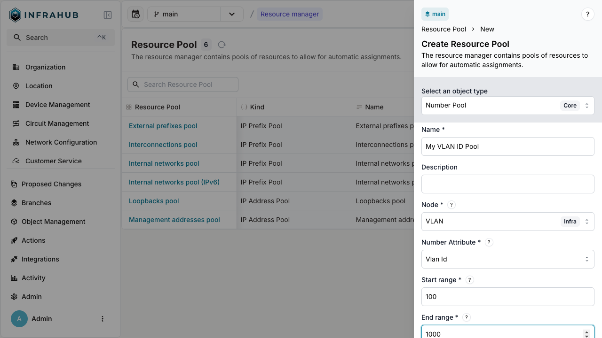
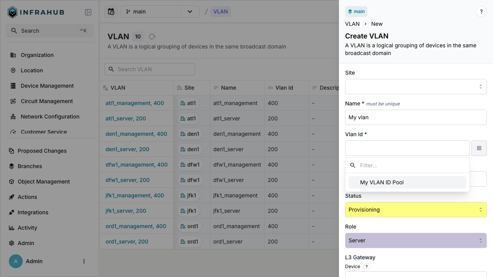
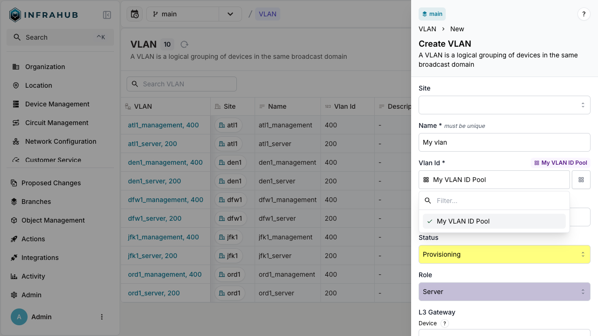

import Tabs from '@theme/Tabs';
import TabItem from '@theme/TabItem';

Number pools (`CoreNumberPool`) automatically assign sequential numbers to numeric attributes.

## Prerequisites

- A running Infrahub instance

<details>
<summary>Schema used in this guide</summary>

The examples on this page use the following schema node. Adapt the type names to match your own schema.

```yaml
nodes:
  - name: VLAN
    namespace: Ipam
    attributes:
      - name: name
        kind: Text
        unique: true
      - name: vlan_id
        kind: Number
```

</details>

## Step 1: Create a number pool

Create a pool for VLAN IDs:

<Tabs groupId="method" queryString>
  <TabItem value="web" label="Web interface" default>

Navigate to **Object Management** → **Resource Manager** and create a new Number Pool with:

- **Name**: `My VLAN ID Pool`
- **Node**: `IpamVLAN`
- **Attribute**: `vlan_id`
- **Ranges**: one range with **Start** `100` and **End** `1000`

Leave **Start** or **End** empty for a range without that bound, as described in [Ranges without a start or an end](#open-ranges).



  </TabItem>
  <TabItem value="graphql" label="GraphQL">

```graphql
mutation {
  CoreNumberPoolCreate(
    data: {
      name: {value: "My VLAN ID Pool"}
      node: {value: "IpamVLAN"}
      node_attribute: {value: "vlan_id"}
      ranges: [{start: 100, end: 1000}]
    }
  ) {
    ok
    object {
      hfid
      id
    }
  }
}
```

The `start_range` and `end_range` fields are deprecated in favor of `ranges`. To update a script that sets them, see [How to migrate number pools to `ranges`](../release-notes/deprecation-guides/number-pool-ranges).

:::important

Save the pool ID for allocation operations!

:::

  </TabItem>
</Tabs>

## Step 2: Allocate a VLAN ID

<Tabs groupId="method" queryString>
  <TabItem value="web" label="Web interface" default>

  Navigate to **VLAN** → **Add VLAN**. On the **VLAN ID** field, open the **From pool** tab and select your number pool. Leave **Number** empty to allocate the next free number, or type a number to record that number in the pool.

  
  

  </TabItem>

  <TabItem value="graphql" label="GraphQL">

  ```graphql
  mutation {
    IpamVLANCreate(
      data: {
        name: {value: "My vlan"}
        vlan_id: {from_pool: {id: "<POOL-ID>"}}
      }
    ) {
      ok
      object {
        name {
          value
        }
        vlan_id {
          value
        }
        id
      }
    }
  }
  ```

  </TabItem>
</Tabs>

:::success

The VLAN is created with VLAN ID allocated from the pool!

:::

## Ranges without a start or an end {#open-ranges}

You can leave out the start of a range, its end, or both. Infrahub stores no value for the missing bound and calculates it from the target attribute each time it allocates a number or shows the pool:

- A range without a start begins at the attribute's `min_value`, or at 1 when the attribute has no `min_value` or a `min_value` below 1.
- A range without an end stops at the attribute's `max_value`, or at the largest number Infrahub supports when the attribute has no `max_value`.

Infrahub reads `min_value` and `max_value` from the schema of the branch you work on. For a `vlan_id` attribute with `max_value: 4094` and a range with **Start** `100` and no end, the pool allocates from 100 to 4094, and the pool page shows the range as `100 - 4094`. Without a `max_value`, the pool page shows the same range as `100 - MAX`. The range object itself shows `100 - MAX`, and a GraphQL query on `CoreNumberPoolRange` returns `null` for the missing end.

When a `CoreNumberPoolCreate` mutation sends none of `ranges`, `start_range` and `end_range`, Infrahub creates the pool with one range without a start or an end. Creating that range needs the permission to create `CoreNumberPoolRange` objects, so an account without that permission receives "You do not have the following permission: object:Core:NumberPoolRange:create:allow_default". To create a pool that holds no range, send `ranges: []`, or remove every range row in the web interface. Such a pool cannot allocate numbers until you add a range.

Infrahub refuses a range that falls outside the attribute's limits when you create the pool or save the range:

- a start below `min_value`
- an end above `max_value`
- a start above `max_value`, on a range without an end
- an end below `min_value`, on a range without a start

A later schema change to `min_value` or `max_value` is not checked against the pool's ranges. Infrahub accepts the change, and during allocation it skips the numbers of a range that fall outside the new limits. The end of a range without an end is calculated from the new `max_value`, and the start of a range without a start from the new `min_value`.

## Next

- [Allocate IP addresses](./allocate-ip-address.mdx)
- [Allocate IP prefixes](./allocate-ip-prefix.mdx)
