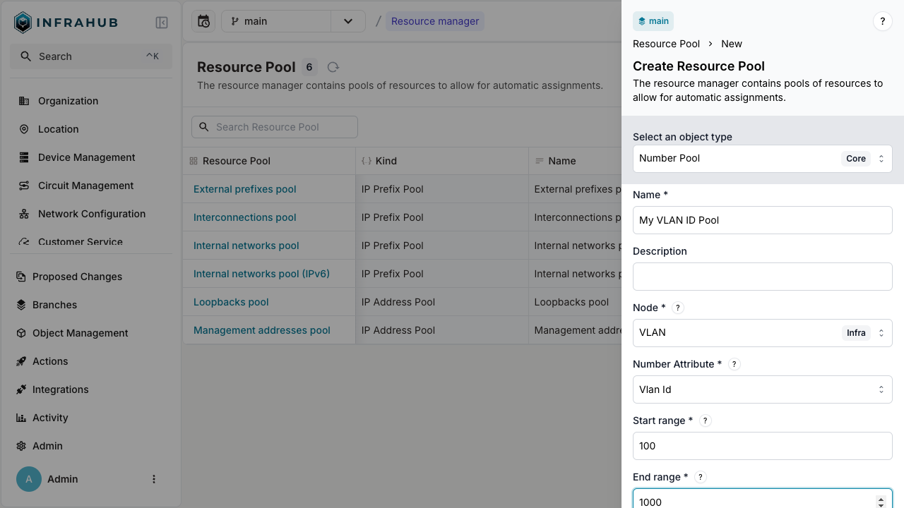
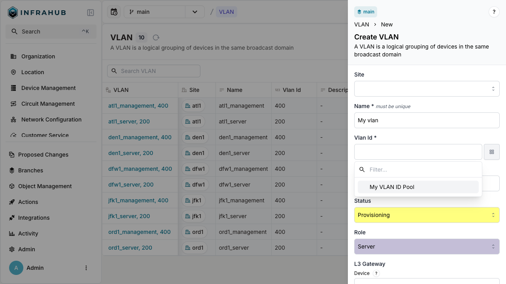
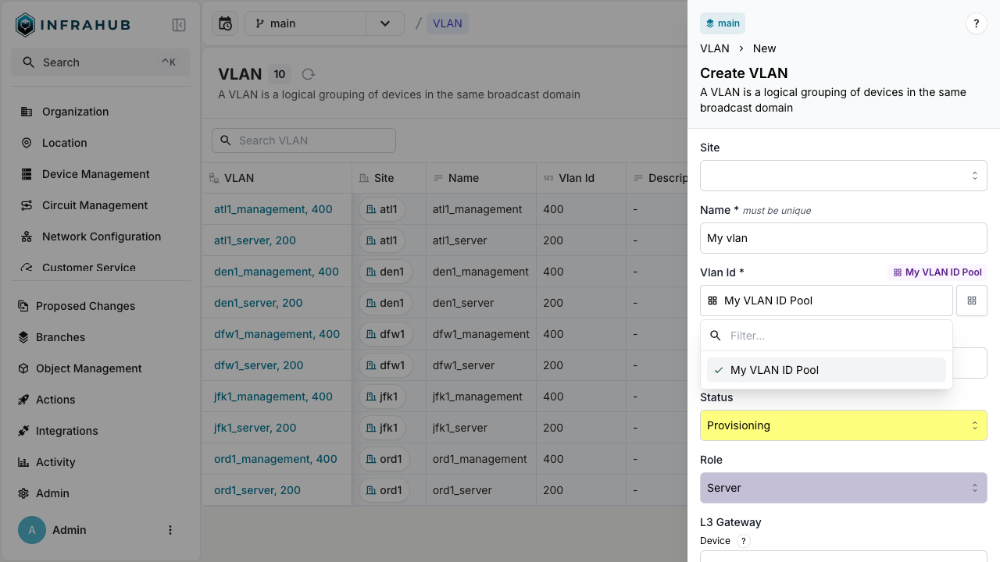

import Tabs from '@theme/Tabs';
import TabItem from '@theme/TabItem';

A number pool (`CoreNumberPool`) allocates numbers for one `Number` attribute of one kind, such as the VLAN ID of a VLAN. It allocates from one or several ranges and records which object holds each number, so it never allocates a number it already tracks. In this guide, you create a pool with two ranges, allocate a VLAN ID from it, and view how much of the pool is in use.

To give the pool numbers that objects already hold, see [Track existing numbers in a number pool](./track-existing-numbers.mdx). To hand out numbers that only have to be distinct within a site or another part of the network, see [Allocate numbers per site with allocation scopes](./allocate-numbers-per-scope.mdx).

## Prerequisites

- A running Infrahub instance

<details>
<summary>Schema used in this guide</summary>

The examples on this page use the following schema node. Adapt the type names to match your own schema.

```yaml
nodes:
  - name: VLAN
    namespace: Ipam
    attributes:
      - name: name
        kind: Text
        unique: true
      - name: vlan_id
        kind: Number
```

</details>

## Step 1: Create a number pool

Create a pool for VLAN IDs with two ranges: 100–199, which the pool uses first, and 300–399 for when that range is full.

<Tabs groupId="method" queryString>
  <TabItem value="web" label="Web interface" default>

Open **Resource Managers** in the menu, click **Add Resource Pool**, and choose **Number Pool** in **Select an object type**. Fill in:

- **Name**: `My VLAN ID Pool`
- **Node**: `IpamVLAN`
- **Attribute**: `vlan_id`
- **Ranges**: a range with **Start** `100`, **End** `199` and **Weight** `10`. Click **Add range** and add a second range with **Start** `300` and **End** `399`, and leave its **Weight** empty.

Leave **Start** or **End** empty for a range without that bound, as described in [Ranges without a start or an end](#open-ranges).



  </TabItem>
  <TabItem value="graphql" label="GraphQL">

```graphql
mutation {
  CoreNumberPoolCreate(
    data: {
      name: {value: "My VLAN ID Pool"}
      node: {value: "IpamVLAN"}
      node_attribute: {value: "vlan_id"}
      ranges: [
        {start: 100, end: 199, allocation_weight: 10}
        {start: 300, end: 399}
      ]
    }
  ) {
    ok
    object {
      hfid
      id
    }
  }
}
```

In GraphQL, the weight of a range is `allocation_weight`. In a schema file it is `weight`, as described in [Number pools](../schema/number-pool.mdx#number-ranges).

The `start_range` and `end_range` fields are deprecated in favor of `ranges`. To update a script that sets them, see [How to migrate number pools to `ranges`](../release-notes/deprecation-guides/number-pool-ranges).

:::important

Save the pool ID for allocation operations!

:::

  </TabItem>
</Tabs>

Ranges in one pool must not overlap. Infrahub refuses an overlapping range with `Range <range> overlaps <range> (<id>)`, and a range whose end is below its start with `Range end (<end>) cannot be lower than start (<start>)`. When the attribute is unique, the ranges must not overlap the ranges of another pool for the same attribute either, as described in [Pools for the same unique attribute](#pools-on-a-unique-attribute).

## Step 2: Allocate a VLAN ID

<Tabs groupId="method" queryString>
  <TabItem value="web" label="Web interface" default>

  Navigate to **VLAN** → **Add VLAN**. On the **VLAN ID** field, open the **From pool** tab and select your number pool in **Pool**. Leave **Number** empty to allocate the next free number.

  
  

  </TabItem>

  <TabItem value="graphql" label="GraphQL">

  ```graphql
  mutation {
    IpamVLANCreate(
      data: {
        name: {value: "My vlan"}
        vlan_id: {from_pool: {id: "<POOL-ID>"}}
      }
    ) {
      ok
      object {
        name {
          value
        }
        vlan_id {
          value
        }
        id
      }
    }
  }
  ```

  </TabItem>
</Tabs>

:::success

The VLAN is created with VLAN ID 100, the lowest number of the range with the highest weight.

:::

## How the pool chooses the next number {#allocation-order}

The pool allocates the next number from the range with the highest weight. A range without a weight counts as weight 0. Among ranges with the same weight, the pool uses the range with the lowest start first. Within a range, it allocates the lowest free number.

A number is free when the pool does not track it, whether the pool allocated that number or you attached it, and when the attribute accepts it: the pool skips the attribute's `excluded_values`, and numbers below `min_value` or above `max_value`.

With the pool from Step 1, the VLANs you create receive 100, 101 and so on up to 199, then 300 to 399. The pool holds 200 numbers in total. To make the pool use 300–399 next, raise the weight of that range above 10. The pool then allocates the lowest free number in 300–399.

## Request a specific number

To give a VLAN a number of your choice and have the pool track it, type the number in the **Number** field of the **From pool** tab. In GraphQL, send the number together with the pool:

```graphql
vlan_id: {value: 150, from_pool: {id: "<POOL-ID>"}}
```

The pool records 150 as a number you provided and never allocates it to another VLAN. The number must be inside one of the pool's ranges. For the other rules, and to attach a pool to a number a VLAN already has, see [Track existing numbers in a number pool](./track-existing-numbers.mdx).

## Ranges without a start or an end {#open-ranges}

You can leave out the start of a range, its end, or both. Infrahub stores no value for the missing bound and calculates it from the target attribute each time it allocates a number or shows the pool:

- A range without a start begins at the attribute's `min_value`, or at 1 when the attribute has no `min_value` or a `min_value` below 1.
- A range without an end stops at the attribute's `max_value`, or at 9,223,372,036,854,775,807, the largest number Infrahub supports, when the attribute has no `max_value`.

Infrahub reads `min_value` and `max_value` from the schema of the branch you work on. For a `vlan_id` attribute with `max_value: 4094` and a range with **Start** `100` and no end, the pool allocates from 100 to 4094, and the pool page shows the range as `100 - 4094`. Without a `max_value`, the pool page shows the same range as `100 - MAX`. The range object itself shows `100 - MAX`, and a GraphQL query on `CoreNumberPoolRange` returns `null` for the missing end.

When a `CoreNumberPoolCreate` mutation sends none of `ranges`, `start_range` and `end_range`, Infrahub creates the pool with one range without a start or an end. Creating that range needs the permission to create `CoreNumberPoolRange` objects, so an account without that permission receives "You do not have the following permission: object:Core:NumberPoolRange:create:allow_default". To create a pool that holds no range, send `ranges: []`, or remove every range row in the web interface. Such a pool cannot allocate numbers until you add a range.

Infrahub refuses a range that falls outside the attribute's limits when you create the pool or save the range:

- a start below `min_value`
- an end above `max_value`
- a start above `max_value`, on a range without an end
- an end below `min_value`, on a range without a start

The web form accepts bounds up to 9,007,199,254,740,991 and shows "Too large" above that. To set a larger bound, use the GraphQL API.

A later schema change to `min_value` or `max_value` is not checked against the pool's ranges. Infrahub accepts the change, and during allocation it skips the numbers of a range that fall outside the new limits. The end of a range without an end is calculated from the new `max_value`, and the start of a range without a start from the new `min_value`.

## Change the ranges of a pool

To give a pool more numbers, add a range or change a bound: edit the pool and change its **Ranges**, or send `ranges` in a `CoreNumberPoolUpdate` mutation. A range sent with the same start and end as an existing range and without `allocation_weight` keeps that range's weight.

Infrahub refuses a change that leaves a number the pool tracks outside every range, on any branch, and lists the objects that hold those numbers:

```text
Changing the ranges of the <pool> pool to <ranges> would leave numbers it tracks outside every range: <kind> '<object>' holds <number> on branch '<branch>'. Keep a range covering each of these numbers, or change those numbers first.
```

The ranges of a pool that a schema declares can only be changed in the schema, as described in [Number pools](../schema/number-pool.mdx#number-ranges).

While the pool exists, Infrahub refuses a schema change that renames its kind or the attribute it allocates, as described in [Schema migration](../schema/migration.mdx#number-pool).

## Pools for the same unique attribute {#pools-on-a-unique-attribute}

Several pools can allocate numbers for the same attribute of the same kind. Each pool skips only the numbers it tracks, not the numbers another pool tracks. On a unique attribute, two pools with overlapping ranges would therefore each allocate numbers the other pool has already allocated, and Infrahub would refuse each of those saves on the uniqueness constraint.

When the attribute is unique, Infrahub therefore refuses a range that overlaps a range of another pool for the same kind and attribute. It checks the ranges when you create a pool, change the ranges of a pool, and create a range or change its bounds:

```text
The '<pool>' pool cannot share numbers with another pool on the unique attribute '<attribute>': <range> overlaps <range> of the '<other-pool>' pool. Choose ranges that no other pool on '<attribute>' uses.
```

The message lists each overlapping pair of ranges by its bounds, for example `150 - 250 overlaps 100 - 199 of the 'My VLAN ID Pool' pool`. For a range without a start or an end, it shows the bound calculated from the attribute, as described in [Ranges without a start or an end](#open-ranges).

- **Attributes that are not unique**: the ranges of their pools can overlap, and each of those pools can allocate a number that another one has already allocated.
- **Branches**: a pool allocates numbers on every branch, so Infrahub treats the attribute as unique when it is unique in the schema of the branch you work on or in the schema of the default branch.
- **Generics**: Infrahub compares only the pools created for the same kind. A pool created for a generic and a pool created for a kind that inherits from it are not compared.
- **Schema changes**: Infrahub refuses a schema change that sets `unique: true` on the attribute while the ranges of two of its pools overlap, as described in [Schema migration](../schema/migration.mdx#number-pool).

Infrahub checks ranges only when you save them, so pools whose ranges overlapped before Infrahub 1.12 still overlap. To separate them, see [Separate pools that overlap on a unique attribute](../release-notes/deprecation-guides/number-pool-ranges.mdx#separate-pools-that-overlap-on-a-unique-attribute).

## View how much of a pool is in use

Open the pool from **Resource Managers**. The pool page shows:

- the ranges, under **All ranges** and one row per range, each with its weight and a usage bar that separates numbers in use on the default branch from numbers in use only on other branches
- the allocations table: each number, the object that holds it, the branch, the range, and its **Source**, either **Allocated** by the pool or **Provided** by you. Filter it by **Branch** and by **Source**.

In the GraphQL API, `InfrahubNumberPoolUtilization` returns the figures of the pool and of each range, and `InfrahubNumberPoolAllocations` lists the numbers:

```graphql
query {
  InfrahubNumberPoolUtilization(pool_id: "<POOL-ID>") {
    figures {
      size
      used
      used_default_branch
      used_branches
      utilization
    }
    ranges {
      display_label
      weight
      figures {
        size
        used
      }
    }
  }
  InfrahubNumberPoolAllocations(pool_id: "<POOL-ID>", limit: 100) {
    count
    allocations {
      value
      branch
      provenance
      holder {
        display_label
      }
    }
  }
}
```

In `used`, a number in use on several branches counts once. `used_branches` is the count of numbers in use only on branches other than the default branch. `provenance` is `ALLOCATED` or `PROVIDED`. `InfrahubNumberPoolAllocations` also filters by `branch`, `range_id` and `provenance`, and returns up to 1,000 numbers per request unless you set `limit`.

## When an allocation fails

| Message | Cause | Fix |
|---|---|---|
| `Pool <pool> (<id>) has no free number left in its ranges.` | The pool tracks every number in its ranges | Add a range or widen one, as described in [Change the ranges of a pool](#change-the-ranges-of-a-pool) |
| `Pool <pool> (<id>) has no number the attribute accepts in its ranges.` | The pool has no range, or its ranges hold only numbers outside the attribute's `min_value`, `max_value` and `excluded_values` | Add a range inside the attribute's limits |
| `The '<pool>' pool can't be used for '<attribute>'.` | The pool's **Node** and **Attribute** name another kind or attribute | Choose the pool created for that attribute. You can use a pool created for a generic for every kind that inherits from it. |
| `'from_pool' is not supported on template attributes.` | `from_pool` was sent on an object template | Set the `<attribute>_from_resource_pool` relationship on the template instead |

### The pool allocated a number that another object holds

On a unique attribute, the pool can allocate a number that another object already holds and that the pool does not track, such as a number set in the **Value** tab. Infrahub then refuses the save. The message names the pool, the number, and the object that holds it, by its display label, or by its human-friendly ID when its kind has no display label:

```text
Violates uniqueness constraint '<attribute>': the '<pool>' pool allocated <number>, which object '<label>' ('<id>') already holds. Attach that number to the pool by updating object '<id>' with value <number> and from_pool '<pool>', or change its number, then retry.
```

The pool allocates the same number on every attempt until you attach that number to the pool, as described in [Track existing numbers in a number pool](./track-existing-numbers.mdx#attach-a-number-to-a-pool), or change the number on the object that holds it.

When another pool tracks the number for that object, the ranges of the two pools overlap, and the message names that pool too. See [Separate pools that overlap on a unique attribute](../release-notes/deprecation-guides/number-pool-ranges.mdx#separate-pools-that-overlap-on-a-unique-attribute). When the uniqueness constraint has several fields that pools filled in the same save, the message names each field, its number and its pool.

## Next

- [Track existing numbers in a number pool](./track-existing-numbers.mdx)
- [Allocate numbers per site with allocation scopes](./allocate-numbers-per-scope.mdx)
- [Allocate IP addresses](./allocate-ip-address.mdx)
- [Allocate IP prefixes](./allocate-ip-prefix.mdx)
