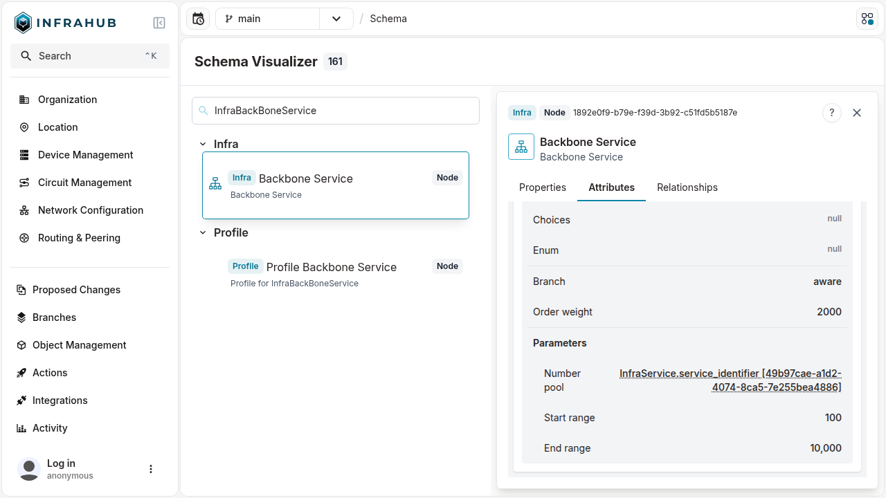
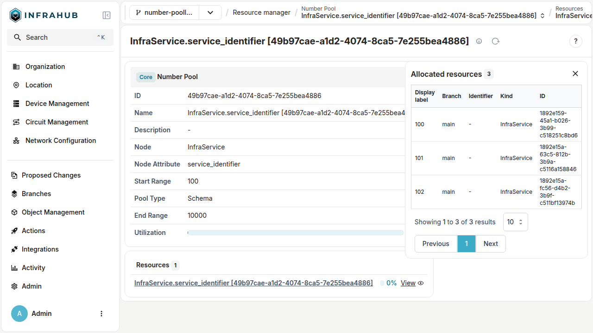

# Number pools

The `NumberPool` attribute kind enables the dynamic creation of a `CoreNumberPool` for the specific schema node and attribute rather than requiring users to define this after the schema is loaded.

:::info Resource pool initial creation

`NumberPool` kind creates the `CoreNumberPool` Resource Manager during schema initialization.

:::

## Defining a `NumberPool` attribute {#define-number-pool}

The `parameters` of a `NumberPool` attribute set the numbers its `CoreNumberPool` allocates from. The parameters are optional: for an attribute that declares no range, the pool allocates from 1 upwards, as described in [Number ranges](#number-ranges).

We'll define a generic service schema that nodes will inherit from to provide a global service identifier among different schema node services.

```yaml
# yaml-language-server: $schema=https://schema.infrahub.app/infrahub/schema/latest.json
---
version: "1.0"
generics:
  - name: Service
    namespace: Infra
    description: "Services"
    human_friendly_id: ["name__value"]
    order_by:
      - name__value
    display_label: "{{ name__value }}"
    attributes:
      - name: name
        kind: Text
        label: Name
        optional: false
        order_weight: 1
      - name: service_identifier
        kind: NumberPool
        read_only: true # Required
        parameters:
          ranges:
            - start: 100
              end: 10000
nodes:
  - name: BackBoneService
    namespace: Infra
    description: "Backbone Service"
    label: "Backbone Service"
    icon: "carbon:container-services"
    inherit_from:
      - InfraService
    uniqueness_constraints:
      - ["circuit_id__value", "internal_circuit_id__value"]
    attributes:
      - name: circuit_id
        kind: Text
        label: Circuit ID
        optional: false
        order_weight: 3
      - name: internal_circuit_id
        kind: Text
        label: Internal Circuit ID
        optional: false
        order_weight: 2
    relationships:
      - name: provider
        cardinality: one
        peer: OrganizationProvider
        optional: false
        kind: Attribute
      - name: site_a
        label: Site A
        cardinality: one
        peer: LocationSite
        optional: false
        identifier: infrabackboneservice__location_site_a
        kind: Attribute
        order_weight: 4
      - name: site_b
        label: Site B
        cardinality: one
        peer: LocationSite
        optional: false
        identifier: infrabackboneservice__location_site_b
        kind: Attribute
        order_weight: 5
```

We can view the schema in the **Schema Visualizer**.



## Number ranges {#number-ranges}

`parameters.ranges` lists the ranges the pool allocates from. Each range has a `start`, an `end` and an optional `weight`, and the ranges must not overlap. Infrahub allocates from the ranges with the highest weight first, and from the lowest start among ranges with the same weight.

```yaml
      - name: service_identifier
        kind: NumberPool
        read_only: true
        parameters:
          ranges:
            - start: 100
              end: 999
              weight: 10
            - start: 5000
```

A range without a `start` begins at 1. A range without an `end` stops at the largest number Infrahub supports. The pool page shows that end as `MAX`, so the second range above is shown as `5000 - MAX`.

The declaration sets the ranges Infrahub creates for the pool:

- Declare no range, with neither `ranges` nor `start_range`/`end_range`, and the pool holds one range without a start or an end. It allocates from 1 to `MAX`.
- Declare `ranges: []` and the pool holds no range. Every allocation from it fails with `Pool <pool> has no number the attribute accepts in its ranges.`, where `<pool>` is the pool's name and id.
- Declare `start_range` and `end_range` and the pool holds one range with those bounds. These two parameters are deprecated, see [How to migrate number pools to `ranges`](../release-notes/deprecation-guides/number-pool-ranges). Set only one of them for a range without the other bound. They cannot be combined with `ranges`.

When a later schema load changes the declaration, Infrahub adds, updates and removes the pool's ranges to match it. When a later load declares neither `ranges` nor `start_range`/`end_range`, Infrahub keeps the ranges the pool already holds. To remove every range, declare `ranges: []`. Infrahub refuses a schema load that leaves a number held by an object outside every range of the pool, and identifies the objects that hold those numbers.

## Viewing the resource manager

Once we create an initial `InfraBackBoneService`, we can navigate to the Resource Manager page and view the details of the created Resource Manager.

The naming of the Resource Manager will be `Kind.attribute_name [uuid]`.



:::info Updating parameters (ranges)

To update the **parameters** of a `NumberPool` attribute requires performing a schema update.

:::

## Deleting the resource manager

To remove the Resource Manager, the attribute must be removed by defining `state: absent` on the attribute in the schema. The Resource Manager will then be removed during the schema loading.

```yaml
# yaml-language-server: $schema=https://schema.infrahub.app/infrahub/schema/latest.json
---
version: "1.0"
generics:
  - name: Service
    namespace: Infra
    description: "Services"
    human_friendly_id: ["name__value"]
    order_by:
      - name__value
    display_label: "{{ name__value }}"
    attributes:
      - name: name
        kind: Text
        label: Name
        optional: false
        order_weight: 1
      - name: service_identifier
        state: absent
        kind: NumberPool
        read_only: true # Required
        parameters:
          ranges:
            - start: 100
              end: 10000
```
