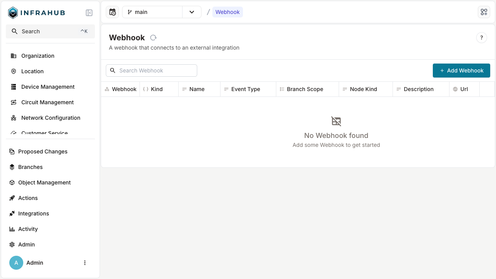
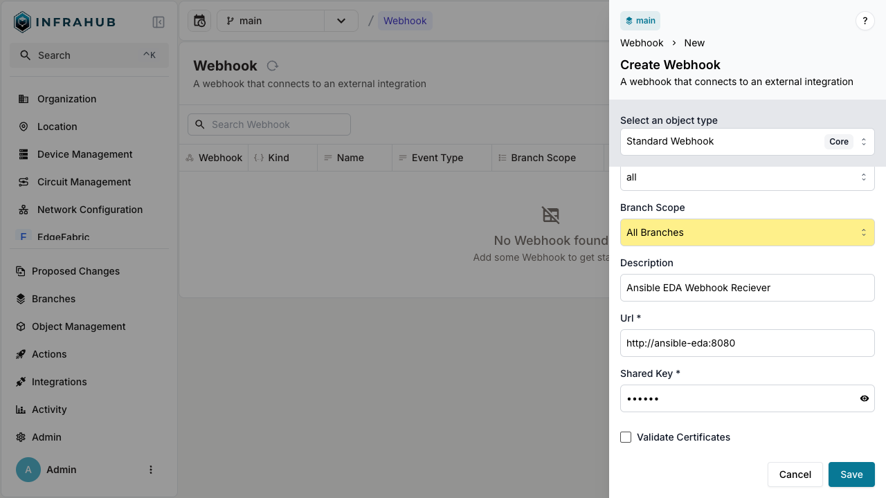
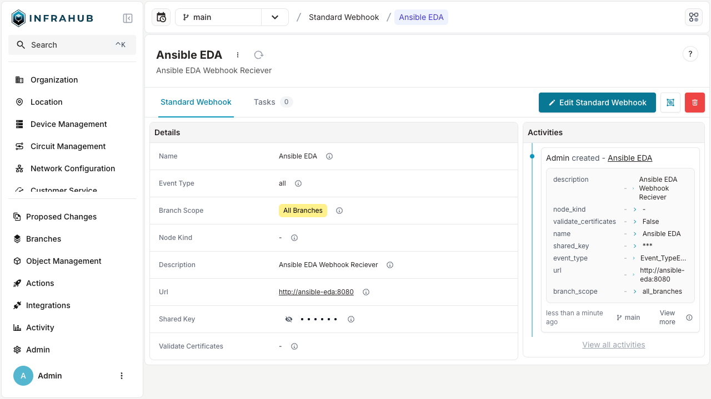

import Tabs from '@theme/Tabs';
import TabItem from '@theme/TabItem';

# Create a webhook

To send Infrahub events to another system, create a webhook with the URL of the system's endpoint and the events it should receive. In this guide, you create a standard webhook, which sends the event payload as JSON. To send the payload in a format the receiver defines, see [Webhook with custom Transformation](./custom-transformation.mdx).

## Prerequisites

- An endpoint that accepts `POST` requests and that the Infrahub task workers can reach. The task workers send the requests, not the API server.
- An account with permission to create webhooks.

## Webhook settings

| Setting | What it does | Default |
|---|---|---|
| **Name** | Identifies the webhook. Names are unique. | |
| **Event Type** | The event type the webhook receives, or `all`. See [Event type](./overview.mdx#event-type). | `all` |
| **Active** | Set it to **False** to stop sending deliveries without deleting the webhook. | **True** |
| **Branch Scope** | The branches whose events the webhook receives. See [Branch scope](./overview.mdx#branch-scope). | **Default Branch** |
| **Node Kind** | Limits the webhook to the events of objects of one kind, such as `InfraDevice`. See [Node kind](./overview.mdx#node-kind). | |
| **URL** | The endpoint that receives the requests. | |
| **Shared Key** | The secret Infrahub signs each request with. Required on a standard webhook. Give the same key to the receiver to [verify the signature](./receive-webhooks.mdx#verify-the-signature). | |
| **Validate Certificates** | Set it to **True** to make Infrahub check the TLS certificate of an HTTPS endpoint against the system's CA certificates, or against the CA bundle in `INFRAHUB_HTTP_TLS_CA_BUNDLE`. With **True**, Infrahub checks the certificate even when `INFRAHUB_HTTP_TLS_INSECURE` is `true`. Set it to **True** for every HTTPS endpoint. | |
| **Headers** | Key-value pairs that Infrahub adds to each request as HTTP headers. See [Add custom headers](#add-custom-headers). | |

## Create a standard webhook

<Tabs groupId="method" queryString>
  <TabItem value="web" label="Web interface" default>

1. Go to **Integrations** > **Webhooks** and click **Add Webhook**.

   

2. In **Select an object type**, choose **Standard Webhook**.
3. Fill in the settings. For example, to notify an Ansible Event-Driven Automation receiver of every new device:
   - **Name**: `ansible-eda`
   - **Event Type**: `infrahub.node.created`
   - **Node Kind**: `InfraDevice`
   - **URL**: `https://ansible-eda.example.com:8443/`
   - **Shared Key**: A random secret
   - **Validate Certificates**: **True**

   

4. Click **Save**. The webhook's page shows its settings, and its deliveries in the **Tasks** tab.

   

  </TabItem>
  <TabItem value="graphql" label="GraphQL">

```graphql
mutation {
  CoreStandardWebhookCreate(
    data: {
      name: {value: "ansible-eda"}
      description: {value: "Ansible Event-Driven Automation receiver"}
      url: {value: "https://ansible-eda.example.com:8443/"}
      event_type: {value: "infrahub.node.created"}
      node_kind: {value: "InfraDevice"}
      branch_scope: {value: "default_branch"}
      shared_key: {value: "<random secret>"}
      validate_certificates: {value: true}
    }
  ) {
    ok
    object {
      id
    }
  }
}
```

  </TabItem>
  <TabItem value="sdk" label="Python SDK">

```python
from infrahub_sdk import InfrahubClientSync

client = InfrahubClientSync(address="http://localhost:8000")

webhook = client.create(
    kind="CoreStandardWebhook",
    name="ansible-eda",
    description="Ansible Event-Driven Automation receiver",
    url="https://ansible-eda.example.com:8443/",
    event_type="infrahub.node.created",
    node_kind="InfraDevice",
    branch_scope="default_branch",
    shared_key="<random secret>",
    validate_certificates=True,
)
webhook.save()
```

  </TabItem>
</Tabs>

## Add custom headers

Add a custom header when the receiver needs one, for example an `Authorization` header with a token, or a header used to route the request. Each header is a key-value pair that you create once and can link to several webhooks. When you change a key-value pair, every webhook it is linked to sends the new value from its next delivery.

Choose the type of key-value pair by where the value is stored:

- **Static Key Value** (`CoreStaticKeyValue`): Infrahub stores the value and sends it as it is.
- **Environment Variable Key Value** (`CoreEnvKeyValue`): Infrahub stores the name of an environment variable, and reads its value from the environment of the [task worker](../overview/architecture.mdx#task-workers) each time it sends a request. Choose it for a secret that is managed outside Infrahub, for example in a Kubernetes secret or HashiCorp Vault. If the variable is not set on the task worker, the delivery fails with a `CONFIG` error that names the webhook and the header, and Infrahub does not send the request.

To add a header:

1. Go to **Integrations** > **Key/Value** and click **Add Key Value**.
2. In **Select an object type**, choose **Static Key Value** or **Environment Variable Key Value**.
3. Fill in **Name**, which identifies the pair in Infrahub, **Key**, the name of the HTTP header, and **Value**, the header value or the name of the environment variable. Click **Save**.
4. Open the webhook, click **Edit**, and add the key-value pair to **Headers**.

:::note

Write the whole header value, including any prefix. For a bearer token, the value is `Bearer eyJhbGci...`, not the token alone.

:::

Infrahub builds the headers of each request in this order, and a later step replaces a header with the same name from an earlier one:

1. `Accept: application/json` and `Content-Type: application/json`.
2. The custom headers. A custom header named `Accept` or `Content-Type` replaces the default.
3. The signature headers `webhook-id`, `webhook-timestamp`, and `webhook-signature`, when the webhook has a shared key. Custom headers cannot replace them.

:::warning

The delivery log shows the value of a static header as it is, unless the header is `Authorization`, `Proxy-Authorization`, `Cookie`, `Set-Cookie`, or `X-API-Key`. To keep any other secret out of the log, store it as an **Environment Variable Key Value**. See [Header and payload logging](./troubleshoot-deliveries.mdx#header-and-payload-logging).

:::

## Check that the webhook works

1. Make a change for which Infrahub emits the event, for example create a device for the `ansible-eda` webhook.
2. Open the webhook and select the **Tasks** tab. A task named `Send webhook <name>` is the delivery.
3. Open the task. Its log shows the request that Infrahub sent and the response status.

:::note

Infrahub sets up a new webhook in a background task, so Infrahub may send nothing for an event that occurs right after you save the webhook.

:::

If no task appears, see [The webhook sent nothing](./troubleshoot-deliveries.mdx#the-webhook-sent-nothing).

## Next

- [Receive webhooks](./receive-webhooks.mdx) — Read the payload and verify the signature in the receiving service
- [Webhook with custom Transformation](./custom-transformation.mdx) — Send a payload in the format the receiver expects
- [Troubleshoot webhook deliveries](./troubleshoot-deliveries.mdx) — Find why a delivery failed, and retry it
