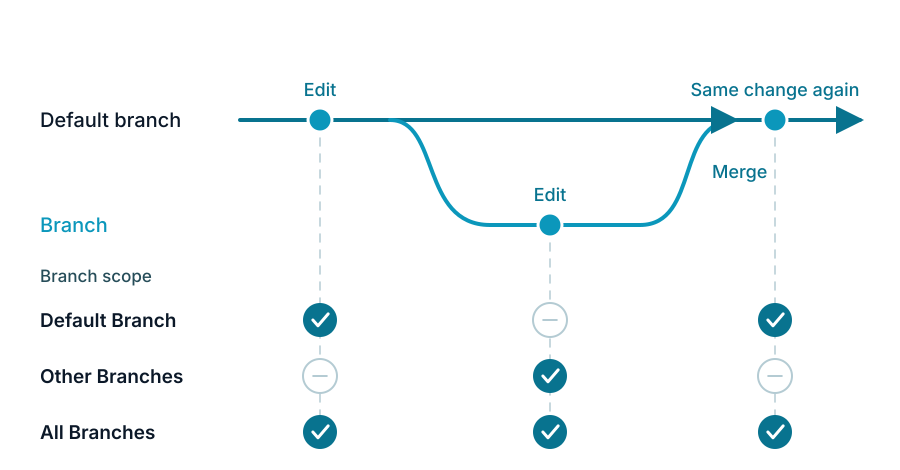

# Webhooks

A webhook sends an HTTP `POST` request to a URL each time a matching [event](../events/event-system.mdx) occurs in Infrahub. The request body contains the event, so a system outside Infrahub can act on a change as soon as it happens, without querying Infrahub for changes:

- Start a CI pipeline when a branch is merged into the default branch.
- Post a message in a chat channel when a device is updated.
- Update an external tool, such as a monitoring system or an Ansible inventory, when an object is created.

To change data in Infrahub when an event occurs, such as adding an object to a group or running a Generator, use an [event rule](../events/overview.mdx) instead. A webhook sends data to another system and does not change data in Infrahub.

## Standard and custom webhooks

- A **standard webhook** (`CoreStandardWebhook`) sends the event payload as JSON. It requires a shared key, which Infrahub uses to sign each request so that the receiver can check that the request comes from Infrahub.
- A **custom webhook** (`CoreCustomWebhook`) can run a [Python Transformation](../transformations/overview.mdx) on the event first, and send the result instead of the event payload. Choose it when the receiver expects its own format, such as a Slack or Microsoft Teams message, or the body of a GitHub Actions workflow dispatch. Its shared key is optional. Without a Transformation, a custom webhook sends the same payload as a standard webhook.

See [Create a webhook](./create.mdx) and [Webhook with custom Transformation](./custom-transformation.mdx).

## How a delivery works

When an event occurs, Infrahub compares it with each active webhook's event type, node kind, and branch scope. For each webhook that matches, Infrahub creates a delivery: a task that sends the request from a task worker and records the outcome. The delivery appears in the **Tasks** tab of the webhook.

A response with a `2xx` status completes the delivery. Any other result, such as an error status, a timeout, or a connection failure, fails the attempt, and Infrahub tries again: up to four attempts, 120 seconds apart. See [Receive webhooks](./receive-webhooks.mdx) for what the receiver gets and has to do, and [Troubleshoot webhook deliveries](./troubleshoot-deliveries.mdx) for failed deliveries.

Infrahub sets up a new or changed webhook in a background task. The webhook sends nothing for events that occur before that task finishes.

## Choose the events a webhook receives

A webhook receives an event when the event matches all three of its settings.

### Event type

A webhook receives one event type, such as `infrahub.node.updated` or `infrahub.branch.merged`, or `all`, the default, which matches every event type. [Infrahub events](../reference/infrahub-events/overview.mdx) lists the event types.

### Node kind

A node kind, such as `InfraDevice`, limits the webhook to the events of objects of that kind. You can set it when the event type is `all` or one of these event types:

- `infrahub.node.created`, `infrahub.node.updated`, `infrahub.node.deleted`
- `infrahub.group.member_added`, `infrahub.group.member_removed`
- `infrahub.artifact.created`, `infrahub.artifact.updated`
- `infrahub.validator.started`, `infrahub.validator.passed`, `infrahub.validator.failed`

With the event type `all` and a node kind, the webhook receives only the events of that node kind.

### Branch scope

The branch scope selects events by the branch they were emitted on:

- **Default Branch** (the default): Events on the default branch.
- **Other Branches**: Events on every other branch, and events that have no branch.
- **All Branches**: Every event.

Some events are not emitted on the branch you worked on, so choose the scope from the branch each event is emitted on:

| Events | Emitted on | Scopes that receive them |
|---|---|---|
| Node and group events from a change on a branch | That branch | Other Branches, All Branches |
| `infrahub.branch.merged`, and the node events of the merged changes | The default branch | Default Branch, All Branches |
| `infrahub.proposed_change.merged`, `approved`, `rejected`, `approval_revoked`, `rejection_revoked` | The default branch, whatever the source branch | Default Branch, All Branches |
| `infrahub.proposed_change_thread.created`, and validator events from a Proposed Change | The source branch of the Proposed Change | Other Branches, All Branches |
| `infrahub.branch.created`, `infrahub.branch.deleted` | No branch: `branch` is `null` in the payload | Other Branches, All Branches |

:::warning Branch scope for merge, Proposed Change, and branch events

With **Other Branches**, a webhook never receives `infrahub.branch.merged` or the `infrahub.proposed_change` events in the table, because Infrahub emits them on the default branch. With **Default Branch**, a webhook never receives `infrahub.branch.created` or `infrahub.branch.deleted`, because these events have no branch.

:::

When a branch is merged, Infrahub emits the node events of the merged changes again on the default branch, and when a branch is rebased, it emits node events on that branch. With **All Branches**, a webhook therefore receives a change made on a branch twice: when the change is made, and when the branch is merged.

To rebase open branches each time a branch is merged, see [Parallel branches](../branches/parallel-branches.mdx).

## Where webhooks are stored and read

A webhook is the same on every branch. Its name, URL, event type, branch scope, node kind, and headers do not differ between branches, so a change you make to them on any branch applies to every branch.

Infrahub reads each webhook from the default branch, both when it sets up the webhook in a background task and when it sends each delivery. The branch scope selects the branches whose events the webhook sends. It does not change which version of the webhook Infrahub uses.

The Transformation of a custom webhook is the exception. Transformations are branch-aware, so the link between a webhook and its Transformation can differ between branches, and Infrahub uses only the link on the default branch. If you choose the Transformation while working on another branch, Infrahub still sends a request for each matching event, but the request contains the standard event payload and the delivery's task log shows no error. Choose the Transformation while working on the default branch.

The same applies to event rules: Infrahub reads trigger rules from the default branch only. See [Where trigger rules are stored and evaluated](../events/event-rules.mdx#where-trigger-rules-are-stored-and-evaluated).

## In this section

- [Create a webhook](./create.mdx) — Choose the endpoint, the events, the shared key, and custom headers
- [Webhook with custom Transformation](./custom-transformation.mdx) — Send a payload in the format the receiver expects
- [Receive webhooks](./receive-webhooks.mdx) — Read the payload, verify the signature, and handle repeated deliveries
- [Troubleshoot webhook deliveries](./troubleshoot-deliveries.mdx) — Read a delivery's log, retry or cancel it, and find why a webhook sent nothing
