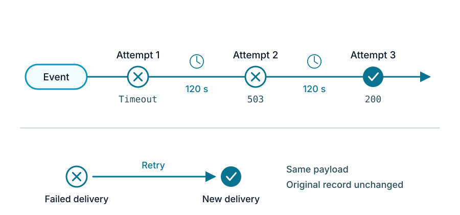

import Tabs from '@theme/Tabs';
import TabItem from '@theme/TabItem';

# Troubleshoot webhook deliveries

Each time a webhook matches an event, Infrahub creates a delivery: a task that sends the request and records each attempt. Open the delivery to view what Infrahub sent, how the endpoint responded, and whether Infrahub will try again. When a webhook has no delivery for an event you expected, see [The webhook sent nothing](#the-webhook-sent-nothing).

## Find a delivery

<Tabs groupId="method" queryString>
  <TabItem value="web" label="Web interface" default>

Open the webhook under **Integrations** > **Webhooks**, and select the **Tasks** tab. Each delivery is a task named `Send webhook <name>`. Open a task to read its log.

  </TabItem>
  <TabItem value="graphql" label="GraphQL">

Query the tasks related to the webhook, by the webhook's ID:

```graphql
query {
  InfrahubTask(related_node__ids: ["<webhook id>"], limit: 10) {
    edges {
      node {
        id
        title
        state
        created_at
      }
    }
  }
}
```

  </TabItem>
  <TabItem value="sdk" label="Python SDK">

```python
from infrahub_sdk import InfrahubClientSync
from infrahub_sdk.task.models import TaskFilter

client = InfrahubClientSync(address="http://localhost:8000")

deliveries = client.task.filter(filter=TaskFilter(related_node__ids=["<webhook id>"]), limit=10)
for delivery in deliveries:
    print(delivery.id, delivery.title, delivery.state)
```

  </TabItem>
</Tabs>

## Read the delivery log

The log of a delivery has these lines for each attempt:

- The request: `Webhook '<name>' attempt <n>/4`, followed by the URL, the headers, and the payload.
- The outcome: `Webhook delivered to <url> attempt <n>/4, HTTP <status> in <time> ms`, or `Webhook delivery failed [<class>] attempt <n>/4 after <time> ms`, followed by the reason, what to check, and when the next attempt runs, for example `Retrying in 120s (attempt 2/4).` After the last attempt, the line ends with `No retries remaining.`

### Failure classes

| Class | Cause | What to check |
|---|---|---|
| `CONNECTION` | Infrahub could not connect to the endpoint. | The endpoint is reachable from the task workers: DNS, routing, the firewall, and the port. |
| `TLS` | The endpoint's TLS certificate could not be validated. | The certificate, its chain, and the CA bundle in `INFRAHUB_HTTP_TLS_CA_BUNDLE`. |
| `TIMEOUT` | The endpoint did not respond within `INFRAHUB_HTTP_TIMEOUT` seconds, 10 by default. | The time the receiver takes to respond. Respond first and do the work afterwards. |
| `HTTP_CLIENT_ERROR` | The endpoint responded with a status other than `2xx` and `5xx`, for example `401`, `404`, or a `3xx` redirect, which Infrahub does not follow. | The URL and the authentication headers. |
| `HTTP_SERVER_ERROR` | The endpoint responded with a `5xx` status. | The receiving service. |
| `CONFIG` | A header value could not be resolved, for example because the environment variable of an **Environment Variable Key Value** is not set on the task worker. The message names the webhook and the header. | The webhook's headers and the environment of the task workers. |
| `UNKNOWN` | Any other error during delivery. The log shows its full traceback. | The traceback. |

### Header and payload logging

The log shows the URL, the headers, and the payload of each attempt. Infrahub replaces these header values with `***`:

- The value of every header from an **Environment Variable Key Value**.
- `webhook-signature`.
- `Authorization`, `Proxy-Authorization`, `Cookie`, `Set-Cookie`, and `X-API-Key`, whatever their case, and whether they come from a static or an environment variable key-value pair.

The value of any other static header is logged as it is. To keep a secret out of the log when it is not sent under one of the header names above, store it as an **Environment Variable Key Value**.

The log shows the first 2048 characters of the payload. The full payload is logged only when the task workers log at debug level.

## Retries

When an attempt fails, Infrahub tries again, whatever the failure class: up to four attempts in total, 120 seconds apart. After a `CONFIG` error or a `401` response, Infrahub therefore still makes four attempts over six minutes before the delivery fails, unless you cancel it.



Infrahub reads the webhook again for each attempt, so a change to its URL, its headers, or its shared key applies from the next attempt. When the log shows a wrong URL or a missing header, correct the webhook while the delivery waits, and the next attempt uses the corrected settings.

## Retry and cancel a delivery

Open a delivery from the webhook's **Tasks** tab to act on it. The **Retry** and **Cancel** buttons appear only when they apply to the delivery's current state.

| Action | When it is available | What it does |
|--------|----------------------|--------------|
| **Retry** | The delivery has finished, or is being cancelled | Sends the original payload again as a new delivery, and leaves the original record unchanged. The new delivery computes a new signature and uses the current settings of the webhook on the default branch. |
| **Cancel** | The delivery is still running or waiting for its next attempt | Stops the delivery, so that no further attempt is made. Cancel has no effect on a request already sent to the endpoint. |

Retry is available on a delivery that succeeded too, so you can send an event to the endpoint again, for example after the receiving system lost its data. To use Retry and Cancel, you need the update permission on the webhook's kind.

To act on a delivery from a script, pass the ID of its task. Retry returns the ID of the new delivery:

<Tabs groupId="method" queryString>
  <TabItem value="graphql" label="GraphQL" default>

```graphql
mutation {
  InfrahubTaskRetry(data: {id: "<task id>"}) {
    ok
    task {
      id
    }
  }
}
```

To cancel, use `InfrahubTaskCancel` with the same input.

  </TabItem>
  <TabItem value="sdk" label="Python SDK">

```python
from infrahub_sdk import InfrahubClientSync

client = InfrahubClientSync(address="http://localhost:8000")

# Send the event again as a new delivery
new_delivery_id = client.task.retry(id="<task id>")

# Stop a delivery that is running or waiting for its next attempt
client.task.cancel(id="<task id>")
```

  </TabItem>
</Tabs>

## The webhook sent nothing

When an event occurred and the webhook has no delivery for it, check:

- **Active**: A webhook whose **Active** is **False** sends nothing.
- **Event type and node kind**: The event must be of the webhook's event type, or the event type must be `all`. With a node kind, the event's object must be of exactly that kind. A generic, such as a kind your devices inherit from, does not match.
- **Branch scope**: The event must be emitted on a branch that the scope includes. Some events are emitted on the default branch or on no branch, whatever branch you worked on. See [Branch scope](./overview.mdx#branch-scope).
- **Timing**: Infrahub sets up a new or changed webhook in a background task, and does not deliver the events that occur before that task finishes.

For a custom webhook with a Transformation:

- If the event matches the webhook but there is no delivery, Infrahub failed before it created the delivery, for example while it ran the Transformation. The error is recorded only in the logs of the [task worker](../overview/architecture.mdx#task-workers).
- If the receiver gets the standard event payload instead of the output of the Transformation, the webhook has no Transformation linked on the default branch. See [Where webhooks are stored and read](./overview.mdx#where-webhooks-are-stored-and-read).
- With a read-write repository, Infrahub sends nothing for an event on a data-only branch. See [Which Transformation code runs for events on other branches](./custom-transformation.mdx#which-transformation-code-runs-for-events-on-other-branches).

## Next

- [Receive webhooks](./receive-webhooks.mdx) — Respond within the timeout, and process each event once
- [Create a webhook](./create.mdx) — Change the URL, the headers, or the shared key of a webhook
